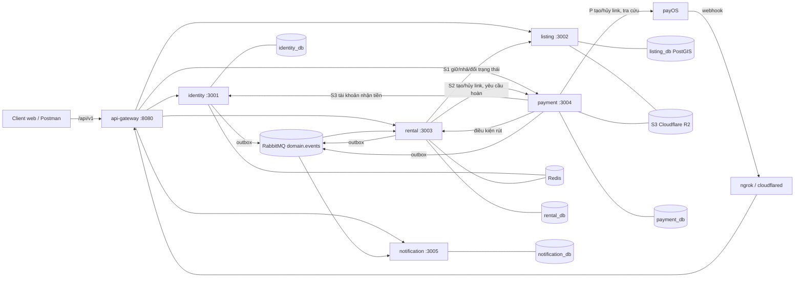

# Kiến trúc Real-estate

> Nạp mọi phiên. Mô tả service nào giữ dữ liệu nào và nói chuyện với nhau thế nào. Chi tiết từng chức năng ở `design/`.

| | |
|---|---|
| **Nguồn** | Báo cáo v2 Chương 4, ADR-0001 đến ADR-0014 |
| **Chủ sở hữu / Cập nhật / Phiên bản** | hoang.lv — 2026-11-16 — v1.0 |

## 1. Tổng quan

Năm service nghiệp vụ NestJS và một API Gateway. Client chỉ gọi gateway (cổng 8080). Service không đọc database của nhau: hỏi qua `/internal/*` hoặc nhận sự kiện qua RabbitMQ.

## 2. Sơ đồ

Không có chuỗi A → B → C để trả lời cùng một request, trừ bước tạo link (rental → payment → payOS).

## 3. Service, dữ liệu, trách nhiệm

| Service, cổng | Dữ liệu sở hữu | Trách nhiệm | Không làm |
|---|---|---|---|
| api-gateway 8080 | Không | Định tuyến, xác thực JWT, kiểm vai trò mức tuyến, sinh `X-Request-ID`, CORS, rate limit, chặn `/internal` | Nghiệp vụ, kiểm chủ sở hữu, gộp dữ liệu |
| identity 3001 | `identity_db`: người dùng, mật khẩu băm, vai trò, trạng thái tài khoản, tài khoản ngân hàng; Redis: refresh token, OTP | Đăng ký và xác minh OTP, đăng nhập (mật khẩu, Google), quên mật khẩu, khóa tài khoản, phát JWT, cung cấp tài khoản nhận tiền; gửi email OTP qua SMTP | Nghe sự kiện |
| listing 3002 | `listing_db` (PostGIS): sản phẩm, trạng thái bất động sản, ảnh (key S3) | Quản lý sản phẩm theo chủ sở hữu, duyệt, tìm kiếm, khoảng cách, giữ chỗ nguyên tử | Biết đơn đặt cọc |
| rental 3003 | `rental_db`: lịch xem, đơn đặt cọc, `saga_log`, `audit_log`, mọi hạn thời gian | Điều phối saga đặt cọc, máy trạng thái đơn, công việc nền | Giữ tiền |
| payment 3004 | `payment_db`: payment order, webhook, ví trung gian, yêu cầu hoàn, lệnh rút, chứng từ, nhật ký | Tích hợp payOS, ghi nhận và chi tiền | Biết phòng, hợp đồng |
| notification 3005 | `notification_db`: thông báo, hội thoại, tin nhắn | Tạo thông báo từ sự kiện, nhắn tin WebSocket | Quyết định kết quả nghiệp vụ |

Mỗi dữ liệu chỉ một service được ghi. Service khác giữ ID (không khóa ngoại) và bản chụp khi cần (ADR-0005).

## 4. Cô lập lỗi

| Thành phần dừng | Còn dùng | Bị ảnh hưởng |
|---|---|---|
| listing | Xem đơn, hoàn, rút, thông báo, nhắn tin | Tìm tin; đặt cọc mới `503` |
| rental | Tìm tin, thông báo, nhắn tin | Đặt cọc, xem nhà; sự kiện cho rental chờ trong queue |
| payment | Tìm tin, xem nhà, nhắn tin | Đặt cọc mới (chỗ giữ được nhả), hoàn, rút; payOS tự gửi lại webhook |
| payOS | Mọi chức năng không liên quan thanh toán | Tạo link mới; đơn đang chờ hết hạn theo lịch |
| notification | Toàn bộ luồng đặt cọc | Thông báo, tin nhắn đến muộn |
| RabbitMQ | Ghi đồng bộ vẫn commit, sự kiện nằm trong outbox | Bước kích hoạt bằng sự kiện bị trễ |
| identity | Request có access token còn hạn | Đăng ký, đăng nhập, làm mới; tạo lệnh rút |
| Redis | Request có access token còn hạn | Đăng ký, xác minh OTP, quên mật khẩu, đăng nhập, làm mới (`503`); API có `Idempotency-Key`; khóa giữ chỗ |

Listing dừng thì không đặt cọc được: cái giá của một lời gọi đồng bộ, đã chấp nhận (ADR-0004).

## 5. Công nghệ

| Hạng mục | Lựa chọn |
|---|---|
| Service, gateway | NestJS 11 (CommonJS), TypeScript strict, Node.js 22 LTS |
| Gateway | `http-proxy-middleware` (proxy, WebSocket), `@nestjs/throttler` (rate limit, bộ đếm trong bộ nhớ) — chốt 2026-11-16 |
| Công việc nền | `@nestjs/schedule` (hết hạn giữ chỗ, tự giải ngân, đối soát) — chốt 2026-11-16 |
| Monorepo | pnpm workspace |
| Lưu trữ | PostgreSQL 16 + PostGIS 3.5, TypeORM, migration (ADR-0013) |
| Dữ liệu tạm | Redis 7.4 |
| Sự kiện | RabbitMQ 3.13, amqplib |
| Thanh toán | payOS (link, VietQR, webhook), SDK `@payos/node` — chốt 2026-11-16; T3.1 (2026-11-21) ghim `2.0.5`, tắt retry khi tạo link bằng `maxRetries: 0` cho từng lệnh (hủy giữ retry mặc định 2), timeout `PAYOS_TIMEOUT_MS` |
| Xác thực | JWT RS256, argon2id |
| Lưu tệp | Cloudflare R2 qua API S3, AWS SDK; dev và production chung tài khoản tới go-live (ADR-0016) |
| Thời gian thực | Socket.IO: `@nestjs/websockets`, `@nestjs/platform-socket.io` — chốt 2026-11-16 |
| Email | SMTP qua nodemailer ở identity (OTP, đặt lại mật khẩu); Mailpit khi dev |
| Đăng nhập Google | Google Sign-In ở Next.js; identity kiểm ID token bằng `google-auth-library` (chốt 2026-11-13) |
| Log | pino JSON; Filebeat, Elasticsearch, Kibana ở profile demo |
| Kiểm thử | Jest, Postman, Newman, k6 |
| Đóng gói | Docker Compose, Dockerfile 3 stage |

## 6. Ranh giới mã nguồn

- Mỗi service copy từ `services/_template-nest` (ADR-0014). Phần kỹ thuật dùng chung nằm trong `src/common/`, `src/messaging/`, `src/storage/`, `src/health/` của từng service. **Không** đưa entity hay luật nghiệp vụ vào đó.
- Module nghiệp vụ nằm ở `src/<miền>/` (mẫu: `services/identity/src/identity/`).
- Gọi service khác chỉ qua `InternalHttpService` trong `clients/` của module.
- API nội bộ và sự kiện viết trước ở `contracts/` (ADR-0012).
- Cây thư mục đích: `project-structure.md`.

## 7. Giao tiếp

### 7.1 Đồng bộ

| Mã | Bên gọi → bên cung cấp | Mục đích |
|---|---|---|
| S1 | rental → listing | Đọc bản chụp, giữ chỗ, nhả chỗ, chuyển `DEPOSITED`, `RENTED`, `AVAILABLE` |
| S2 | rental → payment | Tạo, hủy, tra cứu payment order; tạo yêu cầu hoàn 70% |
| S3 | payment → identity | Lấy tài khoản nhận tiền |
| S4 | payment → rental | Kiểm tra điều kiện rút |
| P | payment → payOS | Tạo, hủy link; tra cứu |

Tham số timeout, retry: `standards/reliability-standard.md`.

### 7.2 Bất đồng bộ

Identity, rental, payment ghi sự kiện vào `outbox_events` cùng transaction; `OutboxRelay` gửi lên exchange topic `domain.events`. Mỗi service nghe có queue riêng; lỗi quá số lần → `domain.events.dlx` → `<queue>.dlq`. Danh mục sự kiện: `design/SHARED/RE.MESSAGING/API_Spec.md §3`.

## 8. Cấu hình

- Địa chỉ service nội bộ: `INTERNAL_<SERVICE>_URL` (ví dụ `INTERNAL_LISTING_URL`).
- Thiếu biến bắt buộc → service in danh sách biến thiếu rồi dừng (`env.validation.ts`).
- Hạ tầng chỉ publish cổng ra `127.0.0.1`. Postgres trên laptop `5433`, trong Docker `postgres:5432`.
- Bản demo: năm database trong một container PostgreSQL, mỗi database một user riêng không phải superuser, `REVOKE CONNECT` từ `PUBLIC` (ADR-0002).

## 9. Đã chốt

1. ~~Cách gateway chuyển tiếp webhook payOS mà giữ body thô~~ Đã chốt 2026-11-16: gateway tắt body parser, proxy bằng `http-proxy-middleware` (`design/SHARED/RE.GATEWAY/API_Spec.md §6`).
2. ~~S4 tạo phụ thuộc hai chiều rental ⇄ payment~~ Chấp nhận 2026-11-16, không tạo ADR riêng: S4 chỉ đọc (`GET` điều kiện rút), không nằm trong cùng request với S2 nên không tạo vòng gọi; rental dừng thì chỉ tạo lệnh rút bị ảnh hưởng (§4).
