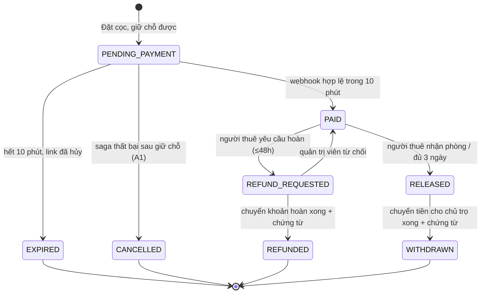

# RE.BUSINESS_RULES — Đặc tả nghiệp vụ Real-estate

| | |
|---|---|
| **Chủ sở hữu / Cập nhật** | hoang.lv — 2026-11-18 |
| **Phạm vi** | Toàn hệ thống |
| **Nguồn** | Báo cáo giữa kỳ `Bao_cao_Real-estate_hoan_chinh_v2.docx` (Nhóm 5, 11-2026) — **nguồn chuẩn**. Khi tài liệu khác lệch (`nghiep-vu-dat-coc-payos.md`, `docs/architecture/service-boundaries.md`, `contracts/`, kế hoạch sprint xlsx) → ghi vào `implementation/van-de-can-quyet-dinh.md`, không tự sửa |
| **Phiên bản** | v1.0 — 2026-11-10 |

## 1. Bài toán

Real-estate là nền tảng tìm kiếm, thuê và đặt cọc nhà ở, căn hộ, phòng trọ. Người thuê lọc tin theo giá, khu vực, tiện ích, bán kính; đặt lịch xem nhà; đặt cọc qua payOS. Tiền cọc **không** chuyển thẳng cho chủ trọ mà nằm ở ví trung gian của nền tảng, chỉ giải ngân khi người thuê xác nhận đã nhận phòng hoặc sau 3 ngày không có yêu cầu hoàn. Trong 48 giờ đầu người thuê được yêu cầu hoàn 70%.

**Vấn đề cần giải quyết:**

| Vấn đề | Hậu quả nếu không xử lý |
|---|---|
| Hai người cùng bấm Đặt cọc một căn | Hai người cùng giữ chỗ, một người mất tiền |
| Đã giữ chỗ nhưng tạo link thanh toán lỗi, hoặc không thanh toán trong 10 phút | Căn nhà bị khóa mãi ở `HELD` |
| Tiền đến sau khi chỗ giữ đã hết hạn | Tiền bị coi nhầm là đặt cọc |
| Webhook payOS gửi trùng | Ví bị cộng hai lần |
| Dữ liệu nằm ở nhiều service, không có transaction chung | Trạng thái tin đăng, đơn đặt cọc và số dư ví lệch nhau |

## 2. Tác nhân

| Tác nhân | Mục tiêu | Vai trò hệ thống | Giới hạn |
|---|---|---|---|
| Khách | Xem, tìm tin đăng | không đăng nhập | Không đặt lịch, không đặt cọc |
| Người thuê | Đặt lịch xem, đặt cọc, xác nhận nhận phòng, yêu cầu hoàn, xem ví, thông báo | `TENANT` | Chỉ thao tác trên đơn, giao dịch của mình; hoàn chỉ trong 48 giờ kể từ lúc thanh toán |
| Chủ trọ | Quản lý sản phẩm của mình, xem danh sách người đăng ký xem và từ chối, xác nhận đơn được bàn giao, rút tiền | `LANDLORD` | Chỉ trên sản phẩm, đơn của mình; chỉ rút khi đơn `RELEASED`; không nhận cọc ngoài hệ thống |
| Quản trị viên | Duyệt tin, bàn giao đơn, xử lý hoàn và rút, quản lý vai trò | `ADMIN` | Không tự đăng ký; mọi khoản chi ra phải có chứng từ |
| payOS | Tạo link/QR, gửi webhook kết quả | hệ thống ngoài | Chỉ webhook đúng chữ ký, mã đơn, số tiền được chấp nhận |
| Công việc nền | Hết hạn giữ chỗ, nhắc và tự giải ngân, đối soát saga | hệ thống | Chỉ chuyển trạng thái theo bảng §5 |

Trong mô hình dữ liệu và tên sự kiện, một số tên lấy từ Báo cáo mang tiền tố `seller` (`seller_acknowledged_at`, `AdminConfirmedToSeller`) cũng chỉ chủ trọ (`domain-glossary.md`).

## 3. Use case

Báo cáo v2 đặt 7 mã UC; các mã còn lại do nhóm đặt để truy vết (cột "Nguồn mã" = Đề xuất).

| Mã | Use case | Tác nhân | Service | Yêu cầu | Nguồn mã |
|---|---|---|---|---|---|
| UC-ACC-01 | Đăng ký và xác minh email OTP, đăng nhập (mật khẩu, Google), quên mật khẩu, làm mới phiên, đăng xuất | Khách, mọi vai trò | identity | FR01 | Đề xuất |
| UC-ACC-02 | Khai tài khoản ngân hàng nhận tiền | Người thuê, chủ trọ | identity | FR01 | Đề xuất |
| UC-ACC-03 | Khóa và mở khóa tài khoản (bỏ đổi vai trò 2026-11-18) | Quản trị viên | identity | FR08 | Đề xuất |
| UC-LST-01 | Thêm, sửa, ẩn/hiện, xóa mềm sản phẩm; xem sản phẩm của tôi; tải ảnh | Chủ trọ | listing | FR02, US08 | Đề xuất |
| UC-LST-02 | Duyệt sản phẩm | Quản trị viên | listing | FR02, FR08 | Đề xuất |
| UC-LST-03 | Tìm kiếm, lọc, bán kính, xem chi tiết | Khách, người thuê | listing | FR03, US01 | Đề xuất |
| UC-VIE-01 | Đặt lịch xem (chốt giờ qua chat), từ chối, hủy, xác nhận đã xem | Người thuê, chủ trọ | rental | FR04 | Đề xuất |
| UC-DEP-01 | **Đặt cọc qua payOS** (luồng chính) | Người thuê, payOS | rental + listing + payment | FR05, US02, US03 | Báo cáo §3.2.1 |
| UC-DEP-02 | Giữ chỗ tin đăng (bao gồm trong UC-DEP-01) | Hệ thống | listing | BR-06 | Báo cáo §3.2.1 |
| UC-DEP-03 | Bàn giao đơn cho chủ trọ, chủ trọ xác nhận | Quản trị viên, chủ trọ | rental | BR-11 | Đề xuất |
| UC-DEP-04 | Xác nhận đã nhận phòng, tự giải ngân | Người thuê, công việc nền | rental + listing | BR-13 | Đề xuất |
| UC-DEP-05 | Hết hạn giữ chỗ | Công việc nền | rental + payment + listing | BR-09 | Báo cáo §3.2.2 |
| UC-DEP-06 | Ghi nhận tiền đến muộn | payOS, quản trị viên | payment | BR-10 | Báo cáo §3.2.2 |
| UC-REF-01 | **Hoàn tiền** | Người thuê, quản trị viên | rental + payment + listing | FR06, US04, US06 | Báo cáo §3.2.3 |
| UC-WDR-01 | Chủ trọ tạo lệnh rút | Chủ trọ | payment + rental + identity | FR06, US05 | Báo cáo §3.2.4 |
| UC-WDR-02 | Quản trị viên xử lý lệnh rút | Quản trị viên | payment | US06 | Báo cáo §3.2.4 |
| UC-NTF-01 | Nhận, xem, đánh dấu đã đọc thông báo | Mọi người dùng | notification | FR07, US07 | Đề xuất |
| UC-CHT-01 | Nhắn tin người thuê – chủ trọ, kênh hỗ trợ với quản trị viên | Mọi người dùng | notification | FR07 | Đề xuất |
| UC-ADM-01 | Xem ví trung gian, lệnh chờ xử lý, nhật ký thao tác | Quản trị viên | payment | FR08 | Đề xuất |

## 4. Quy tắc nghiệp vụ

Lấy nguyên Bảng 2.5 của báo cáo. Cột "Kiểm tra ở" trỏ tới thiết kế chịu trách nhiệm.

| Mã | Quy tắc | Khi vi phạm | Service | Kiểm tra ở |
|---|---|---|---|---|
| **BR-01** | Chỉ `TENANT` và `LANDLORD` được tự đăng ký; `ADMIN` tạo bằng script seed | `400` | identity | `RE.IDENTITY` |
| **BR-02** | Email duy nhất, không phân biệt hoa thường | `409 IDENTITY_EMAIL_TAKEN` | identity | `RE.IDENTITY` |
| **BR-03** | Chỉ chủ trọ sở hữu được sửa, ẩn, xóa sản phẩm; chỉ xóa mềm khi không có đơn đặt cọc đang hoạt động | `403`, `409` | listing | `RE.LISTING` |
| **BR-04** | Tiền cọc do chủ trọ đặt cho từng tin; rental lưu bản chụp, payment thu đúng số này, không lấy số tiền từ client | — | rental, payment | `RE.DEPOSIT_SAGA`, `RE.PAYMENT` |
| **BR-05** | Chỉ đặt cọc khi bất động sản `AVAILABLE` và tin đã duyệt | `409 LISTING_NOT_AVAILABLE` | listing | `RE.LISTING` |
| **BR-06** | Mỗi bất động sản tối đa một người giữ chỗ; giữ chỗ = `AVAILABLE → HELD` trong một câu `UPDATE` có điều kiện | `409` | listing, rental | `RE.LISTING`, `RE.DEPOSIT_SAGA` |
| **BR-07** | Giữ chỗ 10 phút; link payOS hết hạn đúng bằng thời gian giữ chỗ còn lại | — | rental, payment | `RE.DEPOSIT_SAGA`, `RE.PAYMENT` |
| **BR-08** | Chỉ webhook đúng chữ ký, đúng mã đơn, đúng số tiền, mã giao dịch chưa ghi nhận mới chuyển đơn sang `PAID` | bỏ qua, ghi log | payment | `RE.PAYMENT` |
| **BR-09** | Hết 10 phút chưa có tiền: hủy link payOS **trước**, rồi đơn `EXPIRED` và bất động sản về `AVAILABLE` | — | rental, payment, listing | `RE.DEPOSIT_SAGA` |
| **BR-10** | Tiền đến sau khi đơn `EXPIRED` không phải đặt cọc: ghi `LatePayment`, tạo yêu cầu hoàn 100% | — | payment | `RE.PAYMENT`, `RE.PAYOUT` |
| **BR-11** | Quản trị viên bàn giao đơn `PAID` cho chủ trọ; đơn chỉ vào danh sách của chủ trọ sau khi chủ trọ xác nhận | `409` | rental | `RE.DEPOSIT_LIFECYCLE` |
| **BR-12** | Người thuê yêu cầu hoàn trong 48 giờ kể từ lúc thanh toán khi chưa nhận phòng; hoàn 70%, 30% thuộc chủ trọ | `409` | rental, payment | `RE.DEPOSIT_LIFECYCLE`, `RE.PAYOUT` |
| **BR-13** | Người thuê bấm Đã nhận phòng, hoặc đủ 3 ngày kể từ lúc thanh toán mà không có yêu cầu hoàn đang xử lý → `RELEASED`; nhắc trước 24 giờ | `409` | rental | `RE.DEPOSIT_LIFECYCLE` |
| **BR-14** | Mọi khoản cọc phải qua hệ thống, kể cả người xem trực tiếp; nếu đã có người đặt trên web, chủ trọ báo lại người xem trực tiếp và giới thiệu sản phẩm khác | `409` | listing; xử lý tay của chủ trọ | `RE.LISTING` |
| **BR-15** | Chỉ rút khi đơn `RELEASED`, đã có hai mốc xác nhận, không có lệnh rút hay hoàn đang mở. **Sửa 2026-11-12:** đơn `REFUNDED` (người thuê tự hủy) được một lệnh rút phần còn lại sau hoàn 70%, không cần hai mốc; Báo cáo §3.2.3 | `409` kèm điều kiện thiếu | payment hỏi rental | `RE.PAYOUT`, `RE.DEPOSIT_LIFECYCLE` |
| **BR-16** | Mỗi đơn chỉ tới một kết cục: tiền về chủ trọ (`WITHDRAWN`) hoặc về người thuê (`REFUNDED`). Đơn `REFUNDED` rút phần 30% vẫn giữ `REFUNDED` | `409` | rental, payment | `RE.DEPOSIT_LIFECYCLE`, `RE.PAYOUT` |
| **BR-17** | Tiền thật hoàn hoặc chi bằng chuyển khoản tay của quản trị viên; ví chỉ bị trừ khi có chứng từ; chứng từ đã dùng bị từ chối | `409` | payment | `RE.PAYOUT` |
| **BR-18** | Mọi hạn thời gian của đơn do rental giữ; chuyển trạng thái bằng `UPDATE` có điều kiện, bên được 0 dòng là bên thua | `409` | rental | `RE.DEPOSIT_SAGA`, `RE.DEPOSIT_LIFECYCLE` |
| **BR-19** | Người dùng chỉ đọc thông báo, hội thoại, giao dịch của mình | `403` hoặc không có trong danh sách | notification, payment | `RE.NOTIFICATION`, `RE.CHAT`, `RE.PAYOUT` |

Quy tắc phụ của identity (Bảng 2.6):

| Quy tắc | Trạng thái trong code `services/identity` |
|---|---|
| OTP 6 số, hiệu lực 5 phút, sai 5 lần thì hủy, gửi lại sau 60 giây | Chưa có; làm theo `RE.IDENTITY §1.6` (B10) |
| Khóa tài khoản thì thu hồi refresh token | Chưa có; làm theo `RE.IDENTITY §1.9` (đổi vai trò bỏ 2026-11-18) |
| Đăng nhập mạng xã hội bắt buộc có email | Chưa có (đã có bảng `user_identities`); Google theo `RE.IDENTITY §1.8` |
| Quên mật khẩu không tiết lộ email có tồn tại | Chưa có; theo `RE.IDENTITY §1.7` |
| Tài khoản ngân hàng nhận tiền mã hóa khi lưu, chỉ hiển thị bốn số cuối | Chưa có |

## 5. Máy trạng thái đơn đặt cọc

| Hiện tại | Mới | Tác nhân | Kích hoạt |
|---|---|---|---|
| (chưa có) | `PENDING_PAYMENT` | Người thuê | Đặt cọc và giữ chỗ được |
| `PENDING_PAYMENT` | `PAID` | payOS | Webhook hợp lệ trong 10 phút |
| `PENDING_PAYMENT` | `EXPIRED` | Hệ thống | Hết 10 phút, link payOS đã hủy |
| `PENDING_PAYMENT` | `CANCELLED` | Hệ thống | Giữ chỗ được nhưng không tạo được link; chỗ đã nhả (A1, không có trong Bảng 3.4) |
| `PAID` | `RELEASED` | Người thuê | Đã nhận phòng |
| `PAID` | `RELEASED` | Hệ thống | Đủ 3 ngày, không có yêu cầu hoàn đang xử lý |
| `PAID` | `REFUND_REQUESTED` | Người thuê | Trong 48 giờ, chưa nhận phòng (70%) |
| `REFUND_REQUESTED` | `PAID` | Quản trị viên | Từ chối, có lý do — đường lùi duy nhất |
| `REFUND_REQUESTED` | `REFUNDED` | Quản trị viên | Chuyển khoản hoàn xong, tải chứng từ |
| `RELEASED` | `WITHDRAWN` | Quản trị viên | Chuyển tiền cho chủ trọ xong, tải chứng từ |

- Bàn giao (`admin_confirmed_at`) và chủ trọ xác nhận (`seller_acknowledged_at`) là **mốc thời gian**, không phải trạng thái.
- Lệnh rút hoặc hoàn `FAILED`: đơn giữ nguyên trạng thái để xử lý lại.
- Đơn saga thất bại (giữ chỗ được nhưng không tạo được link): `PENDING_PAYMENT → CANCELLED` do hệ thống (`CompensationService`), phát `DepositCancelled`. Bảng 3.4 không có dòng này; nhóm chốt tên `CANCELLED` 2026-11-12 (A1). `CANCELLED` là trạng thái kết thúc.
- Đơn `REFUNDED` do người thuê tự hủy: chủ trọ rút phần còn lại (BR-15 sửa); đơn giữ `REFUNDED`, ghi `withdrawn_at`.

**Trạng thái bất động sản (listing):** `AVAILABLE → HELD → DEPOSITED → RENTED`; `HELD → AVAILABLE` khi hết hạn hoặc bù trừ; `DEPOSITED → AVAILABLE` khi hoàn tiền; `HIDDEN` do chủ trọ ẩn. Trạng thái duyệt tin tách riêng: `PENDING_REVIEW`, `APPROVED`, `REJECTED` (chốt 2026-11-16).

## 6. Luồng nghiệp vụ chính

**UC-DEP-01 Đặt cọc.**

1. Người thuê bấm Đặt cọc kèm `Idempotency-Key`.
2. Rental lấy khóa Redis theo `listingId`, gọi listing giữ chỗ `heldUntil = now + 10 phút` (BR-06).
3. Listing `UPDATE ... SET status='HELD' WHERE status='AVAILABLE'`; 0 dòng → `409 LISTING_NOT_AVAILABLE` (BR-05).
4. Rental tạo đơn `PENDING_PAYMENT` với bản chụp tiền cọc, tiêu đề, `ownerId`, `expires_at`; ghi `saga_log` (BR-04).
5. Rental gọi payment tạo payment order; payment gọi payOS tạo link hạn bằng thời gian giữ chỗ còn lại (BR-07).
6. Trả `201` kèm link, QR, thời gian còn lại.
7. Webhook hợp lệ → payment: order `PAID`, `DEPOSIT_IN`, outbox `DepositPaid` trong một transaction (BR-08).
8. Rental nhận `DepositPaid` → đơn `PAID`, gọi listing `HELD → DEPOSITED`; notification báo người thuê.

**Kết quả có thể có:** `201` · `409` không còn khả dụng · `503`/`504` phụ thuộc lỗi, chỗ giữ được nhả.

**UC-REF-01 Hoàn tiền.** Rental kiểm tra điều kiện (BR-12) → `REFUND_REQUESTED`, gọi payment tạo yêu cầu 70% `PENDING_ADMIN`, tự giải ngân dừng. Quản trị viên chuyển khoản, tải chứng từ → `COMPLETED`, `REFUND_OUT`, `DepositRefunded` → đơn `REFUNDED`, bất động sản `AVAILABLE`. Từ chối → đơn về `PAID`.

**UC-WDR-01/02 Rút tiền.** Payment hỏi rental điều kiện rút (BR-15) và identity tài khoản nhận → lệnh `PENDING`. Quản trị viên chuyển khoản, tải chứng từ → `COMPLETED`, `WITHDRAW_OUT`, `WithdrawalCompleted` → đơn `WITHDRAWN`. Thất bại → `FAILED`, ví không đổi. Đơn `REFUNDED`: rút phần còn lại sau hoàn 70%, đơn giữ `REFUNDED`.

## 7. Ngoài phạm vi

- Hợp đồng thuê điện tử, thanh toán tiền thuê hằng tháng.
- Chi hộ tự động về tài khoản ngân hàng: quản trị viên chuyển khoản tay.
- Trợ lý chat gợi ý phòng (mở rộng X5).
- Khiếu nại `DISPUTED` (mở rộng X4).
- Email thông báo nghiệp vụ (mở rộng X3). Email OTP và quên mật khẩu **trong phạm vi** (identity gửi qua SMTP; dev dùng Gmail App Password, C27 2026-11-28).
- Hồ sơ người thuê: cắt 2026-11-12, ghi hạn chế ở báo cáo cuối kỳ.
- Một tài khoản nhiều vai trò: mỗi tài khoản một vai trò (B9).
- Đổi vai trò của tài khoản đã có, kể cả quản trị viên đổi (bỏ 2026-11-18, lệch Báo cáo v2 FR08): vai trò cố định từ lúc tạo; muốn vai trò khác thì đăng ký bằng email khác.

## 8. Đã chốt 2026-11-16

1. Trạng thái duyệt tin: `PENDING_REVIEW`, `APPROVED`, `REJECTED` (`RE.LISTING §7`). Luồng lịch xem: `RE.VIEWING §5`.
2. Tiền đến muộn với số tiền khác tiền cọc, hoặc trả hai lần cho một order: ghi nhận đúng số thực nhận, tạo yêu cầu hoàn 100% số đó (`RE.PAYMENT §7`).
