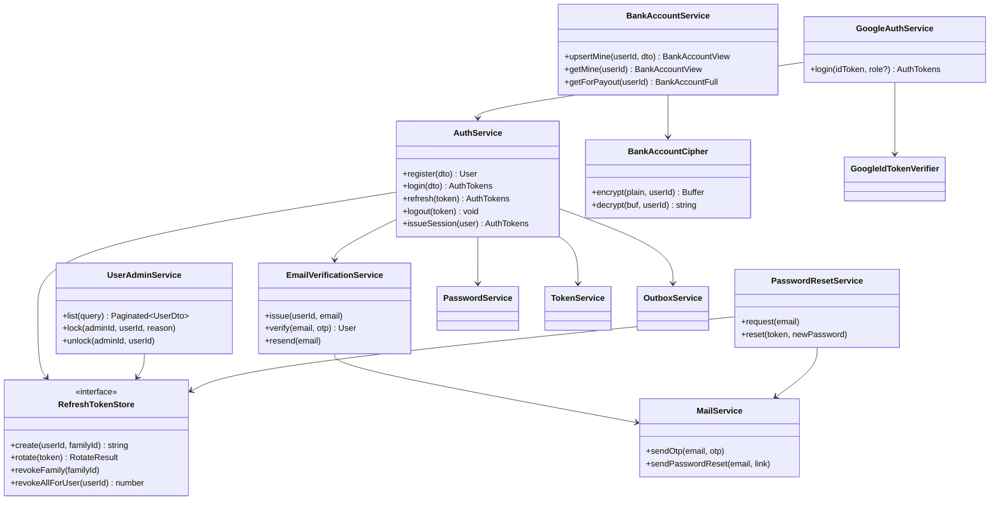

# RE.IDENTITY — Thiết kế thành phần

| | |
|---|---|
| **Service** | `services/identity/src/identity/` |
| **Quy ước** | `standards/coding-convention.md`, `standards/security-policy.md` |
| **Chủ sở hữu / Cập nhật / Phiên bản** | hoang.lv — 2026-11-28 — v2.5 |

## 1. Cấu trúc

Đã có (đánh dấu `+` là phần đề xuất thêm):

```text
src/identity/
├─ identity.module.ts
├─ controllers/
│  ├─ auth.controller.ts                 # register, login, refresh, logout, me, + verify-otp, resend-otp, forgot/reset-password, google
│  ├─ + profile.controller.ts            # PATCH /users/me
│  ├─ + bank-account.controller.ts       # /users/me/bank-account
│  ├─ + users.admin.controller.ts        # /admin/users
│  └─ + users.internal.controller.ts     # /internal/users/:id/bank-account
├─ services/
│  ├─ auth.service.ts                    # luồng; issueSession(user)
│  ├─ password.service.ts                # argon2id
│  ├─ token.service.ts                   # ký JWT RS256
│  ├─ + bank-account.service.ts          # upsert, đọc, lấy số đầy đủ cho payment; che số
│  ├─ + bank-account.cipher.ts           # AES-256-GCM: encrypt/decrypt, AAD = userId (chỉ identity dùng)
│  ├─ + user-admin.service.ts            # danh sách (T2.1); khóa/mở khóa + thu hồi phiên (T2.5)
│  ├─ + email-verification.service.ts    # sinh, kiểm OTP (Redis)
│  ├─ + password-reset.service.ts        # token đặt lại (Redis)
│  ├─ + google-auth.service.ts           # tìm/tạo/liên kết user theo ID token đã kiểm
│  ├─ + google-id-token.verifier.ts      # bọc google-auth-library; token DI để test thay bản giả
│  ├─ + profile.service.ts               # PATCH /users/me (fullName, phone)
│  └─ + mail.service.ts                  # SMTP (nodemailer), mẫu email OTP, đặt lại; gửi không chờ (v2.3)
├─ stores/
│  ├─ refresh-token.store.ts             # interface
│  └─ redis-refresh-token.store.ts       # Lua script xoay vòng nguyên tử
├─ dto/ (+ bank-account.dto, upsert-bank-account.dto, list-users.query) entities/ (user, user-identity, + bank-account) errors/ config/ seed/ (+ seed-users.ts, seed-users.data.ts)
```

`list-users.query.ts` kế thừa `PageQueryDto` (`src/common/response/page-query.dto.ts`, sửa ở `_template-nest` rồi chép sang, ADR-0014).

## 2. Sơ đồ lớp



`revokeAllForUser(userId)` (chốt 2026-11-16): mỗi lần cấp họ token mới, `SADD identity:user-families:<userId> <familyId>` và gia hạn TTL 7 ngày; thu hồi = đọc set, đặt `identity:revoked:<familyId>` cho từng phần tử rồi xóa set. Gọi khi khóa tài khoản, đặt lại mật khẩu (Bảng 2.6). Bỏ đổi vai trò 2026-11-18. Trả về số họ đã thu hồi (user chưa có họ → 0). Đọc set, đặt cờ thu hồi và xóa set chạy trong một Lua script nên nguyên tử; `create` ghi `SADD` + `EXPIRE` cùng `multi` với bản ghi token. `rotate` thành công cũng `SADD familyId` rồi gia hạn TTL của set (cùng script Lua): họ xoay vòng lâu không sống lâu hơn set, và phiên cũ tự vào set ở lần refresh kế tiếp. Token đã dùng (`reuse`) hoặc không hợp lệ không thêm gì vào set.

**Hạn chế (chốt 2026-11-18, sửa 2026-11-19):** phiên tạo **trước** khi có thay đổi này không có trong set `user-families`, nên cho tới lần refresh kế tiếp của phiên đó `revokeAllForUser` không thu hồi được; phiên chưa bao giờ refresh thì tự hết hạn, tối đa 7 ngày (`JWT_REFRESH_TTL_SECONDS`). Phiên đã refresh một lần sau thay đổi này thì thu hồi được. Chấp nhận vì hệ thống chưa chạy thật (chỉ có phiên dev). Ghi ở `standards/security-policy.md §6`.

## 3. Redis

```text
identity:rt:<sha256(token)>   hash {userId, familyId, used}   TTL 7 ngày
identity:revoked:<familyId>   "1"                             TTL 7 ngày
identity:user-families:<userId> set {familyId}                TTL 7 ngày (SADD + gia hạn khi create và rotate)
identity:otp:<userId>         hash {otpHash, attempts}        TTL OTP_TTL_SECONDS
identity:otp-cooldown:<userId> "1"                            TTL OTP_RESEND_COOLDOWN_SECONDS
identity:pwreset:<sha256(token)> userId                       TTL PASSWORD_RESET_TTL_SECONDS
```

OTP băm bằng SHA-256 kèm `userId` trước khi lưu; so sánh hằng thời gian. Mỗi lần kiểm tăng `attempts` bằng `HINCRBY` (nguyên tử) **trước** khi so, nên hai request song song không né được giới hạn `OTP_MAX_ATTEMPTS`.

**Gửi email không chờ (chốt 2026-11-20, v2.3):** `register`, `resend-otp`, `forgot-password` gọi `MailService` mà không `await`, kèm `.catch` ghi log `warn` (không kèm OTP, token, link, địa chỉ nhận). SMTP và Redis lỗi sau commit không đổi kết quả trả client. Timeout SMTP 5 giây (kết nối, chào, socket). Test hạ tầng ghi nhận email bằng transport giả trong bộ nhớ và đợi bằng cách hỏi lại vài lần (v2.5).

**Cooldown gửi lại:** theo `userId` (v2.3 giữ như cũ); đề xuất chuyển sang `lower(email)` ở `van-de-can-quyet-dinh.md` C21, chưa sửa.

## 4. Seed

**ADMIN:** `pnpm seed:admin` với `SEED_ADMIN_EMAIL`, `SEED_ADMIN_PASSWORD` (≥ 12 ký tự, không ghi `.env`). Chạy lại an toàn; không nâng quyền người dùng thường.

**Người dùng dev (T2.4):** `pnpm seed:users` với `SEED_USER_PASSWORD` (≥ 12 ký tự, không ghi `.env`) nạp 3 chủ trọ và 5 người thuê, id cố định (`seed/seed-users.data.ts`; bảng id ở `guides/RE_Docker_Local_Guide.md §5`), mọi tài khoản dùng chung mật khẩu đó, ghi `identity.registered` cho người mới. Một transaction; chạy lại không đổi gì (không đổi mật khẩu, không thêm event). Email hoặc id đã dùng cho dòng khác (khác id, email, vai trò) → báo lỗi nêu dòng xung đột, hoàn tác cả lần nạp, không sửa dữ liệu của người khác. Ghi `status = 'ACTIVE'`, `email_verified_at = now()` (T2.5, v2.3; tech-debt #16); chạy lại không đổi dòng đã có. `seed:admin` cũng ghi hai cột này.

## 5. Test bắt buộc

| # | Tình huống | Mong đợi | Trạng thái |
|---|---|---|---|
| 1 | Đăng ký email trùng khác hoa thường | `409 IDENTITY_EMAIL_TAKEN` (Báo cáo T01) | Có (`auth.infra-spec.ts`) |
| 2 | Đăng ký `role=ADMIN` | `400` | Kiểm lại |
| 3 | Hai đăng ký đồng thời cùng email | Một `201`, một `409` | Có |
| 4 | Sai mật khẩu, sai email | Cùng `401 IDENTITY_INVALID_CREDENTIALS` (Báo cáo T02) | Có |
| 5 | Dùng lại refresh token đã đổi | `401`, cả họ bị thu hồi (Báo cáo T03) | Có |
| 6 | Hai refresh đồng thời cùng token | Một thành công | Có |
| 7 | Đăng ký ghi outbox cùng transaction | Rollback thì không có sự kiện | Có |
| 8 | `identity.registered` đúng schema | `expectEventMatchesContract` | Kiểm lại |
| 9 | Khai tài khoản ngân hàng | Lưu mã hóa, response chỉ bốn số cuối | Mới |
| 9a | `BankAccountCipher` | Khứ hồi đúng; hai lần mã hóa cùng số cho kết quả khác nhau; sai `userId` (AAD), sai khóa, sửa một byte → lỗi | Mới (T2.1, `test`) |
| 9b | `PUT` hai lần, `GET` trước khi khai, không token | Một dòng trong DB, lần hai ghi đè; `404 IDENTITY_BANK_ACCOUNT_NOT_FOUND`; `401` | Mới (T2.1, `test:infra`) |
| 9c | `revokeAllForUser` | Hai họ của cùng user bị thu hồi, họ user khác không; user chưa có họ → 0 | Mới (T2.1, `test:infra`) |
| 9d | `GET /admin/users` | ADMIN: `meta.page/pageSize/total/totalPages`, thứ tự `created_at DESC, id DESC` (cả khi trùng `created_at`), lọc `role` (total theo role), trang vượt → `data []` + total đúng; `role` sai, `pageSize=51`, `page=0` → `400`; không token `401`, TENANT/LANDLORD `403`; tối đa 2 truy vấn, không đọc `password_hash`; `EXPLAIN` dùng index, không Sort | Mới (T2.1, `test:infra`) |
| 10 | ~~Đổi vai trò~~ | Bỏ 2026-11-18 (không còn route đổi vai trò) | Bỏ |
| 11 | `/internal/users/:id/bank-account` | Chưa khai → `404 IDENTITY_BANK_ACCOUNT_NOT_FOUND`; đã khai → số đầy đủ, body khớp schema `BankAccountResponse` trong `identity-internal.v1.yaml`; `id` sai → `400`; access log không có số tài khoản | Mới |
| 12 | Seed chạy hai lần | Không đổi gì | Có (`seed-admin.infra-spec.ts`) |
| 12a | `seed:users`: lần đầu, chạy lại, có sẵn một phần, 5 lần đồng thời, email hoặc id trùng dòng khác | Tạo 8 và 8 event khớp contract; lần hai `created 0`; chỉ tạo phần thiếu; tổng `created` đúng 8; lỗi nêu rõ, hoàn tác, không sửa dòng của người khác | Mới (T2.4, `seed-users.spec.ts`, `seed-users.infra-spec.ts`) |
| 12b | `seed:admin`, `seed:users` ghi `status`, `email_verified_at` (tech-debt #16) | Tài khoản seed `ACTIVE`, `email_verified_at` có giá trị; chạy lại không đổi | Mới (T2.5, `seed-admin.infra-spec.ts`, `seed-users.infra-spec.ts`) |
| 13 | Đăng ký mới | `status = PENDING_VERIFICATION`, transport gửi thư nhận đúng một email OTP (test hạ tầng thay `MAIL_TRANSPORT` bằng bản ghi nhận trong bộ nhớ, hỏi lại vài lần vì gửi không chờ; v2.5) | Mới |
| 14 | Đăng nhập khi chưa xác minh / bị khóa (đúng mật khẩu) | `403 IDENTITY_EMAIL_NOT_VERIFIED` / `403 IDENTITY_ACCOUNT_LOCKED`; sai mật khẩu vẫn `401` | Mới |
| 15 | OTP đúng | `ACTIVE`, trả cặp token | Mới |
| 16 | OTP sai 5 lần | Lần 5 xóa mã; mã đúng sau đó vẫn `400` | Mới |
| 17 | Gửi lại OTP trong 60 giây | `429 IDENTITY_OTP_RESEND_TOO_SOON` | Mới |
| 18 | Quên mật khẩu email không tồn tại | `202`, không gửi email | Mới |
| 19 | Đặt lại mật khẩu, dùng lại token | Lần 1 `204` và refresh token cũ `401`; lần 2 `400` | Mới |
| 20 | Google, user mới thiếu `role` | `400 IDENTITY_ROLE_REQUIRED`; có `role` → tạo user `ACTIVE` + `identity.registered` | Mới |
| 21 | Google, email đã có tài khoản `PENDING_VERIFICATION` | Liên kết, `ACTIVE`, `password_hash = null` | Mới |
| 21a | Google, email đã có tài khoản đã liên kết với `sub` khác | `401 IDENTITY_GOOGLE_TOKEN_INVALID`; không thêm liên kết; tài khoản giữ nguyên | Mới (v2.4) |
| 22 | Khóa tài khoản | Refresh token cũ `401`; đăng nhập `403`; gọi khóa lần hai `200` | Mới |
| 22a | Mở khóa tài khoản chưa xác minh | Về `PENDING_VERIFICATION`; đã xác minh thì về `ACTIVE` | Mới |
| 23 | `phone` trùng (đăng ký và `PATCH /users/me`) | `409 IDENTITY_PHONE_TAKEN`; email trùng vẫn `IDENTITY_EMAIL_TAKEN` | Mới |
| 23a | `PATCH /users/me` với `fullName: null` | `400 VALIDATION_FAILED`; họ tên không đổi | Mới (v2.4) |
| 24 | Google, `GOOGLE_CLIENT_ID` không đặt | `503 DEPENDENCY_UNAVAILABLE` trước khi kiểm token | Mới (`test`) |

## 6. Đã chốt

Thu hồi mọi phiên của một người dùng: set họ token theo user (§2, §3), chốt 2026-11-16.
