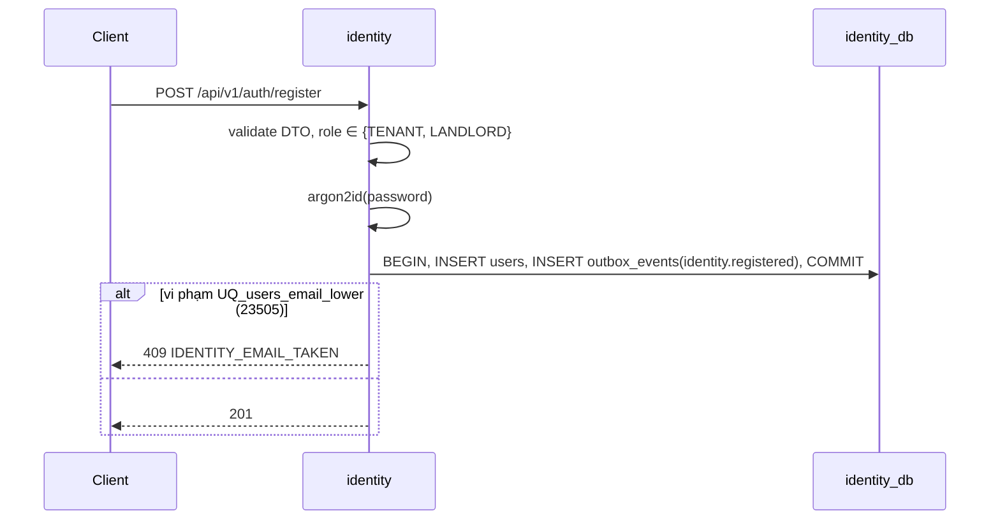
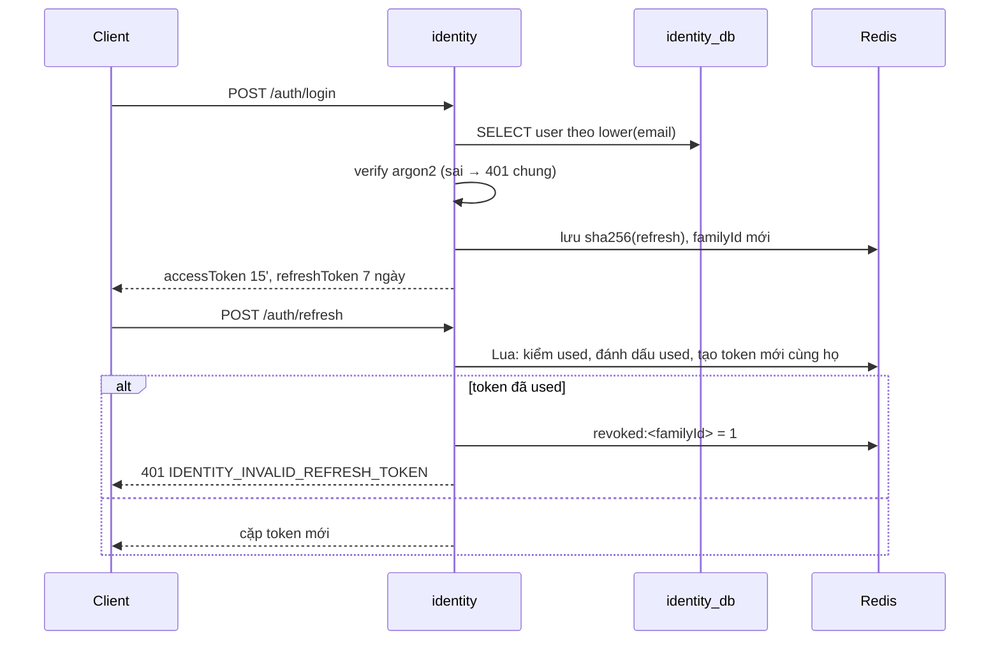
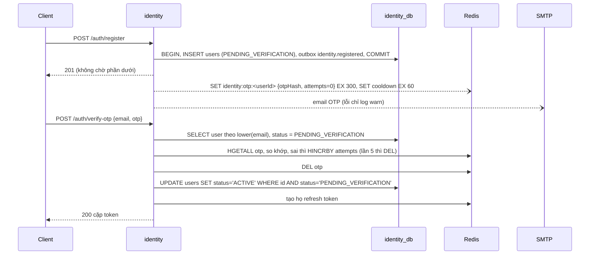
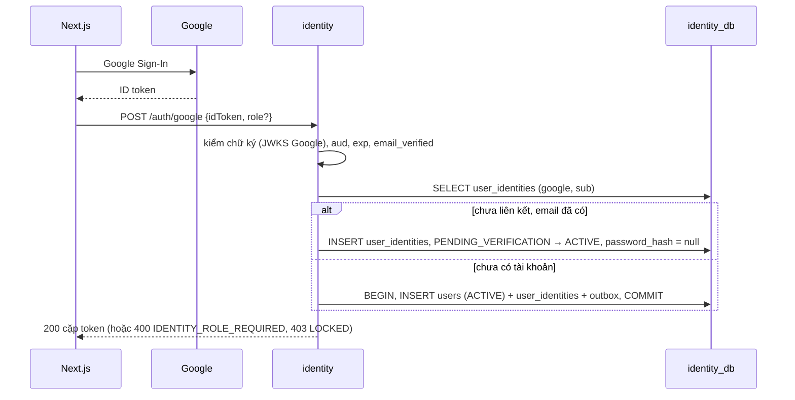

# RE.IDENTITY — Luồng xử lý

| | |
|---|---|
| **Chức năng** | Đăng ký và xác minh OTP, đăng nhập (mật khẩu, Google), quên mật khẩu, làm mới, đăng xuất, khóa tài khoản, cung cấp tài khoản nhận tiền |
| **Tham chiếu** | `API_Spec.md`, `Component_Class_Design.md`, `services/identity/README.md` |
| **Chủ sở hữu / Cập nhật / Phiên bản** | hoang.lv — 2026-11-28 — v2.5 |

## 1. Đăng ký

Hai request đồng thời cùng email: ràng buộc duy nhất quyết định, một bên `409`. Số truy vấn: 2.

## 2. Đăng nhập và làm mới

Redis dừng: đăng nhập, làm mới `503`; service khác vẫn kiểm access token còn hạn bằng khóa công khai.

## 3. ~~Đổi vai trò~~ — bỏ 2026-11-18

Vai trò cố định từ lúc tạo tài khoản. Muốn vai trò khác thì đăng ký tài khoản mới bằng email khác (`API_Spec.md §1`).

## 3a. Xác minh email OTP

Gửi OTP không chờ (v2.3): `201` trả ngay sau commit; SMTP hoặc Redis lỗi chỉ ghi log `warn`, người dùng gửi lại. Số truy vấn DB: đăng ký 2, xác minh 2.

## 3b. Quên mật khẩu

1. `forgot-password`: tìm user (1 truy vấn); có và không `LOCKED` → `SET identity:pwreset:<sha256(token)> userId EX 900`, gửi email link (không chờ, v2.3). Luôn `202`.
2. `reset-password`: `GETDEL` token (dùng một lần, nguyên tử) → `UPDATE users SET password_hash` → `revokeAllForUser`. Token sai → `400`.

## 3c. Đăng nhập Google

Google không phản hồi khi tải JWKS: `503 DEPENDENCY_UNAVAILABLE`; khóa JWKS được cache theo `Cache-Control`. `GOOGLE_CLIENT_ID` không đặt: cũng `503 DEPENDENCY_UNAVAILABLE`, trước khi kiểm token (v2.3). Email đã có tài khoản nhưng tài khoản đó đã liên kết với một `sub` Google khác: `401 IDENTITY_GOOGLE_TOKEN_INVALID`, không liên kết (`API_Spec §1.8` dòng 4a, v2.4).

## 3d. Khóa tài khoản

1. `UPDATE users SET status='LOCKED' … WHERE id AND status <> 'LOCKED'` (commit trước để chặn đăng nhập mới).
2. `revokeAllForUser`. Redis lỗi → `503`; gọi lại khóa chạy lại bước 2 (idempotent).
3. Người bị khóa: refresh `401`, đăng nhập `403`; access token còn hạn tối đa 15 phút.

## 4. Payment lấy tài khoản nhận tiền

`GET /internal/users/:id/bank-account` → đọc 1 dòng, giải mã, trả. Chỉ đọc nên payment được retry. Identity dừng → payment trả `503` khi tạo lệnh rút (`architecture.md §4`).

## 5. Đã chốt 2026-11-16

1. ~~Thu hồi phiên lỗi sau đổi vai trò → `503`, gọi lại để thu hồi (§3).~~ Hết hiệu lực 2026-11-18 (bỏ đổi vai trò); khóa tài khoản vẫn theo `API_Spec.md §1.9`.
