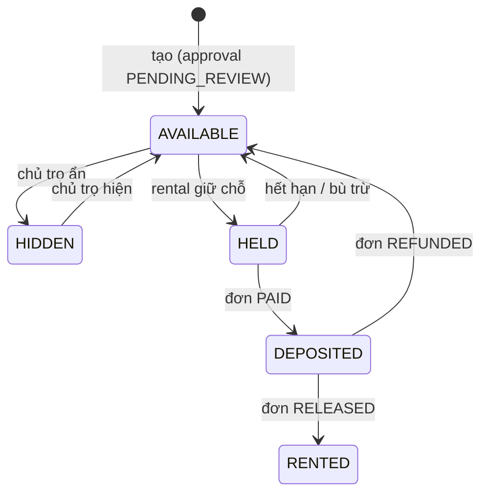
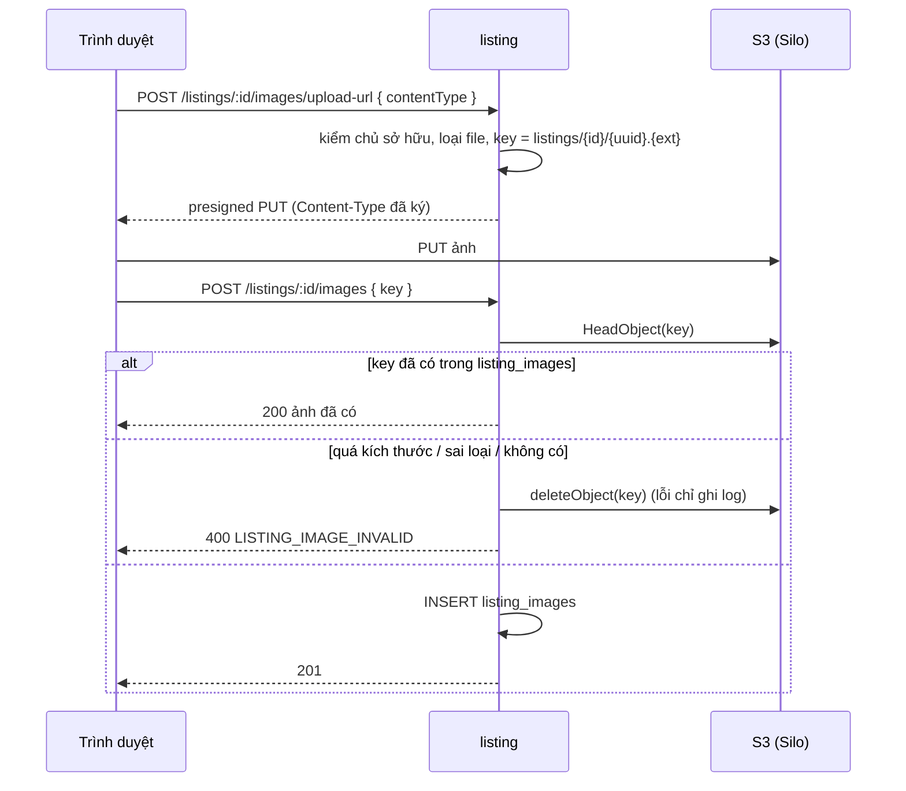
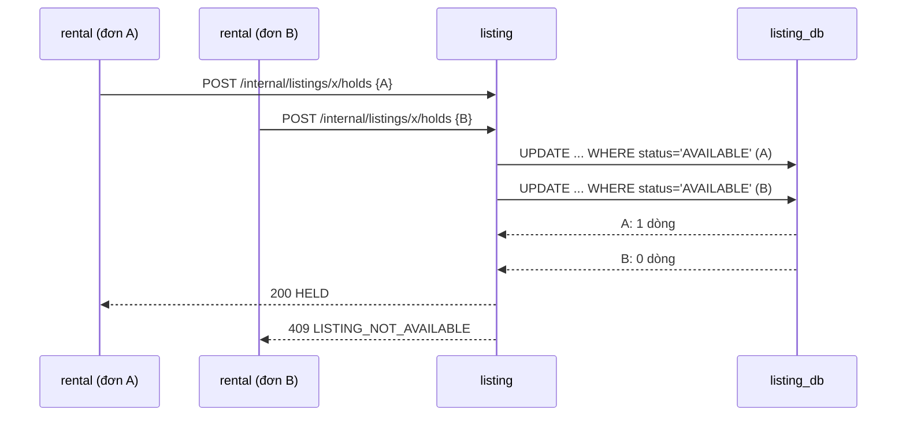
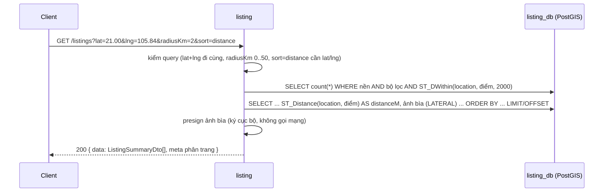

# RE.LISTING — Luồng xử lý

| | |
|---|---|
| **Chức năng** | Quản lý sản phẩm, tải ảnh, tìm kiếm, giữ chỗ và đổi trạng thái theo đơn |
| **Tham chiếu** | `API_Spec.md`, `Component_Class_Design.md`, ADR-0010 |
| **Chủ sở hữu / Cập nhật / Phiên bản** | hoang.lv — 2026-11-26 — v1.5 (đề xuất, chờ A duyệt: `implementation/van-de-can-quyet-dinh.md` C25) |

## 1. Vòng đời trạng thái BĐS

## 2. Tải ảnh

## 3. Giữ chỗ khi hai người cùng đặt cọc

Postgres khóa dòng khi `UPDATE`; lệnh thứ hai chờ rồi đánh giá lại `WHERE`, thấy `HELD` nên 0 dòng. Không cần khóa ứng dụng. Khóa Redis ở rental chỉ chặn bấm lặp sớm.

## 4. Xóa mềm

Một câu `UPDATE listings SET deleted_at = now() WHERE id AND owner_id AND status NOT IN ('HELD','DEPOSITED') AND deleted_at IS NULL`. 0 dòng → đọc lại để chọn `404`/`403`/`409`. Không có cửa sổ giữa kiểm tra và xóa.

## 5. Số truy vấn

| Endpoint | Truy vấn |
|---|---|
| Tìm kiếm | 2 (count + data; ảnh bìa qua `LEFT JOIN LATERAL`, tên tỉnh/quận qua `JOIN` trong cùng câu data, v1.5) |
| Bản chụp nội bộ | 1 |
| Chi tiết | 2 (tin + ảnh) |
| Của tôi | 3 (count + data + ảnh của trang) |
| Thêm, ẩn, hiện | 1–3 (ghi có điều kiện, 0 dòng thì đọc lại để chọn lỗi, đọc ảnh cho response); thêm tin cộng 1 kiểm cặp `cityId`/`districtId` (v1.5) → tối đa 4 |
| Sửa | 3 (đọc tin, `UPDATE ... RETURNING`, ảnh); cộng 1 kiểm cặp khi body có `cityId`/`districtId` (v1.5) → tối đa 4 |
| Xóa mềm | 1, cộng 1 khi 0 dòng |
| Xác nhận ảnh | 5 (đọc tin, khóa tin + đếm + thêm ảnh + đổi duyệt trong một transaction; `HeadObject` ngoài transaction) |
| Duyệt, từ chối | 3 (`UPDATE ... RETURNING`, đọc lại khi 0 dòng, ảnh) |
| Giữ chỗ | 1, cộng 1 khi 0 dòng để phân biệt gọi lại |
| Đổi trạng thái | 1, cộng 1 khi 0 dòng |

## 6. Tìm kiếm theo bán kính

`ST_DWithin` trên `geography` dùng GiST `ix_listings_location` (Báo cáo T05). Count và data dùng **cùng** mệnh đề `WHERE` do một hàm thuần dựng, nên `total` luôn khớp tập trả về. Không có `lat/lng` thì không có `ST_DWithin`, `ST_Distance`. Mọi giá trị đi qua tham số SQL; cột và hướng sắp xếp lấy từ bảng cố định, không từ input.
