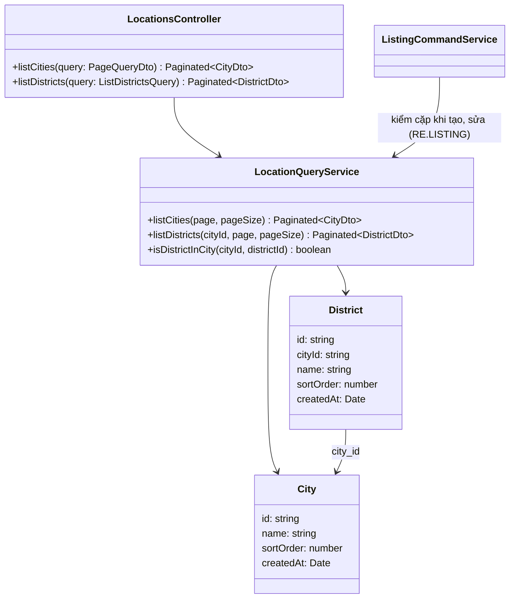

# RE.LOCATION — Thiết kế thành phần

| | |
|---|---|
| **Service** | `services/listing/src/listing/` (cùng module với `RE.LISTING`) |
| **Quy ước** | `standards/coding-convention.md`, `standards/non-functional-standards.md` |
| **Chủ sở hữu / Cập nhật / Phiên bản** | hoang.lv — 2026-11-26 — v1.0 (đề xuất, chờ A duyệt) |

## 1. Cấu trúc

Chỉ liệt kê file mới hoặc sửa vì `RE.LOCATION`. Phần sửa của tin đăng ở `RE.LISTING/Component_Class_Design.md §1`.

```text
src/
├─ database/migrations/
│  └─ 1733200000000-create-locations.ts   # MỚI: bảng, index, 5 tỉnh + 80 quận/huyện (API_Spec §6)
└─ listing/
   ├─ listing.module.ts                   # SỬA: đăng ký LocationsController, LocationQueryService, entity City, District
   ├─ controllers/
   │  └─ locations.controller.ts          # MỚI: route 1, 2 (@Public)
   ├─ services/
   │  └─ location-query.service.ts        # MỚI: listCities, listDistricts, isDistrictInCity
   ├─ dto/
   │  ├─ city.dto.ts                      # MỚI: CityDto
   │  ├─ district.dto.ts                  # MỚI: DistrictDto
   │  └─ list-districts.query.ts          # MỚI: cityId (@IsUUID) + kế thừa PageQueryDto
   └─ entities/
      ├─ city.entity.ts                   # MỚI
      └─ district.entity.ts               # MỚI
```

Dùng lại (chạy `reuse-scan` lúc lập kế hoạch để xác nhận trên source): `PageQueryDto`, `Paginated` (`common/response/`), `@Public()` (`common/auth/public.decorator.ts`), decorator Swagger envelope (`common/response/api-envelope.decorator.ts`), `createValidationPipe` toàn cục. Không tạo thành phần dùng chung mới.

## 2. Sơ đồ lớp



- `listCities`, `listDistricts`: `Repository.findAndCount` với `order: { sortOrder: 'ASC', id: 'ASC' }`, `skip`, `take`; controller trả `new Paginated(items, page, pageSize, total)`.
- `isDistrictInCity`: một câu `SELECT 1 FROM districts WHERE id = $1 AND city_id = $2` (PK). Trả `boolean`; ném lỗi là việc của `ListingCommandService` (`RE.LISTING/API_Spec.md §1.2`).
- Entity chỉ khai báo cột (như `Listing`); không khai báo quan hệ `@ManyToOne` để tránh nạp lười ngoài ý muốn. Tên cột snake_case qua `name:`.

## 3. Test bắt buộc

TDD bật (`.claude/playbooks.json`): viết test trước theo `tdd-workflow`.

| # | Tình huống | Mong đợi | Loại |
|---|---|---|---|
| 1 | Route 1 không token | `200`, 5 tỉnh theo thứ tự §6, `total = 5` | infra (Postgres thật, sau migration) |
| 2 | Route 2 với id Hà Nội, `pageSize=50` | 30 quận/huyện, đúng thứ tự §6, mọi `cityId` = Hà Nội | infra |
| 3 | Route 2 `pageSize=10&page=2` | Phần tử 11–20, `totalPages = 3` | infra |
| 4 | Route 2 `cityId` là UUID không có | `200`, `data: []`, `total = 0` | infra |
| 5 | Route 2 thiếu `cityId`, `cityId=abc`, `pageSize=51`, tham số lạ | `400 VALIDATION_FAILED`, `details` đúng trường | unit DTO + infra (HTTP) |
| 6 | Migration `up` trên DB trống | 5 `cities`, 80 `districts`, không trùng `(city_id, name)`, mọi tên seed `RE.LISTING` có trong danh mục | infra |
| 7 | Migration `down` sau `up` | Không còn `cities`, `districts` | infra |
| 8 | `isDistrictInCity`: cặp đúng / quận của tỉnh khác / id không có | `true` / `false` / `false` | infra |
| 9 | Số truy vấn route 1, route 2 | Mỗi route tối đa 2 câu (log `query` của TypeORM) | infra |
