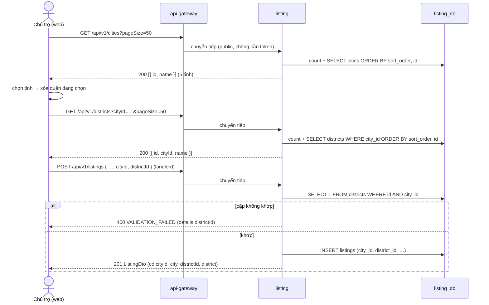

# RE.LOCATION — Luồng xử lý

| | |
|---|---|
| **Chức năng** | Đọc danh mục tỉnh/thành, quận/huyện để chọn trong form tạo/sửa tin và bộ lọc tìm kiếm |
| **Tham chiếu** | `API_Spec.md`, `Component_Class_Design.md`, `RE.LISTING/Processing_Flow.md §5` |
| **Chủ sở hữu / Cập nhật / Phiên bản** | hoang.lv — 2026-11-26 — v1.0 (đề xuất, chờ A duyệt) |

## 1. Form tạo tin chọn địa chỉ

Bước tạo, sửa tin và thứ tự kiểm tra đầy đủ: `RE.LISTING/API_Spec.md §1.2`. Bộ lọc tìm kiếm dùng cùng hai route để chọn `cityId`, `districtId` (`RE.LISTING/API_Spec.md §1.3`).

Giao diện có thể giữ danh mục trong bộ nhớ suốt phiên: dữ liệu chỉ đổi khi có migration mới.

## 2. Transaction, đồng thời, gọi lại

- Route 1, 2 chỉ đọc, không transaction, gọi lại bao nhiêu lần cũng như nhau.
- Kiểm cặp trước khi ghi tin nằm ngoài transaction ghi. Không có cửa sổ sai vì danh mục không bao giờ xóa, sửa lúc chạy; FK `listings.district_id → districts.id` vẫn chặn ở DB.

## 3. Khi phụ thuộc lỗi

Postgres lỗi kết nối hoặc chờ quá hạn → `AllExceptionsFilter` trả `503 DEPENDENCY_UNAVAILABLE` / `504 DEPENDENCY_TIMEOUT` (template). Không gọi service khác.

## 4. Số truy vấn

| Endpoint | Truy vấn | Ngưỡng (`non-functional-standards.md §1`) |
|---|---|---|
| `GET /cities` | 1–2 (data; count chỉ khi trang đầu đầy, `findAndCount`) | Danh sách: 4 |
| `GET /districts` | 1–2 (như trên) | Danh sách: 4 |
| Kiểm cặp khi tạo, sửa tin | +1 vào route 1, 2 của `RE.LISTING` | Ghi: 6 (xem `RE.LISTING/Processing_Flow.md §5`) |
