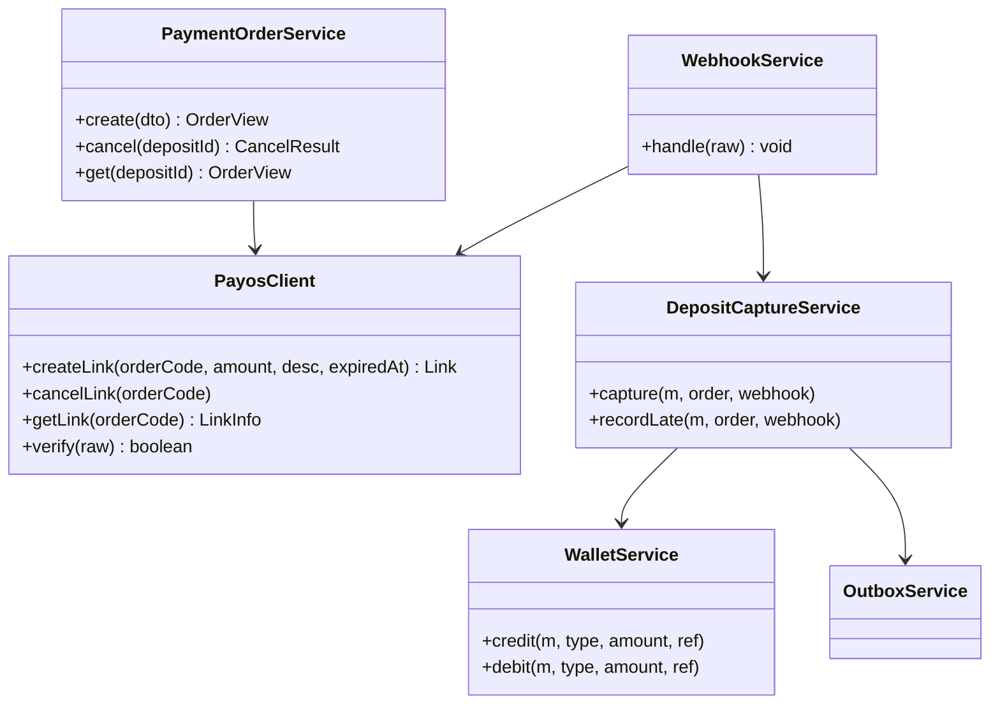

# RE.PAYMENT — Thiết kế thành phần

| | |
|---|---|
| **Service** | `services/payment/src/payment/` |
| **Quy ước** | `standards/coding-convention.md §4`, `standards/reliability-standard.md §3` |
| **Chủ sở hữu / Cập nhật / Phiên bản** | hoang.lv — 2026-11-22 — v1.3 |

## 1. Cấu trúc

```text
src/payment/
├─ payment.module.ts
├─ controllers/
│  ├─ payos-webhook.controller.ts          # @Public, đọc body thô
│  ├─ payment-orders.internal.controller.ts
│  ├─ withdrawals.controller.ts            # RE.PAYOUT
│  ├─ payouts.admin.controller.ts          # RE.PAYOUT
│  └─ transactions.controller.ts           # RE.PAYOUT
├─ services/
│  ├─ payment-order.service.ts             # create, cancel, get
│  ├─ webhook.service.ts                   # handle(raw): bảng §1 API_Spec
│  ├─ deposit-capture.service.ts           # §1.1, §1.2 trong một transaction
│  ├─ wallet.service.ts                    # RE.PAYOUT: credit/debit + wallet_transactions
│  ├─ refund.service.ts, withdrawal.service.ts, receipt.service.ts, audit.service.ts  # RE.PAYOUT
├─ clients/
│  ├─ payos.client.ts                      # bọc SDK payOS: timeout, không retry createPaymentLink
│  ├─ rental.client.ts                     # RE.PAYOUT
│  └─ identity.client.ts                   # RE.PAYOUT
├─ entities/ dto/ errors/payment.errors.ts config/payment.env.ts
```

## 2. Sơ đồ lớp



## 3. `WebhookService.handle`

```ts
async handle(raw: unknown) {
  const valid = await this.payos.verify(raw);                          // SDK: HMAC-SHA256 trên data
  const f = readFields(raw);                                           // sai kiểu → null
  const initial = !valid ? 'INVALID_SIGNATURE' : !usable(f) ? 'IGNORED' : 'RECEIVED';
  const id = await insertEvent(f, valid, initial, raw);                // luôn lưu nguyên văn TRƯỚC
  if (initial !== 'RECEIVED') return initial;
  const order = await this.orders.findOneBy({ payosOrderCode: f.orderCode });
  if (!order) return this.mark(id, 'UNKNOWN_ORDER');
  if (order.status === 'PENDING' && f.amountVnd !== order.amountVnd)  // chỉ xét order PENDING (§1 dòng 5)
    return this.mark(id, 'AMOUNT_MISMATCH');
  try {
    return await this.dataSource.transaction(async (m) => {
      if (order.status === 'PENDING' && (await this.capture.capture(m, order, paid))) {
        await m.query(SET_RESULT, [id, 'PAID']);                       // unique → trùng reference
        return 'PAID';
      }
      await m.query(SET_RESULT, [id, 'LATE']);                         // CANCELLED, PAID reference khác, vừa thua lệnh hủy
      await this.capture.recordLate(m, order, paid);                   // số THỰC NHẬN
      return 'LATE';
    });
  } catch (e) {
    if (isUniqueViolation(e, 'ux_webhook_accepted_reference')) return this.mark(id, 'DUPLICATE');
    throw e;                                                           // 500, payOS gửi lại
  }
}
```

- `result` tạm `RECEIVED` giữa lúc lưu và lúc có kết quả; dòng kẹt ở `RECEIVED` nghĩa là payment dừng giữa chừng (payOS gửi lại).
- `capture` trả `false` khi `UPDATE … WHERE status='PENDING'` đổi 0 dòng (lệnh hủy vừa thắng, hoặc webhook khác vừa `PAID`): ghi tiền đến muộn. Không cần đọc lại order: mọi trường hợp thua đều là tiền đến muộn; trường hợp webhook khác cùng `reference` vừa thắng thì index chặn ở câu ghi `result` → `DUPLICATE`.
- Sai số tiền chỉ xét order `PENDING`; order `CANCELLED`/`PAID` ghi tiền đến muộn với số thực nhận (`API_Spec §1` dòng 5, 8, 9; `§7` mục 2).

## 4. Test bắt buộc

| # | Tình huống | Mong đợi |
|---|---|---|
| 1 | Webhook hợp lệ | Order `PAID`, 1 `DEPOSIT_IN`, `balance` tăng đúng, 1 `payment.deposited` |
| 2 | Webhook hợp lệ gửi hai lần | Một giao dịch ví, một sự kiện (Báo cáo T10) |
| 3 | Hai webhook cùng `reference` đồng thời, Postgres thật | Như trên |
| 4 | Sai chữ ký | Không đổi gì, có log `warn` (Báo cáo T09) |
| 5 | Sai số tiền | Không đổi ví, order `PENDING` (Báo cáo T09) |
| 6 | Webhook cho order `CANCELLED` | `late_payments`, `LATE_PAYMENT_IN`, yêu cầu hoàn 100% `SYSTEM`, 1 `late-payment-credited` (E5) |
| 7 | Tạo order hai lần cùng `depositId` | Một order, một lần gọi payOS |
| 8 | payOS timeout khi tạo link | `503`, order có trước khi gọi |
| 9 | Hủy order `PENDING` | payOS `cancel` gọi trước `UPDATE` |
| 10 | Hủy khi webhook vừa thắng | `409 PAYMENT_ORDER_ALREADY_PAID` |
| 11 | Mọi sự kiện | Đúng schema `contracts/events/` |
| 12 | Số dư ví sau mỗi test | = tổng vào − tổng ra (E10) |

## 5. Đã chốt

SDK `@payos/node` (`architecture.md §5`, 2026-11-16); timeout `PAYOS_TIMEOUT_MS`. Phiên bản cụ thể và cách tắt retry của SDK C ghi vào walkthrough khi làm T3.1.
