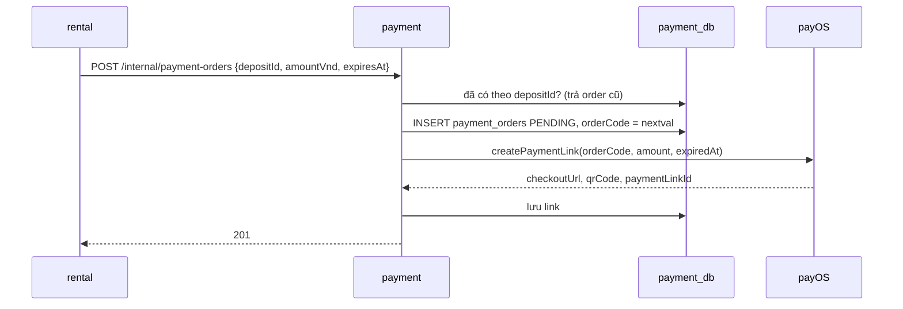
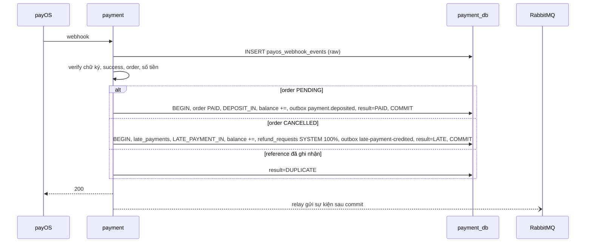

# RE.PAYMENT — Luồng xử lý

| | |
|---|---|
| **Chức năng** | Tạo link, nhận webhook, hủy link khi hết hạn, tiền đến muộn |
| **Tham chiếu** | `API_Spec.md`, `Component_Class_Design.md`, ADR-0009, Báo cáo v2 Hình 3.7, 3.9, 3.11 |
| **Chủ sở hữu / Cập nhật / Phiên bản** | hoang.lv — 2026-11-22 — v1.3 |

## 1. Tạo link

Lưu order **trước** khi gọi payOS: nếu payment chết sau khi payOS tạo link, `orderCode` đã có trong DB để webhook tìm được.

## 2. Webhook

## 3. Đua giữa webhook và hủy link khi hết hạn

| Thứ tự | Kết quả |
|---|---|
| Hủy (payOS + `UPDATE CANCELLED`) xong trước, webhook sau | Webhook thấy `CANCELLED` → tiền đến muộn |
| Webhook `UPDATE PAID` trước, hủy sau | Hủy được 0 dòng → `409 PAYMENT_ORDER_ALREADY_PAID` → rental không `EXPIRED` |
| payOS đã hủy link nhưng `UPDATE CANCELLED` chưa chạy, webhook tới | Webhook `PAID` thắng; hủy trả `409` → đơn `PAID` |

Cả hai đường đều là `UPDATE ... WHERE status='PENDING'`; Postgres khóa dòng nên chỉ một bên thắng.

## 4. Bảng xử lý lỗi

| Điểm lỗi | Xử lý | Kết quả |
|---|---|---|
| payOS dừng khi tạo link | `503`; rental bù trừ nhả chỗ | Người thuê thử lại sau |
| payOS chậm khi tạo link | Timeout → `503`/`504` | Rental đối soát qua `GET /internal/payment-orders/:depositId` |
| Payment dừng khi webhook tới | Gateway `503`; payOS tự gửi lại | Ghi nhận muộn |
| DB lỗi giữa transaction webhook | `500`, rollback | payOS gửi lại; unique chống trùng |
| RabbitMQ dừng sau commit | Outbox giữ | `payment.deposited` gửi bù (E3) |
| Đường hầm ngrok rớt khi demo | Không có webhook | Đối soát tay bằng `GET /internal/payment-orders/:depositId` hỏi payOS |

## 5. Bất biến

| Bất biến | Kiểm tra |
|---|---|
| Mỗi `reference` payOS ghi nhận một lần | `ux_webhook_accepted_reference` |
| Mỗi đơn tối đa một order | `payment_orders.deposit_id UNIQUE` |
| Order `PAID` có đúng một `DEPOSIT_IN` | Truy vấn đối chiếu |

## 6. Số truy vấn

| Nhánh | Truy vấn |
|---|---|
| `PAID` | lưu raw 1 + đọc order 1 + transaction (order, giao dịch ví, số dư, outbox, `result`) 5 = **7** |
| `LATE` (order `CANCELLED`/`PAID`) | 1 + 1 + transaction (`result`, yêu cầu hoàn, `late_payments`, giao dịch ví, số dư, outbox) 6 = **8** |
| Đua: order `PENDING` nhưng `UPDATE` 0 dòng (lệnh hủy vừa thắng) | 1 + 1 + transaction (`UPDATE` order 0 dòng + 6 của `LATE`) = **9** — A chấp nhận vượt ngưỡng ở nhánh hiếm này (2026-11-22) |
| Sai chữ ký, bỏ qua | 1 |
| Không có order, sai số tiền | 3 |

Ngưỡng 8 cho thao tác ghi có thay đổi tiền (`non-functional-standards.md §1`). Lưu nguyên văn trước mọi kiểm tra; mọi thay đổi tiền cùng transaction.
