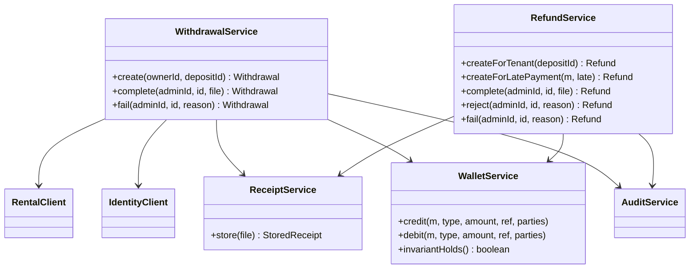

# RE.PAYOUT — Thiết kế thành phần

| | |
|---|---|
| **Service** | `services/payment/src/payment/` (cấu trúc chung ở `RE.PAYMENT/Component_Class_Design.md §1`) |
| **Quy ước** | `standards/coding-convention.md §4`, `standards/security-policy.md` |
| **Chủ sở hữu / Cập nhật / Phiên bản** | hoang.lv — 2026-11-25 — v1.3 |

## 1. Thành phần

| File | Vai trò |
|---|---|
| `services/wallet.service.ts` | `credit`, `debit`: một dòng `wallet_transactions` + `UPDATE admin_wallet SET balance_vnd = balance_vnd ± x`; luôn nhận `manager` |
| `services/refund.service.ts` | Tạo (nội bộ), hoàn tất, từ chối, thất bại |
| `services/withdrawal.service.ts` | Tạo, hoàn tất, thất bại |
| `services/receipt.service.ts` | Đọc tệp, kiểm loại/cỡ, `sha256`, `putObject` S3 |
| `services/audit.service.ts` | Ghi `audit_log` trong transaction của thao tác |
| `services/payout-query.service.ts` | Route 1, 3, 4, 5, 11, 12; route 13, 14 (chi tiết + `IdentityClient`) |
| `clients/rental.client.ts` | `withdrawalEligibility` |
| `clients/identity.client.ts` | `getBankAccount` (`404` → `null`) |
| `controllers/withdrawals.controller.ts`, `transactions.controller.ts`, `payouts.admin.controller.ts`, `refund-requests.internal.controller.ts` | Route 1–14, nội bộ |
| `entities/{refund-request,withdrawal-request,transfer-receipt,audit-log}.entity.ts` | Bảng đã có ở migration T3.1 |
| `domain/refund-amount.ts` | Hàm thuần tính 70% |

## 2. Sơ đồ lớp



## 3. Hoàn tất lệnh chi

```ts
async complete(adminId: string, id: string, file: Express.Multer.File) {
  const stored = await this.receipts.store(file);                // S3 trước, ngoài transaction; tệp mồ côi chấp nhận được
  return this.dataSource.transaction(async (m) => {
    const receipt = await m.save(TransferReceipt, { sha256: stored.sha256, objectKey: stored.key, uploadedBy: adminId });
                                                                  // trùng sha256 → 409 PAYMENT_RECEIPT_ALREADY_USED
    const r = await m.update(Withdrawal, { id, status: 'PENDING' },
                             { status: 'COMPLETED', receiptId: receipt.id, processedBy: adminId, processedAt: now() });
    if (!r.affected) throw invalidStatus();                      // bấm lặp: Idempotency-Key trả kết quả cũ trước khi tới đây
    const w = await m.findOneByOrFail(Withdrawal, { id });
    await this.wallet.debit(m, 'WITHDRAW_OUT', w.amountVnd, { type: 'WITHDRAWAL', id }, { ownerId: w.ownerId });
    await this.audit.log(m, adminId, 'COMPLETE_WITHDRAWAL', 'WITHDRAWAL', id, …);
    await this.outbox.add(m, 'payment.withdrawal-completed', toPayload(w));
    return w;
  });
}
```

`debit` dựa vào `CHECK (balance_vnd >= 0)`: vi phạm → `409 PAYMENT_WALLET_INSUFFICIENT`.

## 4. Test bắt buộc

| # | Tình huống | Mong đợi |
|---|---|---|
| 1 | `refund-amount.spec.ts`: 3.000.000 → 2.100.000; số lẻ | `floor`: 3.000.001 → 2.100.000 |
| 2 | Tạo yêu cầu hoàn hai lần cùng đơn | Một yêu cầu |
| 3 | Hoàn tất yêu cầu hoàn | `REFUND_OUT`, số dư giảm đúng, 1 `payment.refunded` (Báo cáo T12) |
| 4 | Từ chối | `REJECTED`, 1 `payment.refund-rejected`, ví không đổi |
| 5 | Thất bại rồi hoàn tất lại | `FAILED` → `COMPLETED` |
| 6 | Tạo lệnh rút khi chưa `RELEASED` | `409` kèm `missing` (Báo cáo T13) |
| 6a | Tạo lệnh rút cho đơn `REFUNDED` (người thuê đã hoàn 70%) | `201`, số tiền = tiền cọc − số đã hoàn; sau khi hoàn tất ví về 0 cho đơn đó |
| 7 | Tạo lệnh rút lần hai | `409 PAYMENT_PAYOUT_ALREADY_OPEN` |
| 8 | Chưa khai ngân hàng | `409 PAYMENT_BANK_ACCOUNT_MISSING` |
| 9 | Chứng từ đã dùng cho lệnh khác | `409`, lệnh không `COMPLETED` (Báo cáo T14) |
| 10 | Hai quản trị viên cùng hoàn tất, Postgres thật | Một thành công, ví trừ một lần |
| 11 | Lệnh rút `FAILED` | Ví không đổi; tạo lệnh mới được |
| 12 | Người A xem giao dịch của B | Không có trong danh sách (Báo cáo T15) |
| 13 | Bất biến ví sau mọi test | `balance = Σ vào − Σ ra` (E10) |
| 14 | Mọi thao tác quản trị | Có một dòng `audit_log` |
| 15 | Route 13, 14: người nhận đã khai / chưa khai | `bankAccount` đầy đủ / `null` |
| 16 | Chứng từ đổi đuôi (byte đầu không khớp loại), quá cỡ | `400 PAYMENT_RECEIPT_INVALID`, không gọi S3 |
| 17 | Yêu cầu hoàn cũ `REJECTED`, rental gọi lại | Tạo yêu cầu mới `201` |

## 5. Đã chốt

Xem `API_Spec.md §8` (2026-11-16), `§8a` (2026-11-25).
