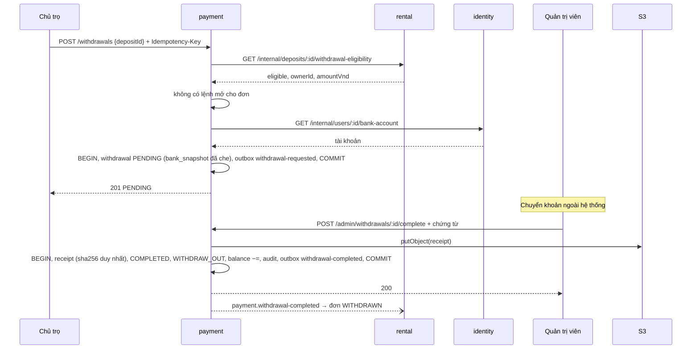
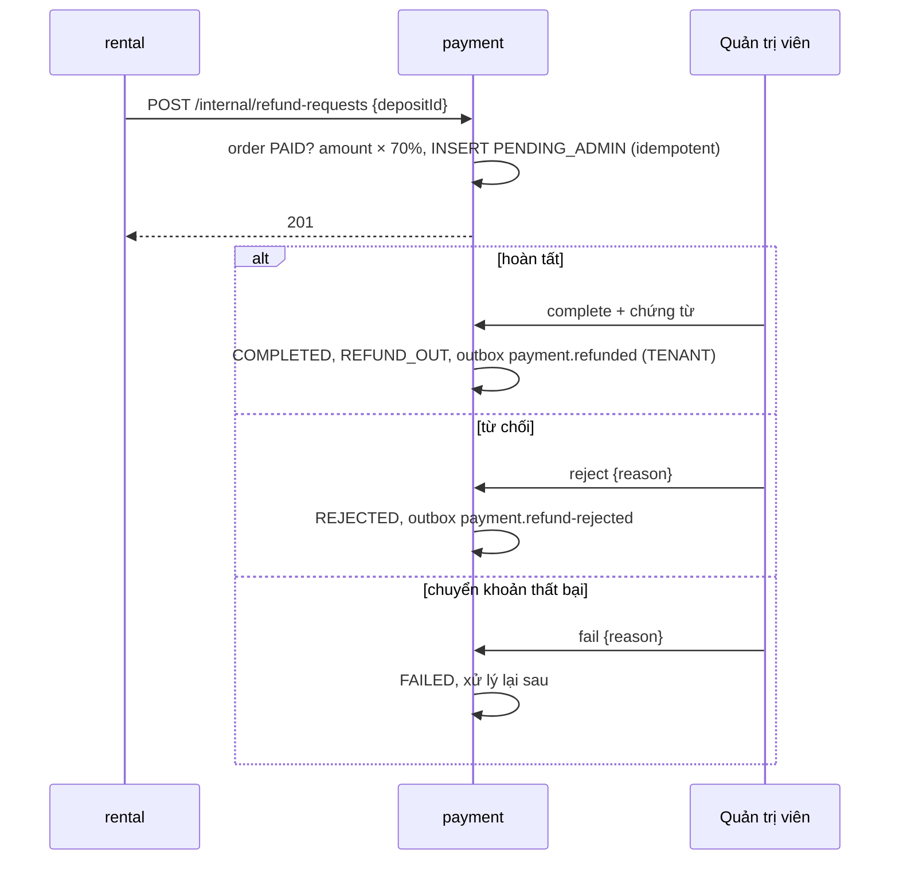

# RE.PAYOUT — Luồng xử lý

| | |
|---|---|
| **Chức năng** | Rút tiền, hoàn tiền, chứng từ, bất biến ví |
| **Tham chiếu** | `API_Spec.md`, `Component_Class_Design.md`, Báo cáo v2 §3.2.3–3.2.4, Hình 3.5 |
| **Chủ sở hữu / Cập nhật / Phiên bản** | hoang.lv — 2026-11-25 — v1.3 |

## 1. Rút tiền

Đơn `REFUNDED` (người thuê tự hủy): cùng luồng, rental trả `eligible = true` không cần hai mốc; payment rút phần còn lại sau hoàn 70%; rental chỉ ghi `withdrawn_at`, đơn giữ `REFUNDED`.

## 2. Hoàn tiền

Tiền đến muộn tạo yêu cầu hoàn `SYSTEM` 100% ở `RE.PAYMENT §1.2`; quản trị viên xử lý cùng màn hình. Người thuê thường chưa khai tài khoản: họ nhắn quản trị viên qua chat `SUPPORT`, quản trị viên hướng dẫn khai ở trang hồ sơ rồi mở route 14 để lấy số (`API_Spec §1.5`). Hoàn tất cũng phát `payment.refunded` (`SYSTEM`).

## 3. Bảng xử lý lỗi

| Điểm lỗi | Xử lý | Kết quả |
|---|---|---|
| Rental dừng khi tạo lệnh rút | `503`, chưa ghi gì | Chủ trọ thử lại |
| Identity dừng khi tạo lệnh rút | `503`, chưa ghi gì | Như trên |
| S3 dừng khi tải chứng từ | `503 DEPENDENCY_UNAVAILABLE`, chưa ghi gì | Thử lại |
| DB lỗi sau khi đã lưu tệp S3 | Rollback; tệp mồ côi | Thử lại; `sha256` chưa ghi nên không bị chặn |
| Bấm hoàn tất hai lần | `Idempotency-Key` trả kết quả cũ; không có khóa → `UPDATE` 0 dòng → `409` | Ví trừ một lần |
| RabbitMQ dừng | Outbox giữ | Rental cập nhật đơn muộn |

## 4. Bất biến ví

| Bất biến | Kiểm tra |
|---|---|
| `admin_wallet.balance_vnd = Σ(DEPOSIT_IN, LATE_PAYMENT_IN) − Σ(WITHDRAW_OUT, REFUND_OUT)` | Truy vấn sau mỗi kịch bản (E10) |
| Ví chỉ bị trừ khi có chứng từ (BR-17) | Mọi dòng `*_OUT` có `receipt_id` ở lệnh tham chiếu |
| Mỗi đơn tối đa một kết cục (BR-16) | `ux_withdrawal_active`, `ux_refund_tenant_active` và rental |
| Số dư không âm | `CHECK` |

## 5. Số truy vấn

Hoàn tất lệnh chi: receipt, update, đọc lại, giao dịch ví, cập nhật ví, audit, outbox = 7, trong ngưỡng 8 cho thao tác ghi có thay đổi tiền (`non-functional-standards.md §1`). Mọi thay đổi tiền và nhật ký cùng transaction.
