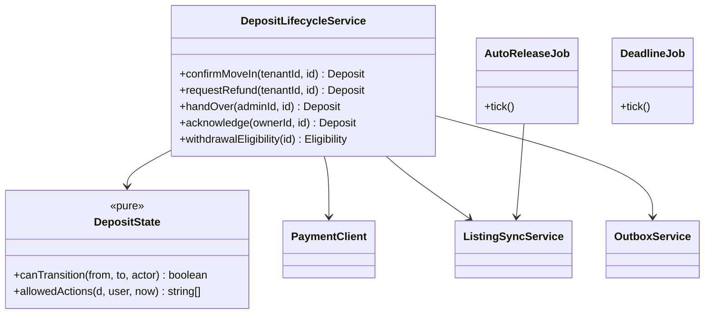

# RE.DEPOSIT_LIFECYCLE — Thiết kế thành phần

| | |
|---|---|
| **Service** | `services/rental/src/rental/` (cấu trúc chung ở `RE.DEPOSIT_SAGA/Component_Class_Design.md §1`) |
| **Quy ước** | `standards/coding-convention.md §4` |
| **Chủ sở hữu / Cập nhật / Phiên bản** | hoang.lv — 2026-11-25 — v1.2 |

## 1. Thành phần

| File | Vai trò |
|---|---|
| `services/deposit-lifecycle.service.ts` | Route 3, 4, 6, 7; điều kiện rút |
| `services/deposit-query.service.ts` | Route 1, 2, 5; tính `allowedActions` |
| `controllers/deposits.admin.controller.ts` | Route 5, 6 |
| `entities/audit-log.entity.ts` | Bảng `audit_log` (B12) |
| `controllers/deposits.internal.controller.ts` | `withdrawal-eligibility` |
| `jobs/auto-release.job.ts` | BR-13 tự giải ngân |
| `jobs/deadline.job.ts` | Nhắc trước 24 giờ |
| `jobs/saga-reconcile.job.ts` (c) | Gửi lại yêu cầu hoàn chưa tới payment |
| `events/payment-events.handler.ts` | `refunded`, `refund-rejected`, `withdrawal-completed` |
| `domain/deposit-state.ts` | Bảng chuyển `RE.BUSINESS_RULES.md §5`, hàm `canTransition(from, to, actor)`, `allowedActions(deposit, user, now)` |

## 2. Sơ đồ lớp



## 3. `requestRefund`

```ts
async requestRefund(tenantId: string, id: string) {
  const d = await this.loadOwned(id, tenantId);                         // 404 / 403
  assertTransition(d, 'REFUND_REQUESTED');                              // 409 RENTAL_INVALID_TRANSITION
  if (now() > d.refundDeadlineAt) throw refundWindowClosed();           // 409
  const r = await this.repo.update(
    { id, status: 'PAID', refundDeadlineAt: MoreThanOrEqual(now()) },
    { status: 'REFUND_REQUESTED', refundSyncedAt: null });              // thắng/thua với AutoReleaseJob
  if (!r.affected) throw invalidTransition();
  try { await this.payment.createRefund({ depositId: id }); await this.markRefundSynced(id); }
  catch (e) { this.logger.warn(...); }                                  // job (c) gửi lại
  return this.reload(id);
}
```

Cột `refund_synced_at` (A8) đánh dấu payment đã nhận yêu cầu hoàn. Rental thắng cuộc đua trước, rồi mới nhờ payment tạo yêu cầu: tránh payment có yêu cầu hoàn cho đơn đã `RELEASED`.

## 4. `AutoReleaseJob`

```sql
UPDATE deposits
SET status='RELEASED', released_at=now(), release_trigger='AUTO',
    listing_target_status='RENTED', listing_synced_at=NULL
WHERE id = $id AND status='PAID' AND auto_release_at <= now()
```

Kèm outbox `rental.deposit-released` trong cùng transaction; sau commit đẩy `RENTED` (`ListingSyncService.push`). Chọn tối đa 50 đơn `PAID` có `auto_release_at <= now()` mỗi lượt (`ix_deposits_auto_release`), kế thừa `IntervalJob`. `REFUND_REQUESTED` tự bị loại (BR-13). Quản trị viên từ chối yêu cầu hoàn sau mốc 72 giờ → đơn về `PAID` với `auto_release_at` đã qua → giải ngân ở lượt kế tiếp (Báo cáo §3.3).

## 4a. `DeadlineJob`, `SagaReconcileJob` (c) (T3.5)

- `DeadlineJob`: chọn `PAID`, `release_reminded_at IS NULL`, `auto_release_at - RELEASE_REMINDER_SECONDS <= now() < auto_release_at` (≤ 50); transaction `UPDATE release_reminded_at = now() WHERE id AND status='PAID' AND release_reminded_at IS NULL` + outbox `rental.release-reminder` → đúng một sự kiện mỗi đơn.
- `SagaReconcileJob` (c): chọn `REFUND_REQUESTED AND refund_synced_at IS NULL` (≤ 50, `ix_deposits_refund_sync`) → `PaymentClient.createRefund`; thành công → `refund_synced_at = now() WHERE refund_synced_at IS NULL`; mọi lỗi → log `warn`, lượt sau.

## 5. Test bắt buộc

| # | Tình huống | Mong đợi |
|---|---|---|
| 1 | `deposit-state.spec.ts`: mọi cặp chuyển trong và ngoài bảng | Đúng `canTransition` |
| 2 | Yêu cầu hoàn trong 48 giờ | `REFUND_REQUESTED`, gọi payment một lần |
| 3 | Yêu cầu hoàn sau 48 giờ hoặc sau `RELEASED` | `409`, đơn không đổi (Báo cáo T11) |
| 4 | Payment lỗi khi tạo yêu cầu hoàn | `200`, job (c) gửi lại thành công |
| 5 | Yêu cầu hoàn đồng thời với `AutoReleaseJob`, Postgres thật | Một trạng thái cuối (E7) |
| 6 | `payment.refunded` (TENANT) | `REFUNDED`, đích listing `AVAILABLE` |
| 7 | `payment.refunded` (SYSTEM) cho đơn `EXPIRED` | Không đổi |
| 8 | `payment.refund-rejected` | Về `PAID`; nếu đã quá 72 giờ thì lượt job sau `RELEASED` |
| 9 | Nhận phòng | `RELEASED`, trigger `TENANT`, đích `RENTED` |
| 10 | Bàn giao khi `REFUND_REQUESTED` | `409 RENTAL_REFUND_PENDING` |
| 11 | Chủ trọ xác nhận trước bàn giao | `409 RENTAL_NOT_HANDED_OVER` |
| 12 | Chủ trọ xem danh sách trước khi xác nhận | Không thấy đơn (BR-11) |
| 13 | `withdrawal-eligibility` mỗi trường hợp thiếu | `missing` đúng (Báo cáo T13) |
| 13a | `withdrawal-eligibility` đơn `REFUNDED` chưa bàn giao | `eligible = true` (BR-15 sửa 2026-11-12) |
| 14 | `payment.withdrawal-completed` | `RELEASED` → `WITHDRAWN`; đơn `REFUNDED` giữ nguyên, có `withdrawn_at` |
| 14a | Bàn giao | Một dòng `audit_log` `HAND_OVER` cùng transaction; gọi lại không thêm dòng |
| 14b | Chủ trọ xem danh sách khi đơn `REFUNDED` chưa bàn giao | Thấy đơn |
| 15 | Nhắc giải ngân | Một sự kiện mỗi đơn, đúng 24 giờ trước (E6) |
| 16 | Người thuê A xem đơn của B | `403` (Báo cáo T15) |
