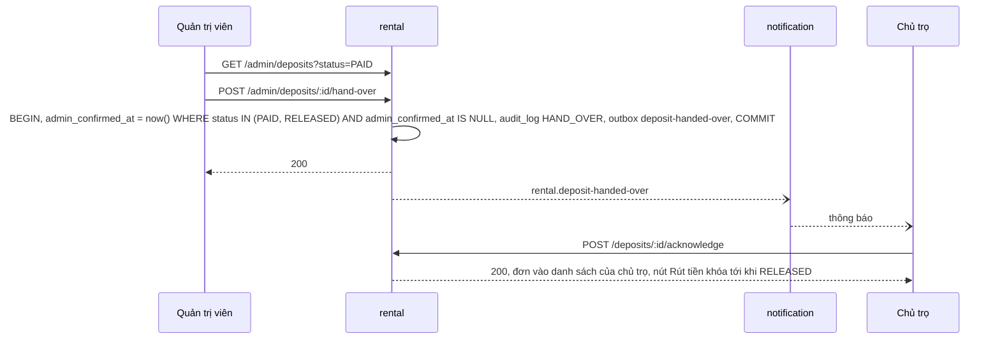
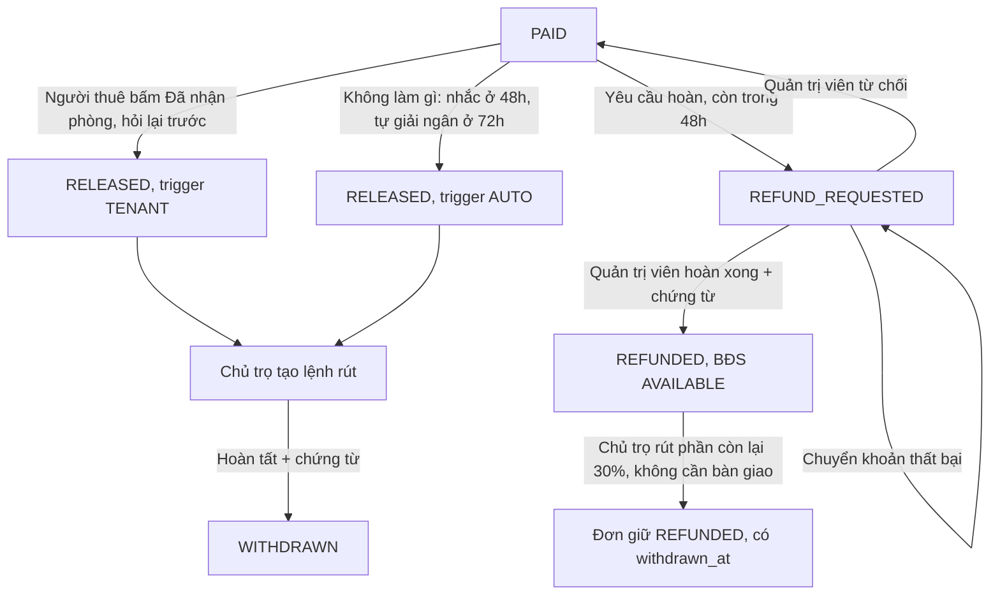
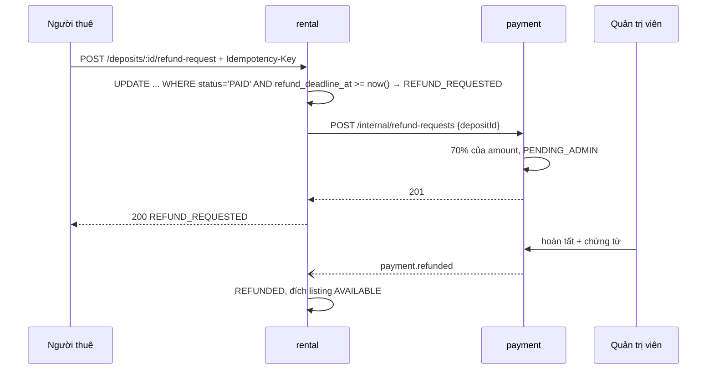

# RE.DEPOSIT_LIFECYCLE — Luồng xử lý

| | |
|---|---|
| **Chức năng** | Bàn giao, nhận phòng hoặc hoàn tiền, tự giải ngân, điều kiện rút |
| **Tham chiếu** | `API_Spec.md`, `Component_Class_Design.md`, Báo cáo v2 Hình 3.3–3.5, 3.10–3.11 |
| **Chủ sở hữu / Cập nhật / Phiên bản** | hoang.lv — 2026-11-25 — v1.2 |

## 1. Bàn giao và chủ trọ xác nhận (BR-11)

Bàn giao không đổi trạng thái: tiền vẫn nằm ở ví trung gian, chỉ quyết định đơn đã hiện ở phía chủ trọ chưa.

## 2. Nhận phòng, hoàn tiền hoặc chờ (BR-12, BR-13)

Hạn hoàn (48 giờ) kết thúc trước hạn tự giải ngân (72 giờ) 24 giờ, nên bình thường hai luồng không chồng nhau.

## 3. Yêu cầu hoàn

## 4. Bảng xử lý lỗi

| Điểm lỗi | Xử lý | Kết quả |
|---|---|---|
| Payment dừng khi tạo yêu cầu hoàn | Đơn đã `REFUND_REQUESTED`; job (c) gửi lại | Tự giải ngân đã dừng; yêu cầu tới payment muộn |
| Yêu cầu hoàn đúng lúc `AutoReleaseJob` chạy | Cả hai `UPDATE ... WHERE status='PAID'`; bên 0 dòng thua | Một trạng thái cuối (E7) |
| Listing dừng khi đồng bộ `RENTED`/`AVAILABLE` | Job (b) đẩy lại | BĐS hiển thị trễ |
| Sự kiện payment đến sai thứ tự | `UPDATE` có điều kiện 0 dòng → bỏ qua | Không đổi sai |
| Identity dừng | Không ảnh hưởng (rental không gọi identity) | |

## 5. Bất biến

| Bất biến | Kiểm tra |
|---|---|
| Mỗi đơn tối đa một kết cục `WITHDRAWN` hoặc `REFUNDED` (BR-16) | Bảng chuyển; không có đường từ `REFUNDED`/`WITHDRAWN`. Lệnh rút phần còn lại của đơn `REFUNDED` không đổi trạng thái |
| Không có đơn `PAID` quá `auto_release_at` + 2 chu kỳ job | Truy vấn |
| Đơn `RELEASED` thì BĐS `RENTED`; `REFUNDED` thì `AVAILABLE` | Đối chiếu sau khi job đồng bộ xong |
