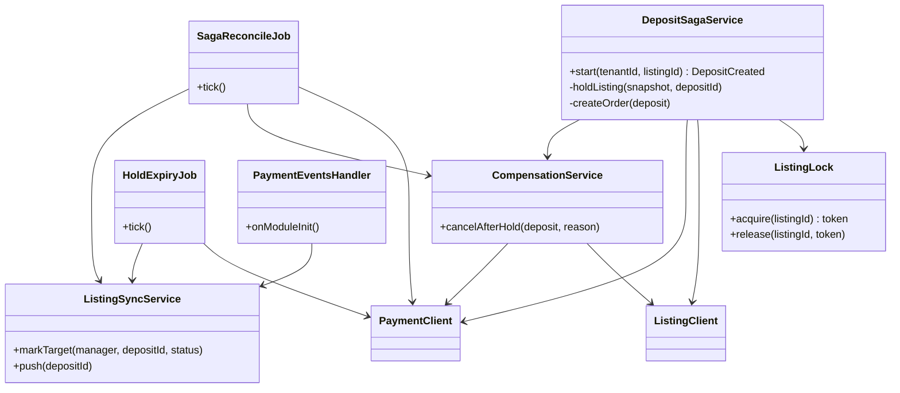

# RE.DEPOSIT_SAGA — Thiết kế thành phần

| | |
|---|---|
| **Service** | `services/rental/src/rental/` |
| **Quy ước** | `standards/coding-convention.md §4`, `standards/reliability-standard.md` |
| **Chủ sở hữu / Cập nhật / Phiên bản** | hoang.lv — 2026-11-22 — v1.3 |

## 1. Cấu trúc

Theo Báo cáo v2 Hình 4.4 (góc nhìn thành phần của rental-service).

```text
src/rental/
├─ rental.module.ts
├─ controllers/
│  ├─ deposits.controller.ts            # POST /deposits (+ route của RE.DEPOSIT_LIFECYCLE)
│  └─ viewings.controller.ts            # RE.VIEWING
├─ services/
│  ├─ deposit-saga.service.ts           # start(): các bước §1 API_Spec
│  ├─ compensation.service.ts           # nhả chỗ, hủy order, CANCELLED
│  ├─ listing-sync.service.ts           # đẩy listing_target_status sang listing
│  └─ deposit-lifecycle.service.ts      # RE.DEPOSIT_LIFECYCLE
├─ locks/listing.lock.ts                # Redis SET NX PX + giải phóng theo token
├─ clients/
│  ├─ listing.client.ts                 # getSnapshot, hold, changeStatus
│  └─ payment.client.ts                 # createOrder, cancelOrder, getOrder, createRefund
├─ events/payment-events.handler.ts     # nghe queue rental.payment-events
├─ jobs/
│  ├─ hold-expiry.job.ts                # BR-09
│  ├─ saga-reconcile.job.ts             # đơn kẹt + listing chưa đồng bộ
│  ├─ deadline.job.ts                   # RE.DEPOSIT_LIFECYCLE: nhắc trước 24h
│  └─ auto-release.job.ts               # RE.DEPOSIT_LIFECYCLE
├─ domain/deposit-state.ts              # bảng chuyển trạng thái (hàm thuần)
├─ entities/ (deposit, saga-log, viewing) dto/ errors/rental.errors.ts config/rental.env.ts
```

## 2. Sơ đồ lớp



## 3. Kiểu kết quả lời gọi

Suy từ lỗi của `InternalHttpService` (`reliability-standard.md §4`):

```ts
type CallOutcome = 'OK' | 'BUSINESS_ERROR' | 'NOT_EXECUTED' | 'UNKNOWN';
// AppException 4xx → BUSINESS_ERROR
// 503/504 có details.outcome = 'NOT_EXECUTED' (chưa gửi được request) → NOT_EXECUTED
// mọi 503/504 khác → UNKNOWN
```

Chốt 2026-11-16 (C14): `InternalHttpService` của template gắn `details.outcome = 'NOT_EXECUTED'` chỉ khi request chưa gửi được (`ECONNREFUSED`, `ENOTFOUND`); upstream trả 5xx hoặc timeout là `UNKNOWN`. A sửa template (bước 0 của T1.2) trước khi C làm T3.2.

## 4. `DepositSagaService.start`

```ts
async start(tenantId: string, listingId: string) {
  const token = await this.lock.acquire(listingId);           // 409 RENTAL_DEPOSIT_IN_PROGRESS
  try {
    const snap = await this.listing.getSnapshot(listingId);   // 404/409/503/504
    assertAvailable(snap);                                    // 409 LISTING_NOT_AVAILABLE
    const depositId = randomUUID();
    const heldUntil = addSeconds(now(), HOLD_TTL_SECONDS);
    await this.listing.hold(listingId, depositId, heldUntil); // không retry; lỗi ném thẳng
    const deposit = await this.dataSource.transaction(async (m) => {
      const d = await m.save(Deposit, { id: depositId, tenantId, ownerId: snap.ownerId,
        listingTitle: snap.title, amountVnd: snap.depositAmountVnd, status: 'PENDING_PAYMENT', expiresAt: heldUntil });
      await this.sagaLog(m, d.id, 'HOLD_LISTING', 'OK');
      await this.outbox.add(m, 'rental.deposit-created', toCreatedPayload(d));
      return d;
    });
    return await this.createOrder(deposit);
  } finally {
    await this.lock.release(listingId, token);
  }
}
```

```ts
private async createOrder(d: Deposit) {
  try {
    const o = await this.payment.createOrder({ depositId: d.id, amountVnd: d.amountVnd, expiresAt: d.expiresAt,
                                               tenantId: d.tenantId, ownerId: d.ownerId, description: … });
    await this.saveOrder(d.id, o);                                   // + saga_log OK
    return toCreated(d, o);
  } catch (err) {
    const outcome = classify(err);
    if (outcome === 'BUSINESS_ERROR' || outcome === 'NOT_EXECUTED') {
      await this.compensation.cancelAfterHold(d, err);               // nhả chỗ, CANCELLED, outbox
      throw err;                                                     // 4xx giữ nguyên / 503
    }
    await this.sagaLog(null, d.id, 'CREATE_PAYMENT_ORDER', 'UNKNOWN', err);
    throw err;                                                       // 504; SagaReconcileJob xử lý
  }
}
```

## 5. `CompensationService.cancelAfterHold`

1. Transaction: `UPDATE deposits SET status='CANCELLED', cancelled_reason, listing_target_status='AVAILABLE' WHERE id AND status='PENDING_PAYMENT'`; 0 dòng → dừng (bên khác đã xử lý). `saga_log`, outbox `rental.deposit-cancelled`.
2. Sau commit: `ListingSyncService.push(depositId)`; lỗi thì để `SagaReconcileJob`.

Không gọi hủy order: chỉ gọi khi tạo order đã `BUSINESS_ERROR`/`NOT_EXECUTED` nên order chưa tồn tại. Nhánh `UNKNOWN` do job xử lý (§7).

Chốt khi làm T3.3 (2026-11-22, A duyệt):

- `cancelled_reason`: `PAYMENT_ORDER_REJECTED` (payment 4xx), `PAYMENT_UNAVAILABLE` (`NOT_EXECUTED`), `PAYMENT_ORDER_NOT_FOUND` (job (a) thấy `404`).
- `saga_log` của bước lỗi (`CREATE_PAYMENT_ORDER` + kết quả) ghi **trong** transaction bù trừ, không ghi riêng trước.
- `ListingSyncService.push`: thành công đặt `listing_synced_at = now()` **chỉ khi** `listing_target_status` chưa đổi và chưa đánh dấu; không ghi `saga_log`. 4xx của listing (C20 và mọi 4xx khác) là kết cục cuối: đánh dấu + `saga_log SYNC_LISTING BUSINESS_ERROR` kèm `details`, cùng transaction. Lỗi tạm (`503`/`504`/kết nối) chỉ log `warn`, không ghi `saga_log` mỗi lượt.

## 6. `PaymentEventsHandler` — `payment.deposited`

```ts
this.events.on('payment.deposited', async (e, m) => {
  const paidAt = new Date(e.payload.paidAt);
  const r = await m.update(Deposit, { id: e.payload.depositId, status: 'PENDING_PAYMENT' }, {
    status: 'PAID', paidAt,
    refundDeadlineAt: addSeconds(paidAt, REFUND_WINDOW_SECONDS),
    autoReleaseAt: addSeconds(paidAt, AUTO_RELEASE_SECONDS),
    listingTargetStatus: 'DEPOSITED', listingSyncedAt: null });
  if (!r.affected) { this.logger.warn(...); return; }   // trùng, hoặc đơn đã đổi: payment đã xử lý tiền đến muộn
  // Chốt 2026-11-16: hủy yêu cầu xem REQUESTED của người khác trên tin, cùng transaction (RE.VIEWING)
  const d = await m.findOneByOrFail(Deposit, { id: e.payload.depositId });      // payload không có listingId
  await this.viewings.cancelOthersOnDeposit(m, d.listingId, d.tenantId);
});
```

Handler không gọi HTTP. Phần hủy lịch xem thêm 1 đọc đơn + 1 `UPDATE ... RETURNING` + outbox (`RE.VIEWING/Component_Class_Design.md §2`). `ListingSyncService` đẩy `DEPOSITED` ở lượt `SagaReconcileJob` kế tiếp (trễ hiển thị ≤ 15 giây; chốt 2026-11-16).

## 7. Job

| Job | Chọn | Việc | Chống đua |
|---|---|---|---|
| `HoldExpiryJob` | `status='PENDING_PAYMENT' AND expires_at < now()`, tối đa 50 | `PaymentClient.cancelOrder(depositId)`: `200`/`404` → transaction `EXPIRED` + `listing_target_status='AVAILABLE'` + outbox `rental.deposit-expired`, rồi `push`; `409 PAYMENT_ORDER_ALREADY_PAID` → bỏ qua (chờ `payment.deposited`); `503/504` → lượt sau | `UPDATE ... WHERE status='PENDING_PAYMENT'` |
| `SagaReconcileJob` (a) | `PENDING_PAYMENT AND payment_order_id IS NULL AND created_at < now() - SAGA_STUCK_AFTER_SECONDS` | `PaymentClient.getOrder`: có → lưu `payment_order_id`; `404` → `cancelAfterHold` | như trên |
| `SagaReconcileJob` (b) | `listing_target_status IS NOT NULL AND listing_synced_at IS NULL` | `ListingSyncService.push` | `PUT` idempotent |

Thứ tự trong `HoldExpiryJob` là BR-09: **hủy link trước, nhả chỗ sau**. Mỗi đơn lỗi không chặn đơn khác. Một bản sao rental (Báo cáo §7.2); không làm `FOR UPDATE SKIP LOCKED` (chốt 2026-11-16, ghi hạn chế: chỉ chạy một bản sao rental).

Lịch chạy (T3.3): `@nestjs/schedule` **6.1.3** (`SchedulerRegistry.addInterval`; dòng 12.x là ESM thuần, không nạp được trong dự án CommonJS). Lượt trước chưa xong thì bỏ lượt mới; mỗi phần tối đa 50 đơn, cũ nhất trước. (a) gắn order: `UPDATE ... WHERE payment_order_id IS NULL` + `saga_log CREATE_PAYMENT_ORDER OK {via: reconcile}`.

## 8. Test bắt buộc

Mock `ListingClient`, `PaymentClient` cho unit; Postgres + Redis thật cho test đồng thời.

| # | Tình huống | Mong đợi |
|---|---|---|
| 1 | Mọi bước thành công | `201`, `PENDING_PAYMENT`, `saga_log` 2 dòng OK, 1 `deposit-created` |
| 2 | Số tiền lấy từ bản chụp, bỏ qua body | `amount_vnd` = `depositAmountVnd` (BR-04) |
| 3 | Giữ chỗ `409` | `409 LISTING_NOT_AVAILABLE`, không có đơn (Báo cáo T06) |
| 4 | Giữ chỗ `503` | `503`, không có đơn |
| 5 | Tạo order `503` | `503`, đơn `CANCELLED`, listing đích `AVAILABLE`, đã gọi `PUT status` |
| 6 | Tạo order `504` | `504`, đơn `PENDING_PAYMENT`, `saga_log UNKNOWN` |
| 7 | Job (a): order tồn tại | Gắn `payment_order_id` |
| 8 | Job (a): order không tồn tại | `CANCELLED`, listing `AVAILABLE` (E8) |
| 9 | Cùng `Idempotency-Key` hai lần | Một đơn (Báo cáo T08) |
| 10 | 50 yêu cầu đồng thời một tin, hạ tầng thật | Một `201`, còn lại `409`; một đơn hoạt động (E1, Báo cáo T07) |
| 11 | Hết hạn, hủy order `200` | `EXPIRED`, outbox, listing `AVAILABLE` sau khi hủy link (E4) |
| 12 | Hết hạn, hủy order `409` đã thanh toán | Không `EXPIRED`; `payment.deposited` đến sau → `PAID` |
| 13 | Hết hạn, payment lỗi | Giữ `PENDING_PAYMENT`, lượt sau xử lý |
| 14 | `payment.deposited` hợp lệ | `PAID`, mốc 48h/72h đúng, đích `DEPOSITED`; yêu cầu xem `REQUESTED` của người khác trên tin thành `CANCELLED` (`LISTING_DEPOSITED`) |
| 15 | `payment.deposited` giao hai lần | Một lần đổi; không hủy thêm lịch xem |
| 16 | `payment.deposited` khi đơn `EXPIRED` | Không đổi, log `warn` |
| 17 | Listing sync lỗi `503`/`504`/kết nối | Job (b) đẩy lại tới khi xong; `409 LISTING_INVALID_STATUS` (và 4xx khác) → kết cục cuối, không đẩy lại (C20) |
| 18 | Unique index `ux_deposits_active_listing` | Đơn hoạt động thứ hai trên cùng tin bị chặn |

## 9. Đã chốt 2026-11-16

1. Phân loại kết quả lời gọi theo `details.outcome` của template (§3).
2. `DEPOSITED` đẩy ở lượt job kế tiếp (§6).
3. Một bản sao rental (§7).
