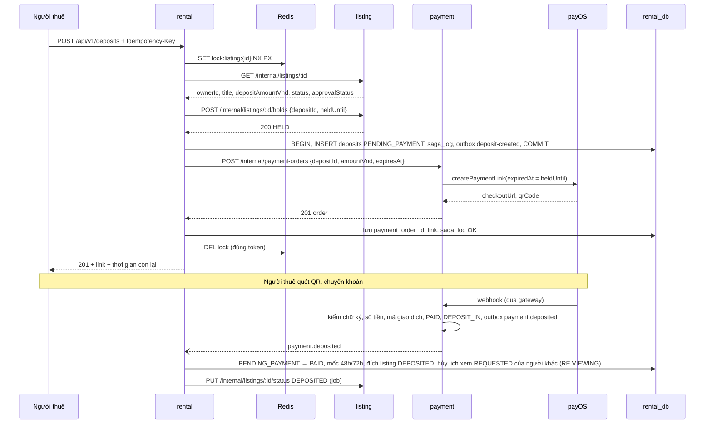
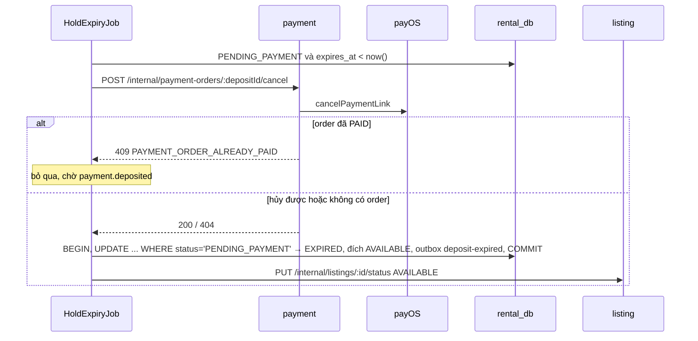

# RE.DEPOSIT_SAGA — Luồng xử lý

| | |
|---|---|
| **Chức năng** | Đặt cọc thành công, bù trừ, hết hạn giữ chỗ, đối soát, bảng xử lý từng điểm lỗi |
| **Tham chiếu** | `API_Spec.md`, `Component_Class_Design.md`, ADR-0004, Báo cáo v2 Hình 3.9–3.11, Bảng 4.9 |
| **Chủ sở hữu / Cập nhật / Phiên bản** | hoang.lv — 2026-11-22 — v1.3 |

## 1. Luồng thành công

**Vì sao giữ chỗ trước khi tạo đơn?** Theo Báo cáo §3.2.1. Nếu giữ chỗ không rõ kết quả, chưa có đơn nào để dọn; điều kiện `held_until < now()` ở listing tự giải phóng chỗ (`RE.LISTING/API_Spec.md §2.1`).

**Vì sao tạo đơn trước khi gọi payment?** Nếu rental chết sau khi payment đã tạo link, đơn `PENDING_PAYMENT` trong DB là manh mối cho `HoldExpiryJob` hủy link và nhả chỗ.

**Không transaction nào giữ trong lúc gọi HTTP.** Webhook không phải đi qua rental: `returnUrl` của payOS chỉ để hiển thị.

## 2. Hai người đặt cọc cùng lúc

Ba lớp chặn (Báo cáo §3.2.1, Bảng 4.9):

| Lớp | Cơ chế | Người thua nhận |
|---|---|---|
| 1 | Khóa Redis `lock:listing:{id}` (chặn bấm lặp) | `409 RENTAL_DEPOSIT_IN_PROGRESS` |
| 2 | `UPDATE listings ... WHERE status='AVAILABLE'` ở listing (khóa thật) | `409 LISTING_NOT_AVAILABLE` |
| 3 | Unique index `ux_deposits_active_listing` ở rental | Lỗi DB → bù trừ, `409` |

## 3. Bảng xử lý theo từng điểm lỗi

| Bước | Lỗi | Kết luận | Saga làm gì | Client nhận | Đơn |
|---|---|---|---|---|---|
| Khóa Redis | Không lấy được | | Không làm gì | `409` | Không có |
| Khóa Redis | Redis dừng | | Không làm gì | `503 DEPENDENCY_UNAVAILABLE` | Không có |
| Đọc bản chụp | `404`/`409`/`503`/`504` | | Không làm gì | Như lỗi | Không có |
| Giữ chỗ | `409` | Nghiệp vụ | Không làm gì | `409` | Không có |
| Giữ chỗ | Từ chối kết nối | Chưa thực hiện | Không làm gì | `503` | Không có |
| Giữ chỗ | Timeout, `5xx` | Chưa biết | Không làm gì; `held_until` tự hết | `504`/`503` | Không có; BĐS có thể `HELD` ≤ 10 phút |
| Ghi đơn | DB lỗi | | Gọi `PUT status AVAILABLE` (best-effort) | `500` | Không có |
| Tạo order | `4xx` | Nghiệp vụ | `cancelAfterHold` | `4xx` | `CANCELLED` |
| Tạo order | Từ chối kết nối | Chưa thực hiện | `cancelAfterHold` | `503` | `CANCELLED` |
| Tạo order | Timeout, `5xx` | Chưa biết | `saga_log UNKNOWN`; job (a) đối soát | `504` | `PENDING_PAYMENT` |
| Nhả chỗ (bù trừ) | listing lỗi (`503`/`504`/kết nối) | | `listing_target_status` giữ, job (b) đẩy lại | Như lỗi gốc | `CANCELLED` |
| Nhả chỗ (bù trừ) | listing 4xx (`409 LISTING_INVALID_STATUS`, `404`, `400`) | Kết cục cuối (C20, chốt 2026-11-22) | Không retry, đánh dấu đã đồng bộ, `saga_log SYNC_LISTING BUSINESS_ERROR` kèm `details`, log `warn` | Như lỗi gốc | `CANCELLED` |
| Rental chết giữa saga | | | Khởi động lại: job (a) hoặc `HoldExpiryJob` xử lý | Mất kết nối | Kết quả cuối |
| Hết 10 phút | | | Hủy link → `EXPIRED` → nhả chỗ | — | `EXPIRED` |
| Hết 10 phút, payment báo đã `PAID` | | Đua với webhook | Bỏ qua, chờ `payment.deposited` | — | `PAID` |
| Webhook sau khi đã `EXPIRED` | | Tiền đến muộn | Payment xử lý (BR-10); rental không đổi | — | `EXPIRED` |
| RabbitMQ dừng sau khi payment commit | | | Outbox payment gửi bù | — | `PAID` muộn |

## 4. Hết hạn giữ chỗ (BR-09)

Link bị hủy **trước** khi nhả chỗ, nên người thuê không trả được vào link cũ sau khi chỗ đã cho người khác.

## 5. Bất biến

| Bất biến | Cách kiểm tra |
|---|---|
| Mỗi BĐS tối đa một đơn hoạt động | `select listing_id, count(*) from deposits where status in ('PENDING_PAYMENT','PAID','REFUND_REQUESTED') group by 1 having count(*) > 1` = 0 |
| Không có đơn `PENDING_PAYMENT` quá `expires_at` + 2 chu kỳ job | Truy vấn sau thí nghiệm |
| Đơn `EXPIRED`/`CANCELLED` thì BĐS không còn `HELD` theo đơn đó | Đối chiếu `listings.held_by_deposit_id` |
| Không có `listing_target_status` chưa đồng bộ quá vài chu kỳ | `ix_deposits_listing_sync` rỗng |

## 6. Số truy vấn

`POST /deposits` so với ngưỡng ghi 6 của `non-functional-standards.md`: insert đơn + `saga_log` + outbox (3) và cập nhật order + `saga_log` (2), cộng đọc lại khi idempotent. Tổng 5–6, trong ngưỡng. **Nhánh bù trừ** (tạo order `BUSINESS_ERROR`/`NOT_EXECUTED`): 3 + bù trừ (`UPDATE` đơn, `saga_log`, outbox) 3 + đánh dấu đã đẩy `AVAILABLE` 1 = **7**, A chấp nhận 2026-11-22. `SagaReconcileJob` mỗi lượt: 2 `SELECT` (≤ 50 đơn mỗi phần); mỗi đơn (a) gắn order 2, (b) đẩy thành công 1, C20 2. Lời gọi liên service: 3 (snapshot, hold, create order), hằng số.
