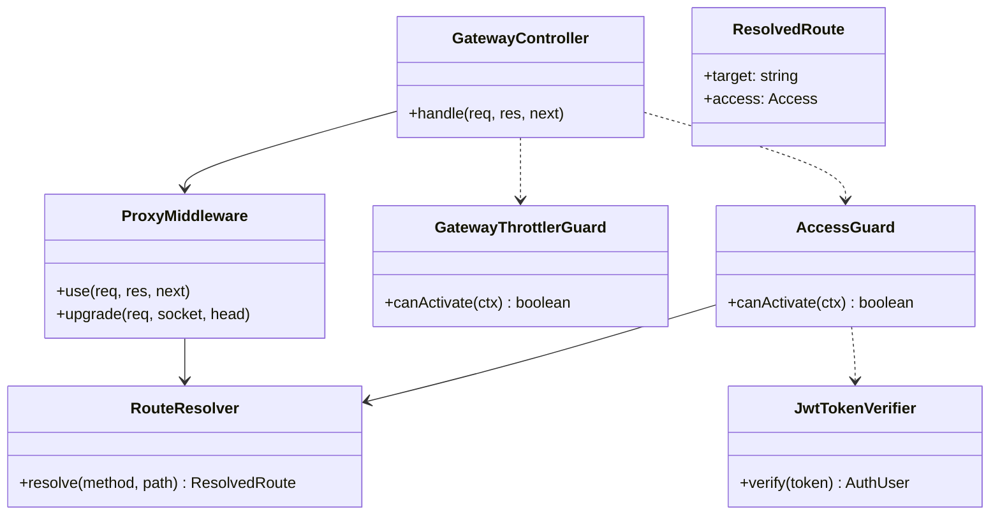

# RE.GATEWAY — Thiết kế thành phần

| | |
|---|---|
| **Service** | `services/api-gateway/` |
| **Quy ước** | `standards/coding-convention.md`, `standards/security-policy.md` |
| **Chủ sở hữu / Cập nhật / Phiên bản** | hoang.lv — 2026-11-26 — v1.4 (đề xuất, chờ A duyệt: C25) |

## 1. Cấu trúc

Copy từ `_template-nest`, giữ nguyên `database/`, `messaging/`, `redis/`, `storage/` và test của chúng (ADR-0014, không sửa riêng bản chép). Không đặt `DATABASE_URL`, `REDIS_URL`, `RABBITMQ_URL`, `S3_ENDPOINT` nên các module này không bật.

```text
services/api-gateway/src/
├─ main.ts, app.module.ts, app.setup.ts
├─ common/ config/ health/            # giữ từ template
└─ gateway/
   ├─ gateway.module.ts
   ├─ gateway.controller.ts          # catch-all @All, @Public, @RawResponse: chạy guard rồi gọi ProxyMiddleware
   ├─ routes.ts                      # bảng định tuyến API_Spec.md §3 (dữ liệu, không logic)
   ├─ route-resolver.ts              # khớp method + đường dẫn → { target, access }
   ├─ access.guard.ts                # resolve route, kiểm JWT theo access; public/payos bỏ qua
   ├─ gateway-throttler.guard.ts     # rate limit sau AccessGuard: có user → theo sub, không có → theo IP
   ├─ internal-block.middleware.ts   # /internal/* → 404
   ├─ throttle.config.ts             # @nestjs/throttler, bộ đếm trong bộ nhớ
   ├─ proxy.middleware.ts            # http-proxy-middleware: chuyển tiếp, timeout, ws, đổi lỗi kết nối thành 503/504
   ├─ route-not-found.filter.ts      # NotFoundException của Nest (ngoài /api/v1) → 404 GATEWAY_ROUTE_NOT_FOUND
   └─ errors/gateway.errors.ts       # GATEWAY_ROUTE_NOT_FOUND
```

## 2. Sơ đồ lớp



`JwtTokenVerifier` nằm trong template (`common/auth/`, `RE.SERVICE_TEMPLATE` v1.2), dùng chung với `JwtAuthGuard`; gateway không viết bản kiểm token riêng.

## 3. Thứ tự xử lý

Middleware Express luôn chạy **trước** guard của Nest, nên chuỗi chia hai phần: middleware gắn bằng `app.use` (§3.1) và `GatewayController` (§3.2). Proxy không gắn bằng `app.use` vì cần chạy sau `AccessGuard`.

### 3.1 Middleware (`app.use`, `app.setup.ts`)

| # | Bước | Ghi chú |
|---|---|---|
| 1 | Correlation ID (template) | Sinh `X-Request-ID` nếu thiếu |
| 2 | Access log (template) | |
| 3 | `InternalBlockMiddleware` | `/internal/*` → `404 GATEWAY_ROUTE_NOT_FOUND`, không tới controller |
| 4 | CORS | `CORS_ORIGINS` |

### 3.2 `GatewayController`

Catch-all `@All`, gắn `@Public()` (để `JwtAuthGuard` toàn cục của template bỏ qua; kiểm token là việc của `AccessGuard`) và `@RawResponse()` (không bọc `{ data, meta }`). Route là `@All('{*path}')` dưới prefix toàn cục `/api/v1` của Nest (mọi route trong bảng §3 của `API_Spec.md` đều bắt đầu bằng `/api/v1/`; `/ws` là upgrade, `/health` là route riêng của `HealthController`; `GatewayModule` import sau `HealthModule`). Không gỡ prefix cho catch-all vì loại trừ `{*path}` khỏi prefix sẽ gỡ luôn prefix của mọi controller khác. Đường dẫn ngoài `/api/v1` không tới controller, Nest ném `NotFoundException`; `RouteNotFoundFilter` đổi thành `404 GATEWAY_ROUTE_NOT_FOUND`. Handler dùng `@Req()`, `@Res()` nên Nest không tự gửi response; việc gửi do `ProxyMiddleware`.

| # | Bước | Ghi chú |
|---|---|---|
| 5 | `AccessGuard` | Gọi `RouteResolver`, không khớp → `404 GATEWAY_ROUTE_NOT_FOUND`; lưu kết quả vào request cho bước 7. `public`/`payos` bỏ qua kiểm token; còn lại `JwtTokenVerifier` → `401`, so vai trò → `403`; gắn `request.user` |
| 6 | `GatewayThrottlerGuard` | Sau `AccessGuard` nên biết có người dùng hay không (xem dưới). Vượt → `429 TOO_MANY_REQUESTS` |
| 7 | `ProxyMiddleware` (gọi từ handler) | Body không bị parse (body parser tắt ở `main.ts`, `bodyParser: false`), webhook giữ nguyên chữ ký |

Lỗi từ bước 5, 6 là exception, đi qua `AllExceptionsFilter` của template nên đúng `{ error, meta }`. Lỗi ở bước 7 phát sinh bất đồng bộ trong callback của `http-proxy-middleware`, nằm ngoài pipeline Nest: `on.error` dựng `{ error, meta }` bằng `buildMeta` của template. Gateway **luôn cung cấp `on.error` riêng**: nếu không, plugin lỗi mặc định của thư viện ghi `host` và URL vào body (lộ địa chỉ nội bộ). Quá `GATEWAY_PROXY_TIMEOUT_MS` chờ đích → `504 UPSTREAM_TIMEOUT` (gateway tự cắt bằng `proxyReq.setTimeout` và đánh dấu request, vì `proxyTimeout` của thư viện chỉ cho `socket hang up` nên không phân biệt được với đích tắt → `503 UPSTREAM_UNAVAILABLE`). Gateway không retry.

**Khớp đường dẫn** (`RouteResolver`, quy tắc đầy đủ ở `API_Spec.md §3`): không phân biệt hoa thường ở phần chữ cố định (chỉ so, không đổi đường dẫn chuyển tiếp); đường dẫn lạ (đoạn rỗng, `.`, `..`, `%2e`/`%2f`/`%5c`, `\`) không bao giờ khớp → `404 GATEWAY_ROUTE_NOT_FOUND`; không giải mã đường dẫn.

**Rate limit (chốt 2026-11-16):** một throttler, đặt sau `AccessGuard`.

| Request | Bộ đếm (tracker) | Giới hạn trong `RATE_LIMIT_TTL_SECONDS` |
|---|---|---|
| Có `request.user` | `sub` | `RATE_LIMIT_USER` (300) |
| Không có người dùng (`public`, `payos`) | IP | `RATE_LIMIT_IP` (100) |

Không đếm IP cho request đã đăng nhập: SSR của Next.js và NAT gom nhiều người về một IP, đếm IP cho mọi request thì giới hạn theo `sub` vô nghĩa. Hệ quả chấp nhận: request mang token hợp lệ không bị giới hạn theo IP; token bị đánh cắp bị chặn ở mức `sub`. IP lấy từ `req.ip` với `trust proxy = false`: không tin `X-Forwarded-For` (chốt 2026-11-16, §6).

**WebSocket `/ws`:** sự kiện `upgrade` của HTTP server không đi qua pipeline Nest. `configureApp` (`app.setup.ts`, dùng chung `main.ts` và test) gắn `server.on('upgrade', …)` gọi `ProxyMiddleware.upgrade`; không qua `AccessGuard` và không tính rate limit. Notification kiểm access token trong handshake. Vì không có `AccessGuard`, `upgrade` **chỉ nhận `/ws`** (viết thường, `/ws` hoặc `/ws/…`): mọi đường dẫn khác (`/api/v1/admin/users`, `/internal/x`, `/wsx`…) bị trả `HTTP/1.1 404` rồi đóng socket, không tới service nào; nếu cho nâng cấp bất kỳ đường dẫn nào thì vòng qua được kiểm quyền mức tuyến. Đích tắt: đóng socket, gateway không sập.

## 4. Test bắt buộc

| # | Tình huống | Mong đợi |
|---|---|---|
| 1 | `GET /internal/listings/x` từ ngoài | `404`, không gọi service (Báo cáo T16) |
| 2 | Token sai chữ ký | `401 AUTH_TOKEN_INVALID` (Báo cáo T17) |
| 3 | Token hết hạn | `401 AUTH_TOKEN_EXPIRED` |
| 4 | `TENANT` gọi `/api/v1/admin/*` | `403 FORBIDDEN_ROLE` |
| 5 | Route `public` không token | Được chuyển tiếp |
| 6 | Webhook payOS không token | Được chuyển tiếp, body nguyên vẹn |
| 7 | Service đích tắt | `503 UPSTREAM_UNAVAILABLE` |
| 8 | Service đích chậm hơn timeout | `504 UPSTREAM_TIMEOUT` |
| 9 | `X-Request-ID` client gửi | Giống nhau ở log gateway và service đích |
| 10 | Vượt rate limit, hai nhánh | Ẩn danh (route `public`) vượt `RATE_LIMIT_IP` (100/60 giây) → `429`; có token vượt `RATE_LIMIT_USER` (300/60 giây) → `429`. Kèm: request có token không bị đếm theo IP; hai `sub` cùng IP không dùng chung bộ đếm; ẩn danh đổi `X-Forwarded-For` mỗi request vẫn bị `429` (không tin header, §6) |
| 11 | Lỗi `409` của service | Chuyển nguyên `{ error, meta }` |
| 12 | Nâng cấp WebSocket `/ws` | Chuyển tới notification, không qua `AccessGuard`, không tính rate limit |

## 5. Đã chốt

Thư viện proxy, body thô, rate limit, WebSocket: `API_Spec.md §6` (2026-11-16). Cách đặt proxy sau guard (§3) và cách đếm rate limit (§3.2), `trust proxy` (§6): chốt 2026-11-16, v1.2.

## 6. Đã chốt 2026-11-16: `trust proxy`

IP của request không có người dùng lấy từ `req.ip` với `app.set('trust proxy', false)` (`app.setup.ts`): **không tin** `X-Forwarded-For`, không thêm biến môi trường.

| Phương án | Hệ quả |
|---|---|
| Tin `X-Forwarded-For` | Client tự đặt header được khi gateway lộ trực tiếp, né giới hạn bằng cách đổi IP giả mỗi request. Loại |
| **Không tin (chốt)** | Không giả mạo được. Đổi lại: request qua đường hầm ngrok/cloudflared (webhook payOS, demo) cùng một IP nên dùng chung bộ đếm 100/60 giây; trong Docker, request từ host mang IP của bridge nên cũng dùng chung. Chấp nhận ở phạm vi đồ án (T1.3 ghi nhận) |

Test 10 kiểm cả việc đổi `X-Forwarded-For` không né được giới hạn IP.
