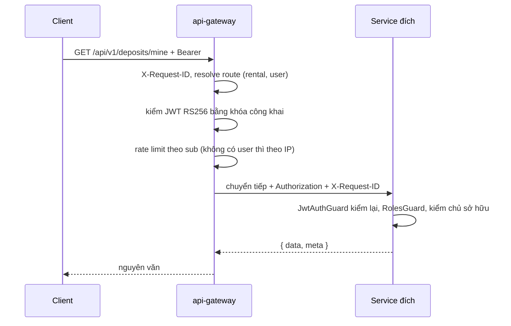
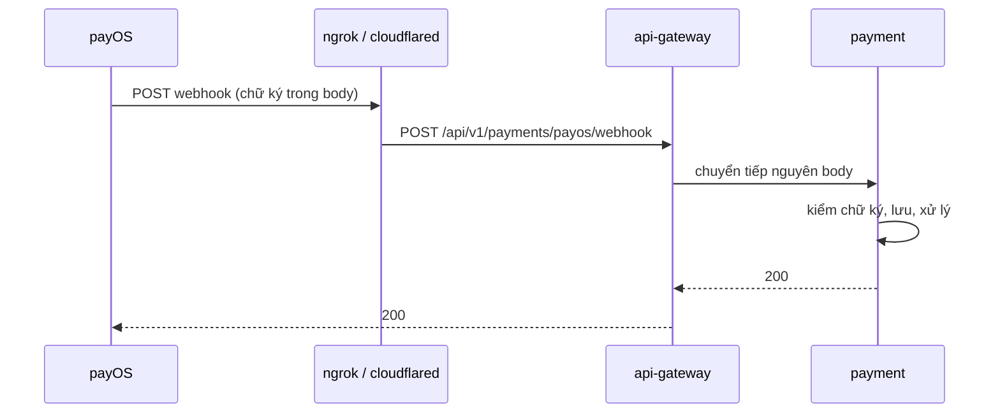

# RE.GATEWAY — Luồng xử lý

| | |
|---|---|
| **Chức năng** | Request thường, token sai, `/internal`, webhook, service đích lỗi |
| **Tham chiếu** | `API_Spec.md`, `Component_Class_Design.md`, ADR-0003 |
| **Chủ sở hữu / Cập nhật / Phiên bản** | hoang.lv — 2026-11-26 — v1.4 (đề xuất, chờ A duyệt: C25) |

## 1. Request thường

Identity dừng không ảnh hưởng bước kiểm token: chỉ cần khóa công khai.

## 2. Token sai hoặc thiếu vai trò

Gateway trả `401`/`403` ngay, không gọi service. Client dùng `POST /api/v1/auth/refresh` để lấy token mới; gateway **không** refresh hộ.

## 3. Webhook payOS

## 4. Service đích lỗi

| Điều xảy ra | Client nhận |
|---|---|
| Từ chối kết nối | `503 UPSTREAM_UNAVAILABLE` |
| Quá `GATEWAY_PROXY_TIMEOUT_MS` | `504 UPSTREAM_TIMEOUT` |
| Service trả `4xx`/`5xx` | Nguyên văn |

Không retry ở gateway. Timeout gateway phải lớn hơn ngân sách 8 giây của luồng đặt cọc (NFR07), để client không nhận `504` khi saga còn chạy.
