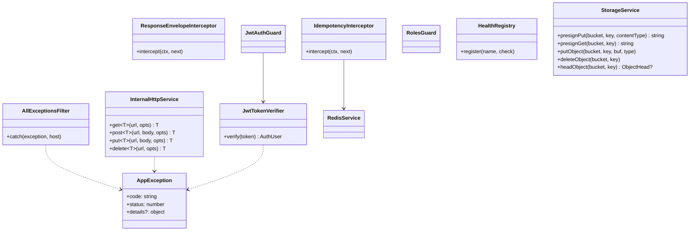

# RE.SERVICE_TEMPLATE — Thiết kế thành phần

| | |
|---|---|
| **Service** | `services/_template-nest/src/` |
| **Quy ước** | `standards/coding-convention.md`, `standards/reliability-standard.md` |
| **Chủ sở hữu / Cập nhật / Phiên bản** | hoang.lv — 2026-11-26 — v2.2 |

## 1. Cấu trúc

```text
src/
├─ main.ts                    # nạp env, logger, Swagger, shutdown hooks
├─ app.module.ts              # ghép module; DB/Redis/RabbitMQ/S3 chỉ bật khi có env
├─ app.setup.ts               # prefix /api/v1, middleware gắn bằng app.use (dùng chung main và test)
├─ swagger.setup.ts
├─ config/                    # env.bootstrap.ts, env.validation.ts (Joi), feature-flags.ts, service-info.ts
├─ common/
│  ├─ errors/                 # AppException, error-codes.ts, AllExceptionsFilter, createValidationPipe, createUuidParamPipe
│  ├─ logging/                # logger.module (pino), correlation-id.middleware, access-log.middleware
│  ├─ auth/                   # JwtAuthGuard, JwtTokenVerifier, RolesGuard, @Public, @Roles, @CurrentUser, jwt.config
│  ├─ idempotency/            # @Idempotent, IdempotencyInterceptor, request-fingerprint
│  ├─ http/                   # InternalHttpService, InternalHttpModule
│  ├─ response/               # ResponseEnvelopeInterceptor, @RawResponse, @ApiEnvelope, Paginated, PageQueryDto
│  └─ lifecycle/              # ShutdownLoggerService
├─ health/                    # HealthController, HealthRegistry
├─ database/                  # DatabaseModule, data-source.ts, transformers.ts, migrations/
├─ redis/                     # RedisModule, RedisService
├─ messaging/                 # xem RE.MESSAGING
├─ storage/                   # StorageService (S3: health check, presign PUT/GET, put/head/delete; bucket tạo sẵn)
├─ example/                   # MẪU — xóa khi tạo service thật
└─ scripts/export-openapi.ts
test/                         # *.e2e-spec.ts, *.infra-spec.ts, helpers/ (createTestApp, upstream giả, contracts: expectEventMatchesContract, expectResponseMatchesOpenApi)
```

## 2. Sơ đồ lớp



## 3. Tạo service mới

Làm theo `services/_template-nest/README.md §1` (PowerShell, robocopy). Việc bắt buộc sau khi copy:

| # | Việc |
|---|---|
| 1 | Đổi `name` trong `package.json` thành `@realestate/<service>`, `SERVICE_NAME`, `PORT` trong `.env.example`, đường dẫn trong `Dockerfile` |
| 2 | Xóa `src/example/`, `ExampleModule` trong `app.module.ts`, `test/example.e2e-spec.ts`, entity và migration mẫu |
| 3 | Giữ mọi `test/*.e2e-spec.ts` và `src/**/*.spec.ts` khác |
| 4 | Bật `DATABASE_URL` với user/DB riêng (`architecture.md §8`) |
| 5 | Viết module nghiệp vụ `src/<miền>/` theo `coding-convention.md §2` |
| 6 | Thêm service vào `infra/compose/docker-compose.yml` (profile `apps`) |
| 7 | Viết hợp đồng nội bộ vào `contracts/openapi/` trước khi code |

## 4. Quy tắc mở rộng template

- Sửa phần dùng chung → sửa ở `_template-nest` trước, rồi chép sang các service (không có package dùng chung, ADR-0014). PR do A duyệt.
- Không thêm entity, mã lỗi nghiệp vụ, client tới service cụ thể vào template.
- `JwtTokenVerifier` (v1.2): kiểm chữ ký, hạn, `iss` và claims (`sub`, `roles`, `exp`) của access token, ném `AppException` `AUTH_TOKEN_INVALID`/`AUTH_TOKEN_EXPIRED`. `JwtAuthGuard` gọi lại, hành vi giữ nguyên. Gateway dùng chung để không có bản kiểm token thứ hai (`RE.GATEWAY`).

`PageQueryDto` (`common/response/page-query.dto.ts`, v1.3): query phân trang chung cho API danh sách, `page` ≥ 1 mặc định 1, `pageSize` 1–50 mặc định 20 (`non-functional-standards.md §1`), getter `skip`. DTO riêng của từng API kế thừa và thêm bộ lọc; handler trả `new Paginated(items, query.page, query.pageSize, total)`. Chỉ chứa phân trang, không có bộ lọc hay luật nghiệp vụ.

`StorageService.headObject(bucket, key)` (v2.1): `HeadObject`, trả `{ contentLength, contentType }`, hoặc `null` khi không có object (S3 `NotFound`/`NoSuchKey`, HTTP 404); lỗi khác ném lại. Dùng để kiểm kích thước và loại file sau khi client tải lên bằng presigned PUT (presigned PUT không giới hạn được kích thước).

`StorageService` không tạo bucket (v2.2, ADR-0016): bucket trong `S3_BUCKETS` phải có sẵn trên kho (tạo tay trên dashboard R2); service khởi động không gửi lệnh S3 nào. `S3_BUCKETS` chỉ dùng cho health check `s3` (`HeadBucket` bucket đầu, rỗng thì `ListBuckets`) và để service kiểm biến bắt buộc. Token chỉ cần quyền đọc/ghi object, không cần quyền tạo bucket.

`createUuidParamPipe(field = 'id')` (`common/errors/uuid-param.pipe.ts`, v1.3, phạm vi v2.0): pipe kiểm tham số đường dẫn là UUID, lỗi trả `400 VALIDATION_FAILED`, message "<field> phải là UUID", `details: [{ field, errors }]`, đúng hợp đồng `contracts/openapi/*-internal.v1.yaml`. Dùng cho **mọi** tham số đường dẫn kiểu UUID, công khai và nội bộ (C19, 2026-11-19). Không dùng `new ParseUUIDPipe()` trần (trả `BAD_REQUEST`); luật ESLint `no-restricted-imports` ở `eslint.config.mjs` gốc chặn import `ParseUUIDPipe` trong `services/*/src` (bắt cả `new ParseUUIDPipe()` lẫn truyền class), trừ chính `uuid-param.pipe.ts`.

`expectResponseMatchesOpenApi(spec, method, path, status, body)` (`test/helpers/contracts.ts`, v1.3): kiểm body response thật khớp schema của một response trong `contracts/openapi/<spec>` (bắt trường thừa khi `additionalProperties: false`, thiếu trường, sai format). Dùng gói `yaml` (devDependency). Chỉ dùng trong test.

## 5. Test bắt buộc

Đã có trong template, mọi service giữ nguyên và phải xanh:

| File | Kiểm tra |
|---|---|
| `test/errors.e2e-spec.ts` | Envelope lỗi, ẩn stack ở 5xx |
| `test/response-envelope.e2e-spec.ts` | `{ data, meta }`, phân trang, không bọc `/health` |
| `src/common/errors/uuid-param.pipe.spec.ts` | `createUuidParamPipe`: UUID hợp lệ trả nguyên; sai → `400 VALIDATION_FAILED`, message "<tên> phải là UUID" |
| `test/example.e2e-spec.ts` | Route mẫu công khai và nội bộ: `id` sai → `400 VALIDATION_FAILED`, message "id phải là UUID", `details` (v2.0) |
| `test/contracts-helper.e2e-spec.ts` | `expectResponseMatchesOpenApi`: khớp, thừa trường, thiếu trường, sai format, `$ref` response, status/đường dẫn/spec không có |
| `src/common/response/page-query.dto.spec.ts` | `PageQueryDto`: mặc định `page=1`, `pageSize=20`; ép kiểu query; từ chối `page < 1`, `pageSize` ngoài 1–50; `skip` |
| `test/idempotency.e2e-spec.ts` | Replay, `422`, `409` |
| `test/http-client.e2e-spec.ts`, `http-client-defaults.e2e-spec.ts` | Retry, timeout, giữ nguyên `4xx`, truyền `X-Request-ID` |
| `test/logging.e2e-spec.ts` | Log JSON có `correlationId` |
| `test/health.e2e-spec.ts` | `200`/`503` theo phụ thuộc |
| `test/auth.e2e-spec.ts` | Guard JWT, vai trò (chạy qua `JwtTokenVerifier`, kết quả không đổi) |
| `test/messaging.infra-spec.ts` | Outbox, inbox, DLQ với RabbitMQ thật |
| `src/storage/storage.service.spec.ts` | `headObject`: có object → `{ contentLength, contentType }`; `NotFound`/`NoSuchKey` → `null`; lỗi khác ném lại (v2.1). Khởi động app có `S3_BUCKETS` không gửi lệnh S3 nào (v2.2) |
| `test/storage.infra-spec.ts` | Health `s3`, presign PUT/GET, `headObject` với S3 thật, bucket có sẵn `S3_TEST_BUCKET`, chỉ xóa key của lượt chạy. `.env` gốc thiếu `S3_ENDPOINT`, `S3_ACCESS_KEY`, `S3_SECRET_KEY` hoặc `S3_TEST_BUCKET` → bỏ qua cả file (v2.2) |
