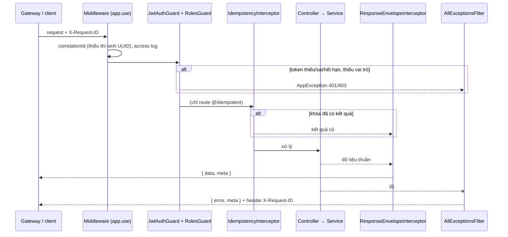
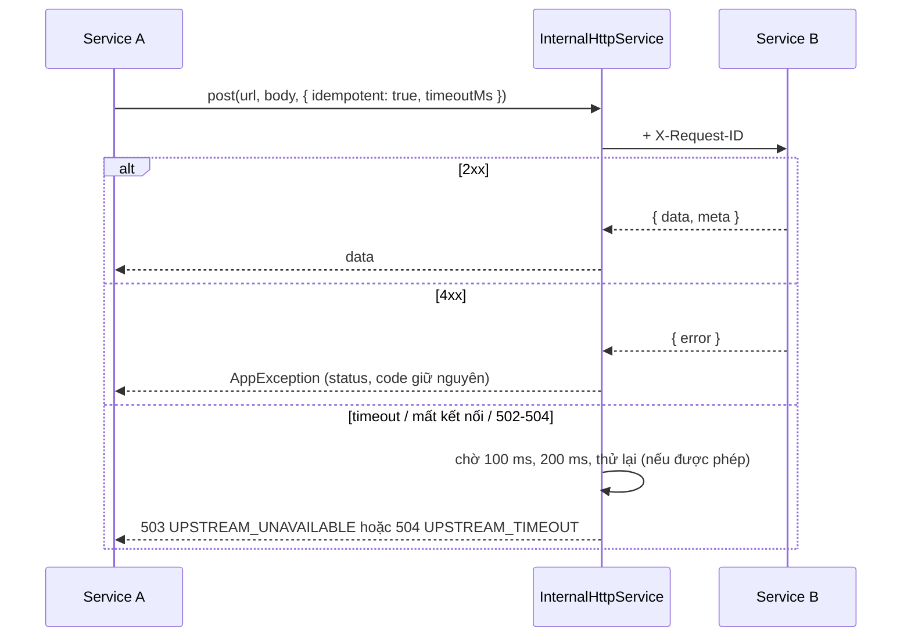

# RE.SERVICE_TEMPLATE — Luồng xử lý

| | |
|---|---|
| **Chức năng** | Vòng đời request, gọi service khác, idempotency, lỗi về client |
| **Tham chiếu** | `API_Spec.md`, `Component_Class_Design.md`, `standards/reliability-standard.md` |
| **Chủ sở hữu / Cập nhật / Phiên bản** | hoang.lv — 2026-11-26 — v2.2 |

## 1. Vòng đời một request

## 2. Gọi service khác

Không gọi khi đang giữ transaction (`coding-convention.md §4`).

## 3. Idempotency-Key

| Trạng thái khóa trong Redis | Hành vi |
|---|---|
| Chưa có | Ghi `IN_PROGRESS` (NX), chạy handler, lưu kết quả thuần + fingerprint body, TTL `IDEMPOTENCY_TTL_SECONDS` |
| `IN_PROGRESS` | `409 IDEMPOTENCY_IN_PROGRESS` |
| Có kết quả, cùng fingerprint | Trả lại kết quả, bọc `meta` của request mới |
| Có kết quả, khác fingerprint | `422 IDEMPOTENCY_KEY_REUSED` |
| Handler lỗi (cả `4xx` và `5xx`) | Xóa khóa; gửi lại cùng khóa sẽ chạy lại handler (`idempotency.interceptor.ts`, đã kiểm 2026-11-16) |

## 4. Khởi động và tắt

1. `env.bootstrap.ts` nạp `.env`; `env.validation.ts` kiểm, thiếu biến → in danh sách, thoát mã 1.
2. Module tùy chọn bật theo env có mặt.
3. `StorageModule` không gọi S3 lúc khởi động; bucket trong `S3_BUCKETS` tạo sẵn (v2.2, ADR-0016). Kết nối kiểm qua health `s3`.
4. SIGTERM → `ShutdownLoggerService` ghi trình tự; đóng kết nối gọn.

## 5. Đã chốt

Xóa khóa idempotency với mọi lỗi của handler (§3), theo code template.
