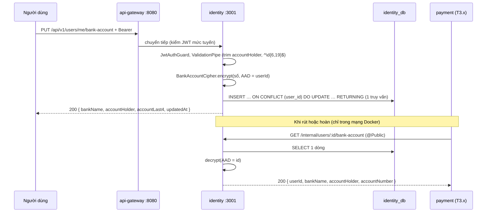

# Giải thích code — identity

> Viết khi task có code đã PASS test và lệnh kiểm chứng, trước `code-review` và commit (`CLAUDE.md` gốc §8).
> Đọc khi: cần hiểu code của identity để sửa tiếp (OTP, quên mật khẩu, Google, khóa tài khoản, hồ sơ, tài khoản nhận tiền), review, hoặc chuẩn bị vấn đáp.

| | |
|---|---|
| **Chủ sở hữu / Cập nhật** | hoang.lv — 2026-11-28 |
| **Thành phần** | `services/identity/` (cổng 3001); phần chép từ `services/_template-nest/` ghi rõ ở §3 |
| **Task** | `T2.1`, phần `seed:users` của `T2.4`, và `T2.5` (xác minh OTP, quên mật khẩu, Google, khóa tài khoản, số điện thoại; `implementation/PHASE-2.md`); phần đã có từ trước (đăng ký, đăng nhập, làm mới, `/me`, seed ADMIN) giải thích ở §1, §3 để đủ bức tranh; `T1.5` gỡ Mailpit (`implementation/PHASE-1.md`) |
| **Thiết kế** | `design/IDENTITY/RE.IDENTITY/` (v2.5), `design/SHARED/RE.SERVICE_TEMPLATE/` (v2.0), `design/PAYMENT/RE.PAYOUT/` (v1.2, chỉ một `[cần xác nhận]`) |
| **Commit / PR** | T2.1: PR #16, merge `b88817a` (2026-11-19). C19: nhánh `fix/C19-uuid-validation-failed`. T2.5: nhánh `feature/T2.5-identity-otp-account` (chưa commit lúc viết, A xem diff trước). T1.5: nhánh `feature/T1.5-remove-mailpit` |

## 1. Luồng chung

Identity giữ tài khoản, phiên và tài khoản nhận tiền. Client gọi qua gateway (8080): `auth/*` công khai, `users/me`, `users/me/bank-account` cần JWT, `admin/users` cần `ADMIN` (gateway chặn thô, `RolesGuard` ở identity kiểm lại). Payment lấy tài khoản nhận tiền qua API nội bộ `/internal/users/:id/bank-account`, chỉ gọi được trong mạng Docker (gateway trả 404 cho `/internal/*`).

**T2.5** thêm vòng đời tài khoản: đăng ký sinh tài khoản `PENDING_VERIFICATION` và gửi **OTP 6 số** qua email (SMTP thật, dev dùng Gmail App Password; Mailpit gỡ ở T1.5); nhập đúng OTP (`verify-otp`) thì `ACTIVE` và cấp phiên luôn; đăng nhập kiểm trạng thái **sau** mật khẩu. Thêm quên và đặt lại mật khẩu (token ngẫu nhiên gửi qua email), đăng nhập Google (kiểm ID token, tự liên kết theo email), khóa và mở khóa tài khoản (thu hồi mọi phiên), `PATCH /users/me`. Mọi email **gửi nền, không chờ**: kết quả `201`/`202` không phụ thuộc SMTP và độ trễ không lộ email nào có tài khoản.

T2.1 thêm ba nhóm: (1) tài khoản nhận tiền, số tài khoản **mã hóa AES-256-GCM** khi lưu và chỉ trả đầy đủ cho payment; (2) danh sách người dùng cho quản trị viên; (3) `revokeAllForUser` trong store refresh token (T2.5 dùng khi khóa tài khoản, đặt lại mật khẩu).



Luồng đăng ký và xác minh OTP (T2.5, `Processing_Flow §3a`):

```mermaid
sequenceDiagram
    participant C as Client
    participant I as identity
    participant R as Redis
    participant DB as identity_db
    participant M as SMTP
    C->>I: POST /auth/register
    I->>R: assertReady (PING, 503 nếu Redis dừng) — TRƯỚC khi ghi DB
    I->>DB: BEGIN, INSERT users (PENDING_VERIFICATION) + outbox, COMMIT (2 truy vấn)
    I-->>C: 201 (không chờ phần dưới)
    I--)R: EmailVerificationService.issue: otp:<userId> {sha256(userId:otp), attempts 0} TTL 300, cooldown 60
    I--)M: MailService.sendOtp (nền, lỗi chỉ log warn)
    C->>I: POST /auth/verify-otp {email, otp}
    I->>DB: SELECT user (PENDING_VERIFICATION)
    I->>R: Lua: HINCRBY attempts TRƯỚC khi so; quá số lần thì DEL
    I->>I: timingSafeEqual(hash)
    I->>R: DEL otp
    I->>DB: UPDATE users SET status='ACTIVE' WHERE id AND status='PENDING_VERIFICATION'
    I->>R: issueSession (họ refresh token)
    I-->>C: 200 cặp token
```

## 2. Cây thư mục

```text
services/identity/
├─ src/
│  ├─ main.ts, app.module.ts, app.setup.ts, swagger.setup.ts
│  ├─ config/                  # env.bootstrap, env.validation, feature-flags, service-info, config.module
│  ├─ common/                  # CHÉP từ _template-nest: auth/ errors/ http/ idempotency/ logging/ response/ lifecycle/
│  │  ├─ errors/uuid-param.pipe.ts (+ spec)        # T2.1, thêm ở template rồi chép
│  │  └─ response/page-query.dto.ts (+ spec)       # T2.1, thêm ở template rồi chép
│  ├─ database/                # data-source, database.module/health, transformers, migrations/ (5 file)
│  ├─ messaging/ redis/ storage/ health/           # CHÉP từ template (storage không bật)
│  ├─ identity/                # PHẦN RIÊNG CỦA IDENTITY
│  │  ├─ identity.module.ts
│  │  ├─ config/identity.env.ts (+ spec)
│  │  ├─ controllers/          # auth, profile, bank-account, users.admin, users.internal
│  │  ├─ services/             # auth, password, token, bank-account (+ cipher), user-admin, mail, email-verification,
│  │  │                        # password-reset, google-auth, google-id-token.verifier, profile, user-email.query, unique-violation (+ spec)
│  │  ├─ stores/               # refresh-token.store + redis-…, otp.store + redis-otp.store
│  │  ├─ entities/             # user, user-identity, bank-account
│  │  ├─ dto/                  # register, login, refresh, auth-tokens, user, verify-otp, email-only, reset-password,
│  │  │                        # google-login, update-profile, lock-user, bank-account, upsert-bank-account, list-users.query
│  │  ├─ errors/identity.errors.ts
│  │  └─ seed/                 # seed-admin.ts, seed-users.ts, seed-users.data.ts (+ spec)
│  └─ scripts/                 # seed-admin.ts, seed-users.ts, export-openapi.ts
├─ test/                       # e2e (chép từ template), *.infra-spec.ts (Postgres, Redis, RabbitMQ thật; email bắt trong bộ nhớ), helpers/ (identity-infra, mail-capture)
├─ scripts/ensure-env.mjs
├─ Dockerfile, Dockerfile.dockerignore, nest-cli.json, tsconfig*.json, package.json
└─ .env.example, README.md
```

## 3. Chức năng từng file

### 3.1 Phần riêng của identity (`src/identity/`)

| File | Làm gì | Gọi tới / được gọi bởi | Ghi chú |
|---|---|---|---|
| `identity.module.ts` | Khai báo entity, controller, provider; tạo bằng factory từ config: `RedisRefreshTokenStore`, `RedisOtpStore`, `BankAccountCipher`, transport nodemailer (timeout 5 giây) + `MailService`, bộ kiểm ID token Google, cấu hình OTP, đặt lại mật khẩu | `app.module.ts` (chỉ nạp khi `isIdentityEnabled()`) | Cipher đọc `BANK_ACCOUNT_ENCRYPTION_KEY` qua `parseEncryptionKey`; thiếu khóa thì lỗi ngay lúc dựng module |
| `config/identity.env.ts` | Biến bắt buộc riêng của identity (DB, Redis, RabbitMQ, JWT, **khóa mã hóa**, `SMTP_HOST`, `MAIL_FROM`; `GOOGLE_CLIENT_ID` không bắt buộc) | `config/env.bootstrap.ts` lúc khởi động | Khóa kiểm bằng `parseEncryptionKey`, lỗi không in giá trị khóa, in lệnh sinh khóa |
| `controllers/auth.controller.ts` | `register`, `login`, `refresh`, `logout`, `me`; T2.5: `verify-otp` (200), `resend-otp` (202), `forgot-password` (202), `reset-password` (204), `google` (200) | `AuthService`, `PasswordResetService`, `GoogleAuthService` | Route công khai gắn `@Public()` |
| `controllers/profile.controller.ts` | Route 15: `PATCH /users/me` | `ProfileService` | Không `@Public()`; người gọi là `@CurrentUser('sub')` |
| `controllers/bank-account.controller.ts` | Route 6, 7: `GET`, `PUT /users/me/bank-account` | `BankAccountService` | Không `@Public()`; người gọi là `@CurrentUser('sub')`, không nhận `userId` |
| `controllers/users.admin.controller.ts` | Route 8: `GET /admin/users`; route 16: `POST :id/lock`, `POST :id/unlock` | `UserAdminService` | `@Roles('ADMIN')`; `:id` qua `createUuidParamPipe` |
| `controllers/users.internal.controller.ts` | `GET /internal/users/:id/bank-account` | `BankAccountService.getForPayout` | `@Public()` (tin mạng Docker), `@ApiExcludeController`, `:id` qua `createUuidParamPipe` |
| `services/auth.service.ts` | Đăng ký (kiểm Redis trước, transaction user `PENDING_VERIFICATION` + outbox, rồi sinh OTP nền), đăng nhập (kiểm trạng thái sau mật khẩu), `verifyOtp` = `verify` + `issueSession`, `resendOtp`, `refresh`, `logout`, `me` | Store, `TokenService`, `PasswordService`, `OutboxService`, `EmailVerificationService` | Trùng email/phone phân biệt theo **tên ràng buộc** của lỗi 23505 |
| `services/mail.service.ts` | `sendOtp`, `sendPasswordReset`: trả về ngay, gửi nền, mọi lỗi (kể cả ném đồng bộ) chỉ thành một dòng log `warn` | `EmailVerificationService`, `PasswordResetService` | Log chỉ có tên mẫu, `errName`, `errCode`, `responseCode`; **không** OTP, link, địa chỉ nhận, thông điệp lỗi gốc |
| `services/email-verification.service.ts` | `issue` (OTP `randomInt`, lưu băm), `verify` (so `timingSafeEqual`, `UPDATE` có điều kiện trạng thái), `resend` (cooldown), `ensureAvailable` | `AuthService` | Mọi lý do `verify` thất bại cùng `IDENTITY_OTP_INVALID` |
| `services/password-reset.service.ts` | `request` (luôn xong êm; token 32 byte base64url, Redis chỉ giữ `sha256`), `reset` (`GETDEL`, đổi mật khẩu, `revokeAllForUser`) | `AuthController` | Băm mật khẩu **sau** khi token hợp lệ |
| `services/google-auth.service.ts` | Dòng 0–8 của `API_Spec §1.8`: tìm theo liên kết, theo email, hoặc tạo mới; cấp phiên | `AuthController` | Thua cuộc đua (23505) thì chạy lại một lần; lần chạy lại vẫn trùng `UQ_user_identities_user_provider` (tài khoản đã liên kết `sub` khác) → 401 (dòng 4a, v2.4); `GOOGLE_CLIENT_ID` trống → 503 trước khi kiểm token, log `warn` lúc khởi động |
| `services/google-id-token.verifier.ts` | Bọc `google-auth-library` `verifyIdToken`; token sai → 401, không tải được khóa Google → 503 | `GoogleAuthService` | Token DI để test thay bản giả; không chép lỗi gốc (chứa token) |
| `services/profile.service.ts` | `PATCH /users/me`: chỉ ghi trường có mặt, `phone: null` xóa số, trùng số → 409 | `ProfileController` | Body rỗng → `400 VALIDATION_FAILED`; `fullName: null` bị DTO chặn (`@ValidateIf`, test 23a) |
| `services/user-email.query.ts`, `services/unique-violation.ts` | `findUserByEmail` (theo `lower(email)`, dùng index); `uniqueViolationConstraint` trả tên ràng buộc của lỗi 23505 | auth, OTP, đặt lại, Google, profile | `findByEmail` tách ra từ `AuthService` |
| `services/password.service.ts` | Băm, kiểm argon2id; `verifyDummy` chống dò email bằng độ trễ | `AuthService`, `seed-admin` | Đã có |
| `services/token.service.ts` | Ký access token RS256, sinh refresh token ngẫu nhiên | `AuthService` | Đã có |
| `services/bank-account.cipher.ts` | `encrypt`/`decrypt` AES-256-GCM, `parseEncryptionKey` | `BankAccountService`, `identity.env.ts` | Chỉ identity dùng, không đưa vào template |
| `services/bank-account.service.ts` | `upsertMine` (một câu `INSERT … ON CONFLICT`), `getMine`, `getForPayout` | Controller bank-account, controller nội bộ | Raw SQL cho upsert; `getMine` không đọc cột mã hóa |
| `services/user-admin.service.ts` | `list(query)` bằng `findAndCount`; T2.5: `lock` (một `UPDATE … status <> 'LOCKED'`, rồi `revokeAllForUser`), `unlock` (một `UPDATE` với `CASE` theo `email_verified_at`) | `UsersAdminController` | `list` chọn 7 cột của `UserDto`; `lock`, `unlock` đúng 2 truy vấn (UPDATE, SELECT) |
| `stores/refresh-token.store.ts` | Interface store + token DI | `AuthService`, `UserAdminService`, `PasswordResetService` | Thêm `revokeAllForUser` |
| `stores/otp.store.ts`, `stores/redis-otp.store.ts` | Interface và cài đặt Redis của OTP: `save`, `tryStartCooldown` (`SET NX`), `attempt` (script Lua), `remove`, `assertReady` | `EmailVerificationService` | Key `otp:<userId>`, `otp-cooldown:<userId>` (`Component_Class_Design §3`) |
| `stores/redis-refresh-token.store.ts` | Cài đặt Redis, hai script Lua: `ROTATE_LUA` (xoay vòng, `SADD`, gia hạn), `REVOKE_ALL_LUA` | Provider ở module | Key: `rt:`, `revoked:`, `user-families:` (`Component_Class_Design §3`) |
| `entities/user.entity.ts`, `user-identity.entity.ts` | Bảng `users` (T2.5: `phone`, `status`, `email_verified_at`, `locked_*`), `user_identities` (Google ghi vào đây) | TypeORM | `USER_STATUSES` khớp CHECK `CK_users_status` |
| `entities/bank-account.entity.ts` | Bảng `bank_accounts` | `BankAccountService.getMine`, `getForPayout` | Cột mã hóa là `bytea` ↔ `Buffer` |
| `dto/upsert-bank-account.dto.ts` | Body route 7: `bankName` 2–100, `accountNumber` `^\d{6,19}$` (chuỗi), `accountHolder` cắt khoảng trắng rồi 1–200 | `BankAccountController` | Dùng lại `trim` của `register.dto.ts` |
| `dto/bank-account.dto.ts` | Response route 6–7, `from()` dựng từng trường | Service | Không bao giờ có số đầy đủ |
| `dto/list-users.query.ts` | Query route 8: kế thừa `PageQueryDto`, thêm `role?` | Controller admin, service | `@IsIn(USER_ROLES)` |
| `dto/register.dto.ts`, `login.dto.ts`, `refresh.dto.ts`, `auth-tokens.dto.ts`, `user.dto.ts` | DTO của auth, `UserDto.from` | | `register.dto.ts` export `trim`, `normalizeEmail`, `PHONE_PATTERN`, giới hạn mật khẩu, và thêm `phone?`; `UserDto` có `status`, `phone` (`API_Spec §1.12`) |
| `dto/verify-otp.dto.ts`, `email-only.dto.ts`, `reset-password.dto.ts`, `google-login.dto.ts`, `update-profile.dto.ts`, `lock-user.dto.ts` | Body route 10–16 | Controller | Cùng `forbidNonWhitelisted`: trường lạ → 400; `google-login.role` chỉ `TENANT`/`LANDLORD` (BR-01) |
| `errors/identity.errors.ts` | Mã lỗi `IDENTITY_*` và hàm dựng `AppException` | Service | T2.1 thêm `IDENTITY_BANK_ACCOUNT_NOT_FOUND`; T2.5 thêm 10 mã (catalog `API_Spec §4`) |
| `seed/seed-admin.ts` | Tạo ADMIN idempotent, không tự nâng quyền | `scripts/seed-admin.ts` | T2.5: ghi `status='ACTIVE'`, `email_verified_at=now()` |
| `seed/seed-users.data.ts` | T2.4: `SEED_USERS` — 3 chủ trọ (`a0000000-…-00000000000N`) và 5 người thuê (`b0000000-…`), email `…@seed.realestate.local` | `seed-users.ts`, test | Id chủ trọ lặp ở `listing/seed/seed-listings.data.ts` (không import chéo service); bảng id ở `RE_Docker_Local_Guide.md §5` |
| `seed/seed-users.ts` | `seedUsers(dataSource, { password })`: băm một lần, một transaction, mỗi người `INSERT … ON CONFLICT DO NOTHING`; người mới ghi `identity.registered` vào outbox; trả `{ created, existing }`. Đã có dòng thì đối chiếu id, email, vai trò: lệch → `SeedUsersError` nêu dòng xung đột và hoàn tác | `scripts/seed-users.ts` | Mật khẩu ≥ 12 ký tự; T2.5 ghi `status='ACTIVE'`, `email_verified_at=now()` (tech-debt #16 đã xử lý) |
| `seed/seed-users.spec.ts` | 10 ca không cần DB: 3+5 người, id, email, id đúng quy ước, mật khẩu ngắn/dài không chạm DB | `pnpm test` | |

### 3.2 Cấu hình, database, script

| File | Làm gì | Ghi chú |
|---|---|---|
| `src/config/env.bootstrap.ts` | Nạp `.env`, validate, thoát mã 1 nếu thiếu biến | Import đầu tiên của `main.ts`; bỏ qua phần riêng của identity khi `NODE_ENV=test` |
| `src/config/env.validation.ts` | Joi cho biến chung; T2.1 thêm `BANK_ACCOUNT_ENCRYPTION_KEY`; T2.5 thêm `SMTP_*`, `MAIL_FROM`, `OTP_*`, `PASSWORD_RESET_*`, `GOOGLE_CLIENT_ID`; T1.5 đổi mặc định `SMTP_PORT` 1025 → 587 (tùy chọn ở đây, `SMTP_HOST`, `MAIL_FROM` bắt buộc ở `identity.env.ts`) | `SMTP_PORT` giới hạn 1–65535 (`Joi.port()` nhận cả 0) |
| `src/config/feature-flags.ts`, `service-info.ts`, `config.module.ts` | Bật module tùy chọn theo env, thông tin service, nạp `ConfigModule` | Chép từ template |
| `src/database/migrations/1730000000001-create-messaging-tables.ts` | `outbox_events`, `processed_events` | Từ template |
| `src/database/migrations/1731000000000-create-identity-tables.ts` | `users`, `user_identities` | Đã có |
| `src/database/migrations/1732000000000-create-bank-accounts.ts` | Bảng `bank_accounts` (PK, `UQ_bank_accounts_user`, `FK_bank_accounts_user`) | T2.1 |
| `src/database/migrations/1732000000001-add-users-list-indexes.ts` | Hai index cho `GET /admin/users` | T2.1; không sửa migration cũ |
| `src/database/migrations/1732000000002-add-user-account-columns.ts` | T2.5: cột `phone`, `status` (+ CHECK), `email_verified_at`, `locked_*`; `UQ_users_phone` (chỉ mục có điều kiện); **backfill** `email_verified_at = created_at` cho tài khoản `ACTIVE` có sẵn | Có `down` |
| `src/database/data-source.ts`, `database.module.ts`, `database.health.ts`, `transformers.ts` | DataSource cho CLI, module DB, health, transformer cột | Từ template |
| `src/scripts/seed-admin.ts`, `seed-users.ts`, `export-openapi.ts`, `scripts/ensure-env.mjs` | Script `pnpm seed:admin`, `pnpm seed:users` (biến tạm `SEED_USER_PASSWORD`), xuất OpenAPI, tạo `.env` khi `pnpm dev` | |
| `Dockerfile`, `Dockerfile.dockerignore` | Ảnh 3 stage | Không đổi ở T2.1; khóa mã hóa truyền qua env của compose |
| `.env.example`, `README.md` | Mẫu biến (khóa để trống kèm lệnh sinh), bảng biến | T2.1 thêm `BANK_ACCOUNT_ENCRYPTION_KEY`; T2.5 thêm SMTP, OTP, đặt lại mật khẩu, Google; T1.5 mẫu SMTP Gmail (`smtp.gmail.com`, 465, App Password để trống) |
| `infra/compose/docker-compose.yml` (service `identity`) | `BANK_ACCOUNT_ENCRYPTION_KEY: ${BANK_ACCOUNT_ENCRYPTION_KEY:-}`; T2.5: `MAIL_FROM`, `OTP_*`, `PASSWORD_RESET_*`, `GOOGLE_CLIENT_ID: ${…:-}`; T1.5: `SMTP_HOST`, `SMTP_PORT` (mặc định 587), `SMTP_USER`, `SMTP_PASSWORD`, `MAIL_FROM` lấy từ `.env` gốc bằng `${…:-}`, bỏ `depends_on: mailpit` | Để trống khóa hay `SMTP_HOST`/`MAIL_FROM` thì chính identity báo thiếu rồi dừng; không dùng `:?` để `infra:up` của người chưa cấu hình không hỏng |

### 3.3 Phần chép từ template (không giải thích lại)

`src/common/*`, `src/messaging/*`, `src/redis/*`, `src/storage/*`, `src/health/*`, `src/app.*`, `src/main.ts`: xem `services/_template-nest/README.md §3` và `design/SHARED/RE.SERVICE_TEMPLATE/`. Riêng T2.1 thêm vào template rồi chép sang: `PageQueryDto`, `createUuidParamPipe`, `expectResponseMatchesOpenApi` (`test/helpers/contracts.ts`) và devDependency `yaml@2.9.1` (ADR-0014). T2.5 thêm vào template (`test/helpers/create-test-app.ts`, tùy chọn `overrides`: thay provider khi dựng app test, dùng cho bộ kiểm ID token Google giả) rồi chép sang identity; PR chạm `services/_template-nest/` nên A duyệt.

### 3.4 Test (`test/`, `src/**/*.spec.ts`)

| File | Tầng | Kiểm gì |
|---|---|---|
| `src/identity/services/bank-account.cipher.spec.ts` | unit | Khứ hồi, IV ngẫu nhiên, sai AAD/khóa, sửa 1 byte `iv`/`tag`/`ciphertext`, dữ liệu ngắn, lỗi không chứa số, `parseEncryptionKey` |
| `src/identity/services/bank-account.service.spec.ts` | unit | SQL upsert có `updated_at = now()`, tham số mã hóa (không số rõ), response từng trường, 404, giải mã hỏng |
| `src/identity/dto/upsert-bank-account.dto.spec.ts`, `list-users.query.spec.ts` | unit | Luật DTO (trim, 6–19 chữ số, role, pageSize) |
| `src/identity/services/user-admin.service.spec.ts`, `user-admin.lock.spec.ts` | unit | `findAndCount` 7 cột, không `passwordHash`; T2.5: khóa (điều kiện `status <> LOCKED`, thứ tự commit rồi thu hồi, idempotent, 404, tự khóa 409, Redis lỗi), mở khóa (`CASE`, không đụng phiên) |
| `src/identity/services/mail.service.spec.ts` | unit | Nội dung thư, **không chờ** SMTP, lỗi không ném, log không chứa OTP, link, địa chỉ |
| `src/identity/services/email-verification.service.spec.ts` | unit | Băm OTP, đúng, sai, 5 lần (test 16), cooldown 429 (test 17), email lạ im lặng; `FakeOtpStore` cùng luật với Lua |
| `src/identity/services/password-reset.service.spec.ts` | unit | Token băm, link, email lạ/khóa không gửi, dùng một lần, thu hồi phiên sau khi đổi mật khẩu |
| `src/identity/services/google-auth.service.spec.ts`, `google-id-token.verifier.spec.ts` | unit | 9 nhánh `API_Spec §1.8`, test 20, 21, 21a, 24, đua 23505 (kể cả `UQ_user_identities_user_provider` ở lần đầu); verifier phân biệt token sai (401) với lỗi mạng (503) |
| `src/identity/services/profile.service.spec.ts`, `unique-violation.spec.ts` | unit | Chỉ ghi trường có mặt, `null` xóa số, test 23; tên ràng buộc của 23505 |
| `src/identity/dto/account-dtos.spec.ts`, `user.dto.spec.ts` | unit | Luật DTO T2.5 (phone, OTP 6 số, mật khẩu mới, role Google, lý do khóa, `fullName: null` → lỗi); `UserDto` đúng 7 trường |
| `src/identity/config/identity.env.spec.ts`, `src/config/env.bootstrap.spec.ts`, `env.validation.spec.ts` | unit | Khóa thiếu/sai/đúng; SMTP bắt buộc, Google tùy chọn; tiến trình thật thoát mã 1 và không in khóa |
| `src/common/errors/uuid-param.pipe.spec.ts`, `src/common/response/page-query.dto.spec.ts` | unit | Chép từ template |
| `src/identity/services/auth.service.spec.ts`, `password`, `token`, `seed-admin` `.spec.ts` | unit | `auth.service.spec` T2.5: trạng thái khi đăng ký, Redis trước DB, OTP không chờ, trùng phone/email theo ràng buộc, login 403 sau mật khẩu (test 14) |
| `test/refresh-token.store.infra-spec.ts` | infra (Redis) | Lua xoay vòng, `revokeAllForUser` (hai họ, user khác, phiên cũ, TTL set) |
| `test/bank-account.infra-spec.ts` | infra | Route 6–7: 401, 404, DB chỉ có bytea, ghi đè tăng `updatedAt`, log không có số, 1 truy vấn |
| `test/internal-users.infra-spec.ts` | infra | API nội bộ: đúng 4 trường, khớp `identity-internal.v1.yaml` (200, 400, 404), bản mã hỏng → 500 |
| `test/admin-users.infra-spec.ts` | infra | Route 8: quyền, thứ tự, phân trang, lọc role, ≤ 2 truy vấn, `EXPLAIN` dùng index |
| `test/auth.infra-spec.ts`, `seed-admin.infra-spec.ts`, `messaging.infra-spec.ts` | infra | Đã có; T2.5: đăng ký rồi kích hoạt bằng SQL (`registerActive`) vì đăng nhập cần `ACTIVE`; `seed-admin` thêm test 12b |
| `test/otp.store.infra-spec.ts` | infra (Redis) | Script Lua đếm lần thử, 20 lần song song chỉ 5 thấy hash, không tạo key không TTL, cooldown `NX` song song, `assertReady` |
| `test/otp.infra-spec.ts` | infra (email bắt bằng `mail-capture`) | Test 13–17: đúng một thư OTP, Redis chỉ giữ băm, `phone` 409, login theo trạng thái, OTP đúng/sai/5 lần/song song, resend, Redis dừng → 503; đếm truy vấn |
| `test/password-reset.infra-spec.ts` | infra (email bắt bằng `mail-capture`) | Test 18, 19: email lạ không thư, token chỉ băm, dùng một lần, 10 reset song song một thắng, thu hồi mọi phiên |
| `test/google.infra-spec.ts`, `google-disabled.infra-spec.ts` | infra | Test 20, 21, 21a, 24 (verifier giả qua `overrides`); `GOOGLE_CLIENT_ID` trống ở **file riêng** vì ConfigModule chốt env lúc import |
| `test/account.infra-spec.ts` | infra | Test 22, 22a, 23: khóa (refresh 401, login 403, idempotent, thu hồi mọi họ), mở khóa theo `email_verified_at`, phân quyền, `PATCH /users/me` (test 23a: `fullName: null` → 400) |
| `test/helpers/identity-infra.ts`, `test/helpers/mail-capture.ts` | helper | Dựng identity thật một lần (schema, Redis, đếm SQL), mặc định thay `MAIL_TRANSPORT` bằng `captureTransport` (`overrides` của test đặt sau nên ghi đè được), dọn thư khi `close()`; `mail-capture` ghi thư vào bộ nhớ (mới nhất trước), `waitForMails` hỏi lại vì gửi nền, `otpOf`, `resetTokenOf`, `expectNoMail` (T1.5, thay `mailpit.ts` đọc API Mailpit) |
| `test/seed-users.infra-spec.ts` | infra | T2.4: 8 người đúng id/vai trò, mật khẩu argon2id đăng nhập được, 8 event khớp contract, chạy lại không đổi gì, có sẵn một phần, 5 lần đồng thời, 3 kiểu xung đột (email khác id, khác vai trò, id khác email) |
| `test/contracts-helper.e2e-spec.ts`, `test/helpers/contracts.ts` | e2e | Chép từ template: `expectEventMatchesContract`, `expectResponseMatchesOpenApi` |
| `test/setup-infra-env.ts` | cấu hình | Khóa cố định chỉ cho test; `SMTP_HOST` `localhost:1025` không có máy chủ (spec tự dựng app mà gửi thư chỉ ghi log `warn`) |

## 4. Quyết định không hiển nhiên

| Quyết định | Lý do | Phương án đã loại | Căn cứ |
|---|---|---|---|
| AAD = `userId` khi mã hóa | Dòng `bank_accounts` của A bị chép sang B (lỗi code hoặc kẻ có quyền ghi DB) thì giải mã thất bại thay vì lộ tài khoản của A cho B | Không dùng AAD (đổi chỗ dòng không bị phát hiện) | `API_Spec §1.4` |
| Định dạng `iv(12) ‖ authTag(16) ‖ ciphertext`, IV ngẫu nhiên mỗi lần ghi | Một cột `bytea`, không cần cột phụ; IV 12 byte là chuẩn của GCM; IV trùng với cùng khóa là thảm họa nên ngẫu nhiên | Hai cột (iv, data); IV theo bộ đếm | `API_Spec §1.4`, §6 |
| Giải mã lỗi → `500 INTERNAL_ERROR` chung chung, log không kèm số | Dữ liệu hỏng hoặc khóa sai là lỗi hệ thống, không phải lỗi người dùng; không lộ chi tiết | Trả 4xx; trả message của crypto | `security-policy §5` |
| `PUT` bằng một câu `INSERT … ON CONFLICT … RETURNING`, `updated_at = now()` viết rõ | Nguyên tử: hai `PUT` đồng thời không lỗi trùng khóa, vẫn một dòng; `DEFAULT now()` chỉ chạy lúc `INSERT` nên ghi đè phải đặt tay | `SELECT` rồi `INSERT`/`UPDATE` (hai request cùng lúc đều thấy "chưa có"); `repository.save` | `API_Spec §1.4`, `NFR01` |
| Response dựng từng trường (`BankAccountDto.from`), không trả entity | Thêm cột vào entity không tự lộ ra API; entity có cột mã hóa | Trả thẳng entity rồi `@Exclude` | `security-policy §5` |
| `accountNumber` là chuỗi, `^\d{6,19}$` | Số 0 đầu và số 19 chữ số vượt độ chính xác của `number` | Nhận `number` | Quyết định 2026-11-16 |
| Body nội bộ đúng 4 trường (không `updatedAt`, `accountLast4`) | Schema `BankAccount` có `additionalProperties: false`; payment dựa vào hợp đồng | Dùng chung `BankAccountDto` | `contracts/openapi/identity-internal.v1.yaml`, ADR-0012 |
| `expectResponseMatchesOpenApi` kiểm body thật với hợp đồng | `contracts:check` chỉ kiểm `example` trong file khớp schema, không kiểm code thật có trả đúng | Tin vào ví dụ | `CLAUDE.md §8` (DoD T2.1) |
| `revokeAllForUser` dùng set `user-families:<userId>` | Thu hồi theo user cần biết user có những họ nào; set đọc một lần | `SCAN` toàn bộ key `rt:*` (chậm, tăng theo dữ liệu); lưu danh sách họ trong Postgres | `Component_Class_Design §2–3` |
| Cả thu hồi và đọc-set-rồi-đặt-cờ nằm trong **một script Lua** | Nguyên tử: không có `create` chen giữa lúc đọc set và xóa set | Nhiều lệnh từ Node | `Component_Class_Design §2` |
| `ROTATE_LUA` làm `SADD familyId` rồi `EXPIRE` set | (1) Gia hạn: họ xoay vòng ngày thứ 6 sống tới ngày 13, set hết hạn ngày 7 thì thu hồi sót. (2) `SADD`: phiên tạo trước thay đổi tự vào set ở lần refresh kế tiếp | Chỉ `EXPIRE` (phiên cũ không bao giờ vào set); migration quét Redis để nạp set | A chốt 2026-11-19; `Component_Class_Design §2` |
| `GET /admin/users`: **tối đa 2** truy vấn, `findAndCount` | TypeORM bỏ `COUNT` khi trang đầu chưa đầy (`OFFSET 0`, ít dòng hơn `LIMIT`) vì `total` chính là số dòng nhận được; vẫn đúng, trong ngưỡng 4 | Tự `find` + `count` luôn 2 truy vấn | `non-functional-standards §1`; A chốt "giữ nguyên" 2026-11-19 |
| Hai index `(created_at DESC, id DESC)` và `(role, created_at DESC, id DESC)` | Chuẩn: MUST có index cho cột sắp xếp, lọc. Khớp thứ tự nên `EXPLAIN` không có bước Sort | Không index (bảng nhỏ) | `non-functional-standards §1`, `API_Spec §6` |
| `createUuidParamPipe` thay `new ParseUUIDPipe()` | `ParseUUIDPipe` trần trả `BAD_REQUEST`; cả bốn hợp đồng nội bộ khai `VALIDATION_FAILED` + "<tên> phải là UUID". Từ C19 (2026-11-19) áp cho mọi route, công khai và nội bộ; luật ESLint chặn pipe trần | Giữ hai cách: route công khai `BAD_REQUEST`, nội bộ `VALIDATION_FAILED` (client phải xử lý hai mã) | C19 ở `van-de-can-quyet-dinh.md` mục D, `RE.SERVICE_TEMPLATE` v2.0 |
| `PageQueryDto` ở template, chép sang identity | listing, rental, payment, notification đều cần; ngưỡng 20/50 ở một nơi | Viết riêng ở identity | ADR-0014 |
| `BANK_ACCOUNT_ENCRYPTION_KEY` bắt buộc ở `identity.env.ts` nhưng compose dùng `${…:-}` | Thiếu thì identity tự báo rõ rồi dừng; `:?` sẽ làm hỏng cả `infra:up` của người chưa thêm biến | `:?` trong compose | `API_Spec §5` |
| `seedUsers` gặp email hoặc id đã dùng cho dòng khác thì báo lỗi, không sửa | Không tự đổi dữ liệu của người khác; lỗi nêu dòng xung đột để người chạy tự xử lý (xóa dòng hoặc reset DB dev) | Ghi đè, bỏ qua im lặng | A duyệt 2026-11-20 |
| `seedUsers`, `seedAdmin` ghi `status='ACTIVE'`, `email_verified_at=now()` (T2.5) | Mở khóa chọn trạng thái theo `email_verified_at`; để `NULL` thì tài khoản seed bị khóa rồi mở sẽ về `PENDING_VERIFICATION` | Chỉ dựa `DEFAULT` | `tech-debt.md` #16 (resolved) |
| Không có route đổi vai trò | Vai trò cố định từ lúc tạo; muốn vai trò khác thì email mới | Route 9 | A chốt 2026-11-18 |
| Gửi email **không `await`**, `.catch` log `warn` (cả `register`) | Phản hồi không phụ thuộc SMTP; `forgot-password`, `resend-otp` không lộ email có tài khoản qua độ trễ; lỗi mail không đổi kết quả (người dùng gửi lại) | `await` (SMTP chậm làm chậm API, lộ email qua độ trễ); hàng đợi riêng (thêm hạ tầng) | A duyệt 2026-11-20, `API_Spec §1.1` v2.3 |
| Redis kiểm sống **trước** khi ghi DB lúc đăng ký (`assertReady`, kiểm `status === 'ready'` rồi `PING`) | Redis dừng thì không tạo tài khoản mà không thể nhận mã; `PING` trên client đang kết nối lại sẽ treo trong hàng đợi | Ghi DB rồi mới sinh OTP (tài khoản mồ côi) | `API_Spec §1.1` |
| OTP: `HINCRBY attempts` trong **Lua**, tăng **trước** khi so | 20 request song song vẫn chỉ 5 lần thấy hash; `HINCRBY` ngoài Lua trên key không tồn tại sẽ tạo hash không TTL | `HGET` rồi so rồi `HINCRBY` (đua, né giới hạn) | `Component_Class_Design §3`, `otp.store.infra-spec.ts` |
| OTP lưu `sha256(userId:otp)`, so `timingSafeEqual` | Đọc Redis không cho mã dùng được; gắn `userId` để cùng mã khác người cho băm khác nhau | Lưu mã rõ; so `===` | `Component_Class_Design §3` |
| Mọi lỗi `verify-otp` cùng `IDENTITY_OTP_INVALID` | Không phân biệt được "không có tài khoản", "đã xác minh", "bị khóa", "sai mã" | Mã lỗi riêng từng lý do | `API_Spec §1.6` |
| Đăng nhập kiểm trạng thái **sau** mật khẩu | Người không biết mật khẩu không dò được tài khoản nào chưa xác minh hay bị khóa | Kiểm trước | `API_Spec §1.2` |
| Token đặt lại: Redis lưu `sha256(token)`, lấy bằng `GETDEL`, băm mật khẩu **sau** khi token hợp lệ | Dùng một lần nguyên tử; token rác không tốn CPU argon2 | `GET` rồi `DEL` (đua); băm trước | `API_Spec §1.7` |
| Google: tài khoản `PENDING_VERIFICATION` được liên kết thì **xóa `password_hash`** | Mật khẩu đó do người chưa chứng minh sở hữu email đặt; chủ email đặt lại qua quên mật khẩu | Giữ mật khẩu (kẻ đăng ký trước giữ quyền vào) | `API_Spec §1.8` dòng 4 |
| Google: thua đua 23505 thì **chạy lại một lần** | Hai request đồng thời cùng thấy "chưa có"; DB chọn người thắng, bên thua rơi vào nhánh "đã có" | Khóa tư vấn; bỏ qua lỗi | `google.infra-spec.ts` (5 request đồng thời) |
| `google-id-token.verifier` phân biệt lỗi mạng với token sai | Mạng lỗi mà trả 401 thì client bắt người dùng đăng nhập lại vô ích | Mọi lỗi → 401 | `Processing_Flow §3c` |
| `GOOGLE_CLIENT_ID` tùy chọn; trống → 503 trước khi kiểm token | Dev, CI, Postman không cần Google | Bắt buộc (service không chạy được) | A duyệt 2026-11-20, `API_Spec §1.8` dòng 0 |
| Khóa: commit `LOCKED` **trước**, rồi mới `revokeAllForUser`; UPDATE 0 dòng vẫn thu hồi | Chặn đăng nhập mới ngay; Redis lỗi giữa chừng thì gọi lại khóa (idempotent) là xong | Một transaction (Redis không nằm trong transaction); thu hồi trước | `API_Spec §1.9` |
| Mở khóa bằng `CASE WHEN email_verified_at IS NOT NULL` trong một `UPDATE` | "Trạng thái trước khi khóa" suy ra từ dữ liệu có sẵn, không cần cột lưu trạng thái cũ | Thêm cột `status_before_lock` | `API_Spec §1.9` |
| Migration backfill `email_verified_at = created_at` cho `ACTIVE` có sẵn | Không thì khóa rồi mở khóa đưa tài khoản cũ về `PENDING_VERIFICATION` | Để `NULL` | A duyệt 2026-11-20, `API_Spec §6` v2.3 |
| Google: tài khoản đã liên kết `sub` khác → **401**, không gỡ liên kết cũ; chỉ kết luận ở **lần chạy lại** | Gỡ liên kết cũ thì một tài khoản Google mới chiếm được tài khoản có sẵn chỉ bằng email. Lần đầu chưa kết luận vì đua cùng `sub` cũng có thể vi phạm chỉ mục này; lần chạy lại tìm thấy liên kết theo `sub` nên đua cùng `sub` không tới được nhánh lỗi | Gỡ liên kết cũ, gắn `sub` mới; 409 với mã mới (thiết kế không có mã) | A duyệt 2026-11-20, `API_Spec §1.8` dòng 4a v2.4 |
| `PATCH /users/me`: `fullName` dùng `@ValidateIf(v !== undefined)`, không `@IsOptional()` | `@IsOptional()` bỏ qua cả `null`, `null` lọt xuống cột `NOT NULL` thành `500`; `phone` vẫn `@IsOptional()` vì `null` là xóa số | Bắt lỗi `23502` ở service | `API_Spec §1.10` v2.4, test 23a |
| Test `GOOGLE_CLIENT_ID` trống nằm ở file riêng | `ConfigModule` chốt env lúc import `AppModule`, cùng file jest chỉ import một lần | Đổi env giữa hai `describe` (không có tác dụng) | `standards/gotchas.md` |
| `test:infra` bắt email bằng transport giả trong bộ nhớ thay vì Mailpit (T1.5, C27) | Không còn container Mailpit; thay đúng chỗ giao cho SMTP (`MAIL_TRANSPORT`), giữ `MailService`, nội dung thư, gửi nền và mọi kiểm (người gửi, tiêu đề, OTP, token, số thư); không thêm thư viện | `smtp-server` trong tiến trình test (giữ đường SMTP thật, thêm thư viện); gửi Gmail thật (không đọc lại được, tốn hạn mức) | A duyệt 2026-11-28, C27 |

## 5. Câu hỏi vấn đáp

| Câu hỏi | Trả lời ngắn | Xem thêm |
|---|---|---|
| Vì sao mã hóa số tài khoản mà không chỉ băm? | Payment cần số **đầy đủ** để quản trị viên chuyển khoản; băm một chiều không lấy lại được. Mã hóa đối xứng cho phép giải mã, nhưng chỉ identity có khóa | §4 |
| AAD để làm gì? | Gắn bản mã với `userId`. Chép dòng của người này sang người khác thì xác thực GCM thất bại | `bank-account.cipher.spec.ts` |
| Mất khóa thì sao? | Mọi số tài khoản đã lưu không giải mã được (500). Không xoay khóa; người dùng phải khai lại. Hướng: đánh số phiên bản khóa trong dữ liệu | `security-policy §6` |
| Hai `PUT` cùng lúc thì sao? | Một câu `ON CONFLICT DO UPDATE` nguyên tử: cả hai 200, vẫn một dòng; bản ghi sau thắng | `bank-account.infra-spec.ts` |
| Làm sao biết số tài khoản không lộ qua log? | Access log chỉ ghi method, url, status; body không được log; lỗi validate không echo giá trị; test kiểm log của PUT thành công, bị 400, và của 500 mã hỏng | `bank-account.infra-spec.ts`, `internal-users.infra-spec.ts` |
| Khóa tài khoản làm sao thu hồi mọi phiên? | `revokeAllForUser` đọc set họ của user, đặt cờ `revoked:<familyId>` từng họ, xóa set, trong một script Lua | `refresh-token.store.infra-spec.ts` |
| Vì sao `rotate` phải `SADD`? | Phiên cũ chưa có trong set thì khóa tài khoản không thu hồi được; sau lần refresh đầu tiên nó tự vào set | §4 |
| Phiên chưa bao giờ refresh thì sao? | Không thu hồi được tới khi hết hạn (tối đa 7 ngày); access token còn tối đa 15 phút. Hệ thống chưa chạy thật nên chấp nhận | §6 |
| Vì sao `/internal` không cần JWT? | Gateway trả 404 cho `/internal/*` từ ngoài, cổng service không publish; tin mạng Docker. Hướng: xác thực service-to-service hoặc mTLS | `security-policy §2, §6` |
| Vì sao danh sách người dùng có khóa phụ `id`? | Nhiều người có thể cùng `created_at`; thiếu khóa phụ thì phân trang lặp hoặc sót dòng | `admin-users.infra-spec.ts` |
| Vì sao test dùng `EXPLAIN` với `enable_seqscan=off`? | Bảng test chỉ vài dòng nên planner chọn quét tuần tự; tắt `seqscan` để chứng minh index **dùng được** và khớp thứ tự (không Sort) | `admin-users.infra-spec.ts` |
| `id` sai trong đường dẫn trả gì, vì sao không dùng `ParseUUIDPipe` trần? | `400 VALIDATION_FAILED`, message "id phải là UUID", `details` theo trường, ở mọi route. `ParseUUIDPipe` trần trả `BAD_REQUEST`, lệch hợp đồng nội bộ; A chốt một mã cho một lỗi (C19), ESLint `no-restricted-imports` chặn pipe trần | C19, `api-convention.md §3` |
| Chạy `seed:users` hai lần có sao không? | Không: id cố định, lần hai `created 0, existing 8`, không đổi mật khẩu, không thêm event | `seed-users.infra-spec.ts` |
| Vì sao đăng ký trả 201 dù email chưa chắc đã gửi được? | Gửi nền để phản hồi không phụ thuộc SMTP và không lộ email qua độ trễ; lỗi chỉ log `warn`, người dùng bấm gửi lại. Đánh đổi: `201` không bảo đảm đã có thư | `mail.service.spec.ts`, §4 |
| Kẻ đoán OTP làm được gì? | Mỗi tài khoản tối đa 5 lần thử trong 5 phút; bộ đếm tăng nguyên tử trong Lua trước khi so nên gửi song song cũng không thêm lần; sau 5 lần sai mã bị hủy phải xin mã mới (cách nhau 60 giây) | `otp.store.infra-spec.ts`, `otp.infra-spec.ts` |
| Vì sao đăng nhập sai mật khẩu vẫn `401` dù tài khoản chưa xác minh? | Kiểm trạng thái sau mật khẩu: kẻ không biết mật khẩu không biết tài khoản đó chưa xác minh hay bị khóa | `auth.service.spec.ts` (test 14) |
| Quên mật khẩu có lộ email nào đã đăng ký không? | Luôn `202`, cùng dạng response, gửi mail nền nên độ trễ không khác. Còn một chỗ lộ: `resend-otp` trả `429` chỉ với tài khoản có thật (đề xuất sửa ở C21, chưa làm) | `van-de-can-quyet-dinh.md` C21 |
| Token đặt lại mật khẩu bị lộ qua Redis thì sao? | Redis chỉ có `sha256(token)`, không dùng ngược được; token chỉ nằm trong email và dùng một lần (`GETDEL`) | `password-reset.infra-spec.ts` |
| Đặt lại mật khẩu xong, phiên cũ thế nào? | Mọi họ refresh token bị thu hồi (`revokeAllForUser`); access token còn hạn tối đa 15 phút | `password-reset.infra-spec.ts` |
| Người dùng Google và người đăng ký email trùng email thì sao? | Cùng email thì tự liên kết, giữ vai trò. Nếu tài khoản email còn chờ OTP thì thành `ACTIVE` và mật khẩu bị xóa | §4, `google.infra-spec.ts` |
| Cùng email nhưng tài khoản đã gắn một tài khoản Google khác thì sao? | `401 IDENTITY_GOOGLE_TOKEN_INVALID`, không gỡ liên kết cũ (nếu gỡ, ai tạo được tài khoản Google mang email đó là chiếm được tài khoản). Ràng buộc `UQ_user_identities_user_provider` phát hiện, ở lần chạy lại | §4, `google.infra-spec.ts` (test 21a) |
| Google sập thì đăng nhập mật khẩu có ảnh hưởng không? | Không. Chỉ route `/auth/google` trả `503`; khóa của Google được `google-auth-library` cache | `google-id-token.verifier.spec.ts` |
| Khóa tài khoản xong, người đó còn làm được gì? | Không đăng nhập, không refresh; access token đang có dùng được tối đa 15 phút (hạn chế đã biết, `security-policy §6`). Tin, đơn, tiền không bị động tới | `account.infra-spec.ts` |
| Khóa hai lần có sao không? | Không: `UPDATE … WHERE status <> 'LOCKED'` đổi 0 dòng, vẫn thu hồi phiên, giữ lý do và thời điểm khóa đầu tiên | `account.infra-spec.ts` |
| Vì sao mở khóa tài khoản chưa xác minh về `PENDING_VERIFICATION`? | Đừng để khóa rồi mở khóa thành cách "xác minh ngầm"; họ phải nhập OTP | `account.infra-spec.ts` (22a) |
| Không còn Mailpit thì test làm sao biết OTP đã được gửi và đọc được mã? | `startIdentityInfra` thay provider `MAIL_TRANSPORT` bằng `captureTransport`: `MailService` vẫn chạy thật, chỉ bước giao cho SMTP ghi vào mảng trong bộ nhớ; test hỏi lại `waitForMails` rồi lấy mã bằng `otpOf`. Bỏ ghi thư thì 13/23 test OTP đỏ | `test/helpers/mail-capture.ts` |
| Contract-first nghĩa là gì ở đây? | `identity-internal.v1.yaml` viết trước; test `expectResponseMatchesOpenApi` kiểm body **thật** khớp, bắt cả trường thừa | ADR-0012 |

## 6. Hạn chế đã biết

| Hạn chế | Ảnh hưởng | Hướng xử lý |
|---|---|---|
| Không xoay khóa mã hóa | Lộ khóa hoặc mất khóa: không đổi khóa mà giữ dữ liệu cũ được | Đánh số phiên bản khóa trong `bytea` (`security-policy §6`); ghi `tech-debt.md` |
| Phiên tạo trước thay đổi `user-families` chưa refresh thì `revokeAllForUser` không thu hồi được | Tối đa 7 ngày (hệ thống chưa chạy thật) | Tự vào set khi refresh; không cần xử lý thêm (`security-policy §6`) |
| `/internal/*` tin mạng Docker | Ai vào được mạng Docker đọc được số tài khoản đầy đủ | Xác thực service-to-service hoặc mTLS (`security-policy §6`) |
| Người dùng không còn trong DB nhưng token còn hạn → `PUT` lỗi khóa ngoại → 500 | T2.5 chỉ khóa, không xóa người dùng nên vẫn chưa xảy ra | Map lỗi `23503` sang `IDENTITY_USER_NOT_FOUND` khi có API xóa; ghi `tech-debt.md` #10 |
| `findAndCount` có thể trả `total` tính từ trang đầu khi trang chưa đầy | Không sai; đồng thời có người đăng ký giữa hai truy vấn thì `total` lệch tạm thời | Chấp nhận |
| `expectResponseMatchesOpenApi` chép logic `rewriteRefs` của `check-openapi.mjs` | Hai nơi phải sửa cùng lúc nếu đổi cách nạp schema | Script ESM không import được từ test TS; gộp khi có chỗ đặt chung (ghi `tech-debt.md`) |
| `resend-otp` còn lộ email có tài khoản: `429` chỉ với tài khoản có thật (cooldown lưu theo `userId`) | Gọi hai lần liên tiếp phân biệt được email có tài khoản `PENDING_VERIFICATION` | Đặt thời gian chờ theo `lower(email)` cho mọi request (`van-de-can-quyet-dinh.md` C21, chưa sửa); `tech-debt.md` #17 |
| Gửi email nền: nếu Redis hoặc SMTP lỗi sau commit thì tài khoản có nhưng không có OTP | Người dùng phải bấm gửi lại; `201` không bảo đảm đã có thư | Chấp nhận (`API_Spec §1.1`) |
| `test:infra` không đi qua SMTP thật (T1.5) | Lỗi cấu hình `createTransport` (cổng, TLS, đăng nhập) không bị test bắt | Kiểm tay khi đổi cấu hình: đăng ký qua Swagger, OTP về hộp thư; log `warn` `responseCode` 535 là sai App Password |
| Ai chạy identity cũng cần thông tin SMTP thật (T1.5) | Thiếu `SMTP_HOST`/`MAIL_FROM` thì identity không khởi động; sai App Password thì không có OTP | Gmail chung của nhóm, App Password chia sẻ qua kênh riêng, không vào repo |
| Refresh không kiểm `status` | Tài khoản bị khóa nhưng có họ token chưa thu hồi (Redis lỗi lúc khóa) vẫn refresh được tới khi quản trị viên gọi lại khóa | Chấp nhận: thiết kế dựa vào `revokeAllForUser`; gọi lại khóa là xong |
| `env.bootstrap.spec.ts` chạy tiến trình thật qua ts-node, có lần đỏ khi cả bộ test chạy song song | Đỏ ngẫu nhiên, chạy lại xanh | `tech-debt.md` #18 |
| DB dev có user `smoke*@example.com` do kiểm chứng T2.5 | Không ảnh hưởng | Xóa khi dọn dev DB |
| DB dev có user `t21-*` do smoke test | Không ảnh hưởng | Xóa khi dọn dev DB |
