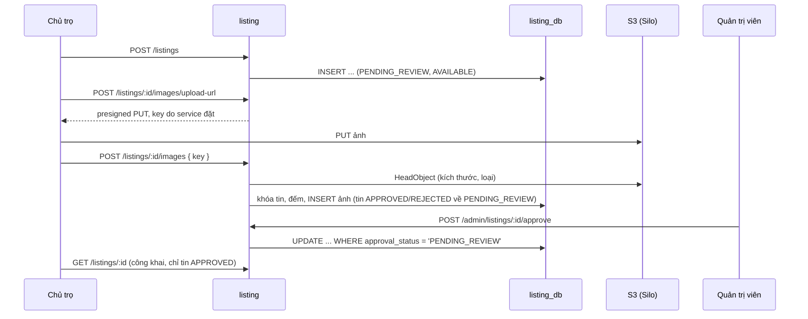
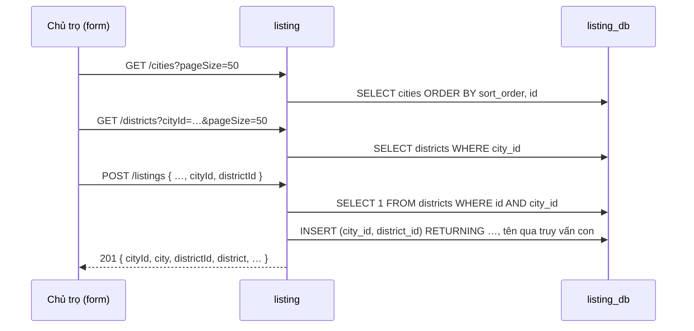
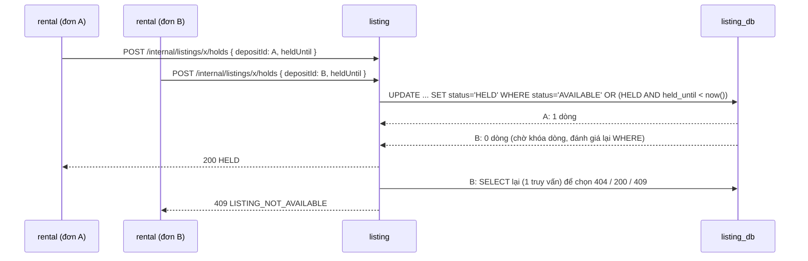

# Giải thích code — Listing (`services/listing`)

> Đọc khi: cần hiểu code listing để sửa tiếp (thêm bộ lọc, đổi trạng thái giữ chỗ, danh mục địa giới), review, hoặc chuẩn bị vấn đáp.

| | |
|---|---|
| **Chủ sở hữu / Cập nhật** | hoang.lv — 2026-11-26 |
| **Thành phần** | `services/listing/` (cổng 3002, `listing_db` PostGIS, bucket `listing-images`) |
| **Task** | T2.2 (CRUD, duyệt, ảnh), T2.3 (tìm kiếm PostGIS, `/internal/*`, giữ chỗ), T2.4 (seed 30 tin) và T2.6 (danh mục tỉnh/quận, tin dùng `cityId`/`districtId`) — `implementation/PHASE-2.md` |
| **Thiết kế** | `design/LISTING/RE.LISTING/` v1.5, `design/LISTING/RE.LOCATION/` v1.0, ADR-0010, ADR-0015 (Proposed); `design/SHARED/RE.SERVICE_TEMPLATE/` v2.1 |
| **Commit / PR** | T2.2: PR #19. T2.3: PR #21. T2.4: PR #23. T2.6: chưa có (nhánh `feature/T2.6-location-catalog`) |

## 1. Luồng chung

Chủ trọ gọi gateway (8080) với JWT. Gateway kiểm chữ ký và vai trò thô theo `routes.ts`, rồi chuyển cho listing. Listing kiểm lại JWT bằng khóa công khai (`JwtAuthGuard`, `@Roles`), kiểm **chủ sở hữu** bằng `sub` (không bao giờ từ body, BR-03), rồi ghi bằng **một câu SQL có điều kiện**. Ảnh đi thẳng từ trình duyệt lên S3 bằng presigned PUT; listing chỉ cấp URL và kiểm lại bằng `HeadObject`. Sản phẩm và tin đăng là một bản ghi `listings` (ADR-0010). Listing không phát và không nghe sự kiện, không gọi service khác.

Hai luồng thêm ở T2.3. **Tìm kiếm** (`GET /listings`, công khai): `SearchListingsQuery` kiểm tham số, `buildSearchSql` dựng hai câu `count` và `data` dùng chung một `WHERE`, `ST_DWithin` trên `geography` dùng index GiST, ảnh bìa lấy bằng `LEFT JOIN LATERAL` trong cùng câu `data` (2 truy vấn, không tăng theo số tin). **API nội bộ** (`/internal/listings/*`, chỉ rental gọi qua mạng Docker, gateway trả 404 từ ngoài): bản chụp, giữ chỗ, đổi trạng thái theo đơn; quyết định "còn trống hay không" nằm ở một câu `UPDATE ... WHERE` (BR-05, BR-06).



**Danh mục địa giới** (T2.6, `RE.LOCATION`): hai bảng chỉ đọc `cities`, `districts` (5 tỉnh, 80 quận/huyện theo địa giới trước 1/7/2025, ADR-0015) nạp trong migration. Form tạo tin gọi `GET /cities` rồi `GET /districts?cityId=` (công khai) để chọn, rồi gửi `cityId`, `districtId`. `ListingCommandService` kiểm quận thuộc tỉnh bằng `LocationQueryService.isDistrictInCity` (sai → `400 VALIDATION_FAILED`, `details` ở `districtId`). `listings` chỉ lưu id; tên tỉnh, quận trong mọi response lấy bằng truy vấn con theo PK nằm ngay trong danh sách cột (`locationColumns`), nên không thêm lượt truy vấn.



Giữ chỗ khi hai người cùng đặt cọc (T2.3, `Processing_Flow §3`):



## 2. Cây thư mục

```text
services/listing/
├─ src/
│  ├─ app.module.ts, app.setup.ts, main.ts, swagger.setup.ts   # chép từ template, app.module nạp ListingModule
│  ├─ common/ config/ health/ database/ storage/ messaging/ redis/   # chép nguyên từ template (ADR-0014)
│  ├─ config/ (env.validation, env.bootstrap, feature-flags)    # thêm LISTING_IMAGE_*, isListingEnabled()
│  ├─ database/migrations/ 1733000000000-create-listings.ts, 1733100000000-add-listing-search-indexes.ts,
│  │                       1733200000000-create-locations.ts, 1733300000000-listings-location-ids.ts   # T2.6
│  └─ listing/
│     ├─ listing.module.ts
│     ├─ config/listing.env.ts (+ spec)
│     ├─ controllers/ listings, listings.admin, listings.internal, locations (T2.6)
│     ├─ services/ listing-command, listing-review, listing-image, listing-query, listing-hold,
│     │            listing.presenter, listing-edit.rules, listing-image.rules, listing-hold.rules,
│     │            listing-search.sql, listing.sql, location-query (T2.6)
│     ├─ dto/ (search-listings.query, listing-summary.dto, internal-listing.dto, city, district, list-districts.query, ...)
│     ├─ entities/ (listing, listing-image, city, district) errors/
│     └─ seed/ seed-listings.data.ts, seed-listings.ts (+ spec)     # T2.4: 30 tin Hà Nội
│  └─ scripts/ export-openapi.ts, seed-listings.ts              # `pnpm openapi:export`, `pnpm seed:listings`
├─ test/ (template + listing-crud, listing-search, listing-internal, seed-listings, location, listing-location-migration .infra-spec.ts + helpers/listing-fixtures.ts)
├─ Dockerfile, package.json, .env.example
```

## 3. Chức năng từng file

Phần chép nguyên từ `_template-nest` (`common/`, `health/`, `redis/`, `messaging/`, `Dockerfile`, `test/*` còn lại) xem `RE.SERVICE_TEMPLATE`, không lặp ở đây. Riêng `src/storage/storage.service.ts` là bản template v2.1 (có `headObject`).

| File | Làm gì | Gọi tới / được gọi bởi | Ghi chú |
|---|---|---|---|
| `src/app.module.ts` | Nạp `ListingModule` khi đủ DB + S3 | `feature-flags.ts#isListingEnabled` | Bỏ `ExampleModule` |
| `src/config/env.validation.ts` | Thêm `LISTING_IMAGE_MAX_BYTES` (5 MB), `LISTING_IMAGE_MAX_COUNT` (10), `LISTING_IMAGE_TYPES` | `ListingImageService` | Mặc định theo `API_Spec §5` |
| `src/config/env.bootstrap.ts` | Gọi `checkListingEnv` khi khởi động (bỏ qua `NODE_ENV=test`) | `main.ts` | Giống cách identity gắn `identity.env.ts` |
| `src/config/feature-flags.ts` | `isListingEnabled()` = DB + S3 | `app.module.ts` | Không cần Redis, RabbitMQ |
| `src/listing/config/listing.env.ts` | Biến bắt buộc: DB, S3, `S3_BUCKETS` có `listing-images`, JWT public key + issuer | `env.bootstrap.ts` | Không in giá trị biến sai |
| `src/database/migrations/1733000000000-create-listings.ts` | `listings`, `listing_images`, CHECK, GiST `ix_listings_location`, `ix_listing_images_listing` | `pnpm migration:run` | Không `CREATE EXTENSION` (`listing_user` không phải superuser; init script đã bật) |
| `src/listing/entities/listing.enums.ts` | Hằng `PROPERTY_TYPES`, `LISTING_STATUSES`, `APPROVAL_STATUSES`, 11 `AMENITIES` | DTO, entity | Một nguồn cho DTO và CHECK |
| `src/listing/entities/listing.entity.ts`, `listing-image.entity.ts` | Khai báo cột (`location` là `geography`, `select: false`; T2.6: `cityId`, `districtId` thay `city`, `district`) | `TypeOrmModule.forFeature` | Truy vấn dùng SQL, không dùng repository |
| `src/listing/errors/listing.errors.ts` | 8 mã `LISTING_*` và hàm dựng `AppException` | Các service | Khớp `API_Spec §4` |
| `src/listing/dto/*.dto.ts`, `list-mine.query.ts`, `trim.ts` | Validate body, query, hình dạng response | Controller | `UpdateListingDto = PartialType(Create)`, `lat`/`lng` đi cùng nhau; T2.6: `cityId`, `districtId` (`@IsUUID`) thay chuỗi, đi cùng nhau khi sửa; `ListingDto`/`ListingSummaryDto` có cả id và tên |
| `src/listing/services/listing.sql.ts` | `listingColumns(alias)`, `locationColumns(alias)` (T2.6: `cityId`, `districtId` + tên bằng truy vấn con theo PK), `pointSql`, `rowsOf`, `isUniqueViolation` | Mọi service, `listing-search.sql.ts` | `rowsOf`: TypeORM trả `[dòng, số dòng]` cho `UPDATE ... RETURNING`. Truy vấn con dùng được trong `RETURNING` |
| `src/listing/services/listing.presenter.ts` | `ListingRow` → `ListingDto`, một truy vấn ảnh cho cả trang, presign GET; T2.3: `presentSummaries` (`SearchRow` → `ListingSummaryDto`, không truy vấn, chỉ ký URL ảnh bìa) | Command, Review, Query, Image | Không truy vấn trong vòng lặp |
| `src/listing/services/listing-edit.rules.ts` | Hàm thuần: `classifyEdit`, `resubmits` (bảng duyệt lại §1.1). T2.6: trường hiển thị `cityId`, `districtId` thay `city`, `district` | `ListingCommandService` | Có spec 26 ca |
| `src/listing/services/listing-image.rules.ts` | Hàm thuần: `buildImageKey`, `isKeyOfListing`, `checkUploadedImage` | `ListingImageService` | Có spec |
| `src/listing/services/listing-command.service.ts` | `create`, `update`, `hide`, `unhide`, `softDelete`. T2.6: kiểm cặp `cityId`/`districtId` (route 1 trước `INSERT`; route 2 sau `lockOwned`, tức sau 404/403) → `districtNotInCity()` | `ListingsController`, `LocationQueryService` | `UPDATE ... WHERE <trạng thái mong đợi>`; 0 dòng thì đọc lại chọn 404/403/409 |
| `src/listing/services/listing-review.service.ts` | `approve`, `reject` | `ListingsAdminController` | `WHERE approval_status = 'PENDING_REVIEW'` |
| `src/listing/services/listing-image.service.ts` | `createUploadUrl`, `confirm` | `ListingsController` | `HeadObject` ngoài transaction; khóa dòng rồi mới đếm |
| `src/listing/services/listing-query.service.ts` | `findPublic` (route 12), `findMine` (route 6); T2.3: `search` (route 11), `snapshot` (API nội bộ a) | `ListingsController`, `ListingsInternalController` | `search`: đếm trước, `total = 0` thì bỏ truy vấn data (1 truy vấn). `snapshot` không lọc `approval_status` (rental tự xử lý), chỉ loại tin đã xóa |
| `src/database/migrations/1733100000000-add-listing-search-indexes.ts` | T2.3: GIN `ix_listings_amenities`, `ix_listings_created (created_at DESC, id DESC) WHERE deleted_at IS NULL`, `ix_listings_area` | `pnpm migration:run` | Không sửa migration T2.2 đã merge. NFR §1: MUST có index cho cột lọc, sắp xếp |
| `src/listing/dto/search-listings.query.ts` | Query route 11 (kế thừa `PageQueryDto`): ép kiểu, CSV `amenities`, kiểm chéo `lat`/`lng`/`radiusKm`/`sort=distance`, `minX ≤ maxX`; T2.6: `cityId`, `districtId` (UUID) thay `district` | `ListingsController.search` | `lat`/`lng` chỉ dùng `@ValidateIf` (không `@IsOptional`: hai decorator này AND với nhau nên thiếu một trong hai sẽ không báo lỗi). Có spec 37 ca |
| `src/listing/dto/listing-summary.dto.ts` | `ListingSummaryDto`: bản gọn cho trang kết quả (`coverImageUrl`, `distanceM`), không `description`, `images[]`, `approvalStatus` | `ListingPresenter.presentSummaries` | `API_Spec §1.4` v1.4 |
| `src/listing/dto/internal-listing.dto.ts` | Body `HoldListingDto`, `ChangeStatusDto` và kiểu response của 3 API nội bộ | `ListingsInternalController` | `heldUntil` bắt buộc có múi giờ, không kiểm "tương lai" (chốt 2026-11-20) |
| `src/listing/services/listing-search.sql.ts` | Hàm thuần `buildSearchSql(query)` → `{ countSql, countParams, dataSql, dataParams }`; T2.6: lọc `l.city_id`, `l.district_id`, cột tên qua `locationColumns` | `ListingQueryService.search` | Mọi giá trị là tham số `$n`; count và data cùng `WHERE`; mỗi câu chỉ có tham số nó dùng (pg báo lỗi nếu thừa). Có spec 21 ca |
| `src/listing/services/listing-hold.rules.ts` | Hàm thuần: `STATUS_TRANSITIONS` (4 cặp §2.2), `sourcesFor`, `decideWhenNoMatch` (`IDEMPOTENT` / `CONFLICT`) | `ListingHoldService` | Có spec 30 ca |
| `src/listing/services/listing-hold.service.ts` | `hold` (§2.1) và `changeStatus` (§2.2): mỗi cái một `UPDATE ... WHERE`, 0 dòng thì đọc lại đúng một lần | `ListingsInternalController` | Không transaction nhiều câu, không khóa ứng dụng, không gọi service khác |
| `src/listing/controllers/listings.controller.ts` | Route 1–8, 11, 12 và `mine` | | `mine` khai báo trước `:id`; `confirmImage` đặt `201` hoặc `200` bằng `@Res({ passthrough })`; route 11 là `@Public()` |
| `src/listing/controllers/listings.internal.controller.ts` | `GET :id`, `POST :id/holds`, `PUT :id/status` dưới `/internal/listings` | rental (S1) | `@Public()` + `@ApiExcludeController()`: tin mạng Docker (`security-policy §6`), không lộ ở Swagger, không có prefix `/api/v1` |
| `src/listing/controllers/listings.admin.controller.ts` | Route 9–10, `@Roles('ADMIN')` | | |
| `src/listing/listing.module.ts` | Ghép controller, service; T2.6 thêm `LocationsController`, `LocationQueryService`, entity `City`, `District` | `app.module.ts` | |
| `src/database/migrations/1733200000000-create-locations.ts` | T2.6: `cities`, `districts` (UNIQUE `(city_id, name)`, FK, `ix_cities_sort`, `ix_districts_city`) và nạp 5 tỉnh, 80 quận/huyện bằng hai `INSERT ... unnest` | `pnpm migration:run` | Comment ghi nguồn đối chiếu (QĐ 790/QĐ-TTg, QĐ 586/QĐ-TTg) |
| `src/database/migrations/1733300000000-listings-location-ids.ts` | T2.6: thêm `city_id`, `district_id` + FK, ánh xạ theo tên, xóa cứng tin (và ảnh) không ánh xạ được (`RAISE NOTICE` số lượng), `NOT NULL`, bỏ cột chuỗi, `ix_listings_search` trên `district_id`, thêm `ix_listings_city` | `pnpm migration:run` | `down` khôi phục cột chuỗi cho tin còn lại, không khôi phục tin đã xóa |
| `src/listing/entities/city.entity.ts`, `district.entity.ts` | T2.6: khai báo cột danh mục, không `@ManyToOne` | `LocationQueryService` | |
| `src/listing/dto/city.dto.ts`, `district.dto.ts`, `list-districts.query.ts` | T2.6: `CityDto {id,name}`, `DistrictDto {id,cityId,name}`, query `cityId` (UUID) + `PageQueryDto` | `LocationsController` | Spec `list-districts.query.spec.ts` 7 ca |
| `src/listing/services/location-query.service.ts` | T2.6: `listCities`, `listDistricts` (`findAndCount`, `sort_order, id`), `isDistrictInCity` (một câu theo PK) | `LocationsController`, `ListingCommandService` | `cityId` không có → danh sách rỗng |
| `src/listing/controllers/locations.controller.ts` | T2.6: `GET /cities`, `GET /districts` (`@Public()`) | Gateway dòng 6a | |
| `services/api-gateway/src/gateway/routes.ts` (+ `routes.spec.ts`, `route-resolver.spec.ts`) | T2.6: hai dòng `GET` mức `public` tới listing | `RouteResolver` | Danh sách route không cần token cập nhật theo `RE.GATEWAY` v1.4 |
| `test/setup-infra-env.ts` | Dùng `listing_db`, schema test, `search_path` có `public` | `jest-infra.json` | Cần `public` để thấy kiểu `geography` |
| `test/listing-crud.infra-spec.ts` | 38 ca với Postgres + S3 thật: test 1, 2, 3, 12–17, số truy vấn | `pnpm test:infra` | |
| `test/listing-search.infra-spec.ts` | Test 4, 18, 19, số truy vấn: 9 tin tọa độ thật ở Hà Nội, khoảng cách đối chứng bằng haversine (độc lập với PostGIS), kiểm 4 index có trong catalog, `EXPLAIN` dùng `ix_listings_location` trên ~5.000 tin ngẫu nhiên đã `ANALYZE` | `pnpm test:infra` | Seed thật là T2.4 nên dùng fixture; T2.4 chạy lại `EXPLAIN` trên seed |
| `test/listing-internal.infra-spec.ts` | Test 5–11, 20, 21: kể cả 50 lời giữ chỗ đồng thời (đúng một `200`, `version = 1`), mọi response khớp `listing-internal.v1.yaml` | `pnpm test:infra` | Đã thử đột biến: bỏ điều kiện `held_until < now()` thì 4 ca fail, test 7 nhận 50 lần `200` |
| `test/helpers/listing-fixtures.ts` | `insertListing` (dựng tin bằng SQL, đặt được `status`, `held_*`), `haversineM`. T2.6: nhận TÊN tỉnh/quận, tra ra id bằng truy vấn con | Các infra-spec | API không cho đặt các trường này |
| `src/listing/seed/seed-listings.data.ts` | T2.4: `SEED_LISTINGS` (30 tin, id `c0000000-…-0000000000NN`), `SEED_OWNER_IDS` (3 chủ trọ seed). Tọa độ thật ở Hà Nội; cơ cấu theo khoảng cách tới (21.00, 105.84) ghi ở đầu file | `seed-listings.ts`, test | `ownerId` lặp id của `identity/seed/seed-users.data.ts` (không import code service khác) |
| `src/listing/seed/seed-listings.ts` | `seedListings(dataSource)`: một transaction, mỗi tin `INSERT ... ON CONFLICT (id) DO NOTHING`, `ST_MakePoint(lng, lat)`; trả `{ created, existing }`. T2.6: `city_id`, `district_id` tra từ tên bằng truy vấn con; tên lạ → lỗi `NOT NULL`, hoàn tác | `scripts/seed-listings.ts`, infra-spec | Không ghi đè tin đã sửa; `created_at` lệch 1 giờ/tin; `reviewed_by` để `NULL` |
| `src/listing/seed/seed-listings.spec.ts` | 15 ca không cần DB: 30 tin, id, enum, giới hạn trường, `0 < cọc ≤ giá`, tọa độ, cơ cấu trạng thái, phân bố theo haversine (≥ 10 tin trong 2 km, 2–3 tin ở 2,1–3 km, có `PENDING_REVIEW` và `HIDDEN` trong 2 km, không tin sát ranh 2 và 3 km) | `pnpm test` | Khóa các con số trong `RE_Docker_Local_Guide.md §5` |
| `src/scripts/seed-listings.ts` | CLI `pnpm seed:listings`: nạp `.env`, mở `DataSource` riêng, gọi `seedListings`; không khởi động Nest | `package.json` | Giống `seed-admin.ts` của identity |
| `test/seed-listings.infra-spec.ts` | 11 ca (T2.6 thêm: id trỏ đúng danh mục, tên lạ thì hoàn tác) với Postgres + PostGIS thật: tạo 30 đúng cột, chạy lại, không ghi đè tin đã sửa, 5 lần đồng thời, route 11 trên seed (2 km đúng tập, 3 km thêm đúng 2,1–3 km, tổng 25), in `EXPLAIN` | `pnpm test:infra` | Dùng lại `buildSearchSql` thật |
| `test/location.infra-spec.ts` | T2.6: `RE.LOCATION` test 1–6, 8, 9 (13 ca): dữ liệu migration (số theo tỉnh, NFC, mọi tên seed có trong danh mục), hai route qua HTTP không token, `isDistrictInCity`, số truy vấn | `pnpm test:infra` | Danh sách mong đợi viết lại độc lập trong test |
| `test/listing-location-migration.infra-spec.ts` | T2.6: `RE.LISTING` test 25 + `RE.LOCATION` test 7: chạy migration tới trước v1.5, chèn tin kiểu cũ (khớp, tỉnh ngoài danh mục có ảnh, quận sai tỉnh, đã xóa mềm, thiếu tên), chạy v1.5, kiểm, `down` hai lần, `up` lại | `pnpm test:infra` | Đã thử đột biến: bỏ bước xóa thì migration lỗi `NOT NULL`, test fail |
| `.env.example`, `Dockerfile` | Cấu hình dev, ảnh Docker | | |
| `infra/compose/docker-compose.yml` (khối `listing`) | Service `re-listing`, không publish cổng | gateway gọi `http://listing:3002` | Chạy kèm `--profile dev` (cần `s3`, `postgres`) |

## 4. Quyết định không hiển nhiên

| Quyết định | Lý do | Phương án đã loại | Căn cứ |
|---|---|---|---|
| Ghi trạng thái bằng một câu `UPDATE ... WHERE` | Hai request đồng thời: một bên thắng, không có cửa sổ kiểm tra-rồi-ghi. `hide` dùng cùng điều kiện `status = 'AVAILABLE'` với giữ chỗ nên không đè lên đơn | Đọc rồi ghi, khóa ứng dụng | ADR-0010, BR-06, `Processing_Flow §3–4` |
| Khóa dòng tin (`FOR UPDATE`) rồi **đếm ảnh bằng câu riêng** | Ở READ COMMITTED, subquery đếm trong cùng câu `FOR UPDATE` dùng snapshot cũ: hai request cùng thấy 9 ảnh và cùng thêm. Test 16 bắt được lỗi này | Đếm bằng subquery cùng câu; `UNIQUE` trên `(listing_id, sort_order)` | `RE.LISTING §1.2` mục 8 |
| `PATCH` đọc dòng bằng `FOR UPDATE` trong transaction ngắn | Quyết định "về `PENDING_REVIEW`" dựa trên trạng thái duyệt hiện tại; quản trị viên không chen vào giữa | CASE trong SQL lặp điều kiện nhiều lần | `API_Spec §1.1` |
| `HeadObject` gọi ngoài transaction | Không giữ transaction khi gọi mạng | Gọi trong transaction | `coding-convention §4` |
| Ảnh không hợp lệ thì `deleteObject`, lỗi xóa chỉ log | Không để rác trên S3; kết quả `400` không phụ thuộc việc dọn | Bỏ qua | A chốt 2026-11-19 |
| Ảnh lấy URL mà không xác nhận không được dọn | Ghi nợ, phạm vi đồ án | Job quét S3 | `tech-debt.md` #14 |
| Xác nhận lại cùng key → `200` kèm ảnh đã có | Idempotent, kể cả đua hai lời gọi (bắt `23505`) | `409` | A chốt 2026-11-19 |
| Key ảnh do service sinh, route 8 kiểm dạng `listings/{id}/{uuid}.{ext}` | Client không đặt key, không dùng key của tin khác hay `..` | Tin client | `security-policy §5` |
| Dùng SQL thuần, entity chỉ khai báo cột | PostGIS (`ST_Y`, `ST_SetSRID`), `RETURNING`, `FOR UPDATE OF` | QueryBuilder, repository | T2.3 dùng tiếp cho `ST_DWithin`, `ST_Distance` |
| Bộ dựng SQL tìm kiếm là hàm thuần, count và data chung một `WHERE` | `total` luôn khớp tập trả về; test không cần DB cho phần dựng câu; giá trị chỉ ở tham số (chống injection), chỉ cột và hướng sắp xếp lấy từ bảng cố định | Nối chuỗi ở service; QueryBuilder | `RE.LISTING §1.3`, `non-functional-standards §1` |
| Ảnh bìa bằng `LEFT JOIN LATERAL ... LIMIT 1` trong câu data | Số truy vấn cố định (2), không truy vấn ảnh theo từng tin hay thêm truy vấn ảnh cho trang | Dùng `presenter.present` (thêm 1 truy vấn, trả `images[]` không cần ở trang kết quả) | `Processing_Flow §5` |
| `lat`/`lng` không `radiusKm`: không lọc bán kính, vẫn có `distanceM` | Cho `sort=distance` mà không giới hạn vùng (A chốt 2026-11-20) | Bắt buộc `radiusKm` | `API_Spec §1.3` |
| ~~`district` so khớp đúng chuỗi~~ → T2.6: lọc `districtId`, `cityId` | Chọn từ danh mục nên không còn lệch chữ; `ix_listings_search` chuyển sang `district_id`, thêm `ix_listings_city` | Giữ chuỗi + `unaccent` | `RE.LISTING` v1.5 §1.3 |
| T2.6: `listings` chỉ lưu `city_id`, `district_id`, tên lấy từ danh mục | Một nguồn tên; FK chặn id rác | Lưu cả id và tên; chỉ thêm API danh sách cho dropdown | Người dùng chọn 2026-11-26, ADR-0015 |
| T2.6: tên tỉnh, quận bằng truy vấn con theo PK trong `locationColumns` | Dùng được trong `INSERT/UPDATE ... RETURNING` nên không phải viết lại mọi câu ghi, không thêm lượt truy vấn | CTE `WITH w AS (… RETURNING) SELECT … JOIN` | `decisions-log.md` (local-dev) 2026-11-26 |
| T2.6: quận không thuộc tỉnh → `400 VALIDATION_FAILED` (`details` ở `districtId`), không thêm mã lỗi | Đây là lỗi đầu vào; tránh thêm mã cần nhóm chốt | `LISTING_LOCATION_INVALID` mới | `RE.LOCATION §4` |
| T2.6: sửa tin kiểm cặp SAU `lockOwned` | Giữ thứ tự 404 → 403 → 2a (người lạ không dò được id danh mục qua lỗi 400) | Kiểm trước khi đọc tin | `RE.LISTING §1.2` |
| T2.6: `GET /districts` với `cityId` không có → `200` rỗng | Không cần mã lỗi mới, một truy vấn | `404 LISTING_CITY_NOT_FOUND` với đường dẫn lồng | Người dùng chọn 2026-11-26 |
| T2.6: id danh mục sinh `gen_random_uuid()` lúc migration | Theo `api-convention §8`; client, seed, test tra id qua API hoặc theo tên | Mã ĐVHC làm khóa chính | `RE.LOCATION §1.1` |
| T2.6: migration xóa cứng tin không ánh xạ được, rồi `NOT NULL` | Không còn tin "không có quận"; mọi response luôn có tên | Để `NULL`, báo số dòng | Người dùng chốt 2026-11-26 |
| Giữ chỗ là một `UPDATE ... WHERE status = 'AVAILABLE' OR (HELD AND held_until < now())` | Postgres khóa dòng: lệnh thứ hai chờ rồi đánh giá lại `WHERE`. Chỗ giữ của đơn không tạo được tự hết hạn (A9). Đơn bị gọi lại cùng `depositId` thì 0 dòng, đọc lại thấy cùng đơn → `200` | `SELECT FOR UPDATE` rồi ghi; khóa Redis ở listing | BR-05, BR-06, `Processing_Flow §3` |
| Đổi trạng thái: một `UPDATE ... status = ANY(nguồn hợp lệ)` cho mỗi đích | Tập nguồn của đích lấy từ bảng `STATUS_TRANSITIONS`, một truy vấn thay vì thử từng cặp | Mỗi cặp một `UPDATE` | `API_Spec §2.2` |
| Đích `AVAILABLE` mà tin đã `AVAILABLE` → `200` với mọi `depositId` | Về `AVAILABLE` xóa `held_by_deposit_id` nên không còn kiểm "cùng đơn"; rental retry bù trừ vẫn phải nhận `200`. Tin của đơn khác → `409 LISTING_INVALID_STATUS` kèm `details`. Hệ quả cho rental ghi ở `van-de-can-quyet-dinh.md` C20 | Bắt buộc cùng `depositId` (rental retry sẽ `409`) | A chốt 2026-11-20 |
| `/internal/*` là `@Public()` | Tin mạng Docker; gateway chặn từ ngoài (smoke: `404`) | Xác thực service-to-service | `security-policy §6` |
| `rowsOf` bọc mọi `UPDATE ... RETURNING` | TypeORM + Postgres trả `[dòng, số]` cho UPDATE/DELETE, mảng dòng cho SELECT/INSERT | Đoán kiểu ở từng chỗ | Lỗi 500 phát hiện ở infra test |
| Seed không ghi đè tin đã có (`ON CONFLICT (id) DO NOTHING`) | Đang demo, chạy thử saga hay sửa tin xong chạy lại seed không được mất dữ liệu. Muốn về gốc thì reset DB | `ON CONFLICT DO UPDATE` | A duyệt 2026-11-20 |
| Seed tin không đọc `identity_db`, id chủ trọ viết cứng ở hai nơi | listing không import code hay DB của identity (ADR-0005); bảng id ở `RE_Docker_Local_Guide.md §5` là nguồn đối chiếu | Dùng file chung giữa hai service | `architecture.md §6` |
| Không seed `HELD`, `DEPOSITED`, ảnh | Hai trạng thái cần `held_by_deposit_id` của đơn có thật; ảnh cần đối tượng trên S3 | Tạo đơn giả, upload ảnh trong seed | A duyệt 2026-11-20 |
| Bản chép template còn `src/messaging`, migration messaging | ADR-0014: không sửa riêng bản chép | Xóa phần thừa | `tech-debt.md` #15 |

## 5. Câu hỏi vấn đáp

| Câu hỏi | Trả lời ngắn | Xem thêm |
|---|---|---|
| Hai chủ trọ cùng sửa/xóa tin của nhau thì sao? | `403 LISTING_NOT_OWNER`, kiểm bằng `sub` của JWT, không tin `ownerId` trong body | `API_Spec §1.2`, test 1 (T04) |
| Vì sao không xóa được tin đang có đơn cọc? | `UPDATE ... WHERE status NOT IN ('HELD','DEPOSITED')`; 0 dòng thì `409 LISTING_HAS_ACTIVE_DEPOSIT` | `Processing_Flow §4`, test 2 (T18) |
| Ảnh quá 5 MB bị chặn ở đâu? | Presigned PUT không giới hạn kích thước, nên `HeadObject` sau khi tải; quá cỡ thì `400` và xóa object | `gotchas.md`, test 12 |
| Sửa gì thì tin phải duyệt lại? | Nội dung hiển thị hoặc thêm ảnh: `APPROVED → PENDING_REVIEW`; tin `REJECTED` sửa gì cũng nộp lại; giá, cọc, diện tích, tiện ích thì giữ `APPROVED` | `API_Spec §1.1`, `listing-edit.rules.spec.ts` |
| Hai quản trị viên duyệt cùng lúc? | Một người thắng bằng `WHERE approval_status = 'PENDING_REVIEW'`, người kia `409 LISTING_ALREADY_REVIEWED` | Test 3 |
| Tin `HIDDEN` có xem được không? | Chi tiết công khai vẫn trả; tìm kiếm loại tin ẩn | `API_Spec §1.4` |
| Hai người cùng đặt cọc một phòng thì sao? | Hai lời giữ chỗ chạy `UPDATE ... WHERE status = 'AVAILABLE'`; Postgres khóa dòng, bên chậm thấy `HELD` nên 0 dòng → `409 LISTING_NOT_AVAILABLE`. Test 7: 50 lời đồng thời trên Postgres thật, đúng một `200` | `Processing_Flow §3`, test 7 (T07) |
| Rental gọi giữ chỗ nhưng không nhận được trả lời thì chỗ bị kẹt? | Không: tin `HELD` quá `held_until` được coi là trống, đơn mới giữ được (test 9) | A9, `API_Spec §2.1` |
| Tìm trong bán kính 2 km hoạt động thế nào? | `ST_DWithin(location::geography, điểm, 2000)` trên `geography` (mét); dùng index GiST `ix_listings_location`. Plan thật: `Bitmap Index Scan on ix_listings_location` (≈5.000 dòng) | `API_Spec §1.3`, test 4 (T05) |
| Vì sao test dùng haversine mà không tin `ST_Distance`? | Đối chứng độc lập: không dùng PostGIS để tự kiểm PostGIS (sai số cầu so với spheroid < 0,5%, test cho ±1%) | `listing-search.infra-spec.ts` |
| Hỏi `radiusKm` mà không có tọa độ thì sao? | `400 VALIDATION_FAILED`: `lat` và `lng` phải đi cùng nhau và đi kèm `radiusKm` hoặc `sort=distance` | `API_Spec §1.3`, test 19 |
| Rental gọi lại bước nhả chỗ thì sao? | Idempotent: đã `AVAILABLE` → `200`. Tin đã giao cho đơn khác → `409`; rental coi là kết cục cuối (đề xuất, chờ C chốt ở T3.3) | `API_Spec §2.2`, C20 |
| Chạy seed hai lần có nhân đôi tin không? | Không: id cố định và `ON CONFLICT (id) DO NOTHING`; lần hai `created 0, existing 30`. Tin đã sửa tay giữ nguyên | `seed-listings.infra-spec.ts` |
| Vì sao seed tin chạy được khi chưa có chủ trọ? | `owner_id` không có khóa ngoại sang `identity_db`; seed người dùng ở identity (`seed:users`) để chủ trọ đăng nhập được | ADR-0005, `RE_Docker_Local_Guide.md §5` |
| Vì sao không tin nào nằm sát 2 km hay 3 km? | PostGIS tính trên spheroid, haversine trên mặt cầu: lệch dưới 0,5%; cách xa ranh ±50 m để tập kết quả không phụ thuộc cách tính | `seed-listings.spec.ts` |
| Vì sao listing không có `clients/` hay outbox? | Không gọi và không phát sự kiện; rental gọi listing, không ngược lại | `architecture.md §7`, ADR-0004 |
| Vì sao vẫn dùng quận/huyện khi cả nước đã bỏ cấp huyện từ 1/7/2025? | Khớp Báo cáo v2, FR03 "lọc theo quận" và thói quen tìm phòng; đổi sang phường/xã là đổi mô hình dữ liệu lớn. Đánh đổi ghi ở ADR-0015 | ADR-0015 |
| Chủ trọ gửi quận của Hồ Chí Minh nhưng tỉnh Hà Nội thì sao? | `400 VALIDATION_FAILED`, `details: [{ field: "districtId" }]`; `isDistrictInCity` là một câu `WHERE id AND city_id`; không ghi gì | `RE.LISTING §1.2` mục 2a, test 23 |
| Lấy tên tỉnh, quận có làm tăng số truy vấn không? | Không: truy vấn con theo PK nằm trong cùng câu SELECT/RETURNING. Đo: tạo 3, sửa tỉnh/quận 4, chi tiết 2, tìm kiếm 2 | `Processing_Flow §5`, test 26 |
| Danh mục đổi giữa các môi trường thì client làm sao? | Id sinh ngẫu nhiên lúc migration nên luôn lấy qua `GET /cities`, `GET /districts`; seed và test tra theo tên | `RE.LOCATION §1.1` |
| Tin cũ có tên tỉnh/quận lạ khi nâng cấp DB thì sao? | Migration v1.5 xóa cứng tin đó cùng ảnh và báo số lượng; `down` không khôi phục được | `RE.LISTING §6.1`, test 25 |
| Muốn thêm tỉnh mới? | Viết migration nạp dữ liệu mới, không sửa migration `1733200000000` | `RE.LOCATION §6` |
| Vì sao `GET /districts` chỉ 1 truy vấn trong khi thiết kế ghi 2? | `findAndCount` của TypeORM bỏ câu `count` khi trang đầu chưa đầy; trang sau vẫn 2 câu | `location.infra-spec.ts` test 9 |

## 6. Hạn chế đã biết

| Hạn chế | Ảnh hưởng | Hướng xử lý |
|---|---|---|
| Ảnh lấy upload-url nhưng không xác nhận nằm lại trên S3 | Tốn dung lượng | Job dọn hoặc lifecycle rule (`tech-debt.md` #14) |
| `listing_db` có bảng `outbox_events`, `processed_events` không dùng | Không ảnh hưởng | `tech-debt.md` #15 |
| `/internal/*` tin mạng Docker, không xác thực | Container nào trong mạng cũng gọi được giữ chỗ | `security-policy §6`; hướng: xác thực service-to-service hoặc mTLS |
| `EXPLAIN` chỉ chứng minh GiST ổn định trên dữ liệu đủ lớn (~5.000 dòng) | Seed ~30 dòng: planner có thể đổi plan khi thống kê khác. Trên seed thật (2026-11-20, sau `ANALYZE`): `Bitmap Heap Scan` ← `Bitmap Index Scan on ix_listings_location`, 15 dòng, 6,5 ms | Test 4 (T2.3) là bằng chứng chính |
| Tìm kiếm phân trang bằng `OFFSET` | Trang rất sâu chậm dần (chặn `pageSize ≤ 50`, dữ liệu đồ án nhỏ) | Phân trang theo con trỏ nếu cần |
| Danh mục theo địa giới trước 1/7/2025, chỉ 5 tỉnh | Không đúng pháp lý hiện hành; tin ngoài 5 tỉnh không đăng được | Thêm tỉnh bằng migration; địa giới mới cần ADR thay ADR-0015 |
| Kiểm cặp tỉnh/quận khi sửa chạy trên kết nối khác transaction đang khóa tin | Không sai vì danh mục không đổi lúc chạy và FK vẫn chặn | Giữ nguyên |
| Migration v1.5 xóa tin không khớp: object ảnh trên S3 nằm lại, đơn rental trỏ tin đó nhận 404 | Chỉ dữ liệu dev | Cùng tech-debt #14 |
| Đổi hợp đồng công khai (`city`/`district` → id) | Giao diện cũ gửi chuỗi nhận `400` | Repo `real-estate` sửa form và bộ lọc cùng đợt |
| Tìm kiếm không cache | Mỗi lần gọi chạm DB | Không cần ở phạm vi đồ án |
| Hai infra-spec mới lặp phần dựng app, schema, đếm truy vấn của `listing-crud.infra-spec.ts` | Khó bảo trì | Gom vào `test/helpers/` (cùng loại tech-debt #13) |
| `address` bắt buộc và `description` ≤ 5000 chỉ kiểm ở API (A chốt 2026-11-20, `RE.LISTING` v1.3); từ T2.6 `city_id`, `district_id` đã `NOT NULL` | DDL vẫn cho `address` `NULL`; dữ liệu chèn thẳng vào DB có thể thiếu | Thêm `NOT NULL` bằng migration nếu cần (đổi bảng, MAJOR) |
| Ảnh quá giới hạn 10 khi xác nhận, ảnh hợp lệ nằm lại trên S3 | Như trên | Cùng tech-debt #14 |
