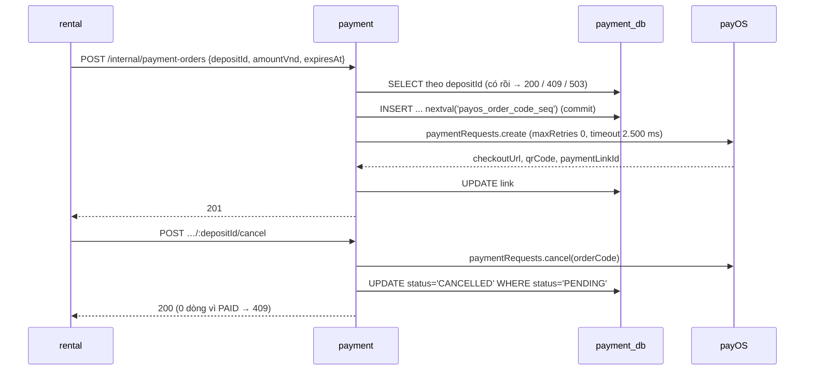
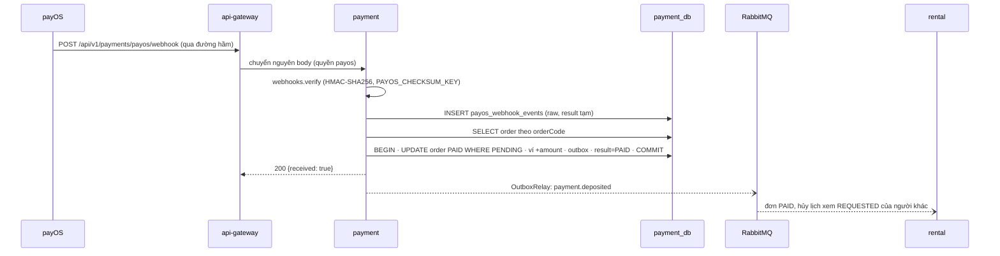
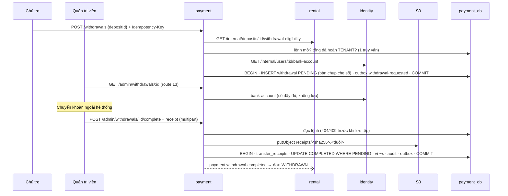

# Giải thích code — payment

> Đọc khi: cần hiểu code của payment (payment order, webhook payOS, ví trung gian, hoàn, rút, chứng từ) để sửa tiếp, review, hoặc chuẩn bị vấn đáp.

| | |
|---|---|
| **Chủ sở hữu / Cập nhật** | hoang.lv — 2026-11-27 (T1.4: S3 chuyển sang Cloudflare R2) |
| **Thành phần** | `services/payment/` (cổng 3004); phần chép từ `services/_template-nest/` ghi rõ ở §3.3 |
| **Task** | `T3.1` (khung, payment order, payOS), `T3.4a` (webhook payOS, ghi nhận tiền vào ví, tiền đến muộn, script webhook giả), `T3.6` (ví trừ tiền, yêu cầu hoàn, lệnh rút, chứng từ, nhật ký quản trị); `implementation/PHASE-3.md`; `T1.4` (S3 trên R2, `PHASE-1.md`) |
| **Thiết kế** | `design/PAYMENT/RE.PAYMENT/` (v1.3), `design/PAYMENT/RE.PAYOUT/` (v1.3), ADR-0006, ADR-0009, ADR-0016 (S3 là Cloudflare R2) |
| **Commit / PR** | T3.1: PR #26 (`feature/T3.1-payment-order`). T3.4a: PR #28 (`feature/T3.4a-payos-webhook`). T3.6: nhánh `feature/T3.6-payout` (A cùng Claude, 2026-11-25) |

## 1. Luồng chung

Rental tạo đơn đặt cọc xong thì gọi `POST /internal/payment-orders`. Payment **ghi order `PENDING` trước** (cấp `orderCode` từ sequence), rồi mới gọi payOS tạo link hết hạn đúng lúc giữ chỗ hết hạn, lưu link và trả `201`. Gọi lại cùng `depositId` trả order cũ (`200`). Khi giữ chỗ hết hạn hoặc bù trừ, rental gọi `…/cancel`: payment hủy link ở payOS **trước**, rồi `UPDATE … WHERE status='PENDING'`; nếu webhook (T3.4) đã kịp chuyển order sang `PAID` thì `UPDATE` đổi 0 dòng và payment trả `409`, rental không chuyển đơn sang `EXPIRED`. Không có transaction nào bao lời gọi payOS.

**Webhook (T3.4a).** Người thuê quét QR trả tiền; payOS gọi `POST /api/v1/payments/payos/webhook` qua đường hầm → gateway (quyền `payos`, không token, giữ nguyên body) → payment. Payment kiểm chữ ký bằng SDK, **lưu nguyên văn trước mọi kiểm tra**, rồi tìm order theo `orderCode`. Order `PENDING` đúng số tiền: một transaction đổi order sang `PAID`, cộng ví (`DEPOSIT_IN`), ghi outbox `payment.deposited`, đặt `result = PAID`. Order đã hủy, hoặc đã `PAID` mà nhận thêm tiền với `reference` khác: tiền đến muộn (BR-10) — tạo yêu cầu hoàn 100% số thực nhận, ghi `late_payments`, cộng ví (`LATE_PAYMENT_IN`), outbox `payment.late-payment-credited`. Sau commit, `OutboxRelay` đẩy sự kiện lên RabbitMQ; rental nghe `payment.deposited` để chuyển đơn sang `PAID` (T3.2). payOS luôn nhận `200` khi webhook đã được lưu.





**Payout (T3.6).** Mọi tiền vào nằm ở **một** ví trung gian; tiền chỉ ra khi quản trị viên đã chuyển khoản ngoài hệ thống và tải **chứng từ** lên (BR-17). Có hai loại lệnh chi:

- **Yêu cầu hoàn.** Người thuê tự hủy trong 48 giờ: rental gọi `POST /internal/refund-requests` và payment tạo yêu cầu 70% `TENANT`. Tiền đến muộn: yêu cầu 100% `SYSTEM` đã được tạo sẵn ở T3.4a.
- **Lệnh rút của chủ trọ.** Chủ trọ gọi `POST /withdrawals`. Payment hỏi rental đơn đã đủ điều kiện chưa, tự tính số tiền (cọc trừ phần đã hoàn), hỏi identity tài khoản nhận tiền, rồi lưu bản chụp đã che số.

Quản trị viên xem chi tiết lệnh (route 13, 14; số tài khoản đầy đủ lấy từ identity lúc xem), chuyển khoản, rồi hoàn tất kèm tệp. Payment kiểm tệp, tính `sha256`, lưu S3 trước. Sau đó **một** transaction ghi: chứng từ (sha256 duy nhất), `UPDATE … WHERE status=<chờ>` sang `COMPLETED`, trừ ví, `audit_log`, outbox `payment.refunded` hoặc `payment.withdrawal-completed`. Rental nghe các sự kiện đó để chuyển đơn sang `REFUNDED` hoặc `WITHDRAWN` (T3.5).



## 2. Cây thư mục

```text
services/payment/
├─ src/
│  ├─ app.module.ts                 # nạp PaymentModule khi có DATABASE_URL
│  ├─ scripts/send-fake-webhook.ts  # T3.4a: pnpm webhook:fake (+ spec)
│  ├─ config/                       # env.validation (+PAYOS_*), env.bootstrap (+checkPaymentEnv), feature-flags (+isPaymentEnabled)
│  ├─ database/migrations/          # 1730000000001 messaging (template), 1734000000000 bảng payment + ví, 1764000000000 index danh sách payout (T3.6)
│  └─ payment/
│     ├─ payment.module.ts
│     ├─ config/payment.env.ts      # biến bắt buộc riêng (+ spec)
│     ├─ clients/payos.client.ts    # bọc @payos/node: tạo/hủy link, kiểm chữ ký webhook (+ spec)
│     ├─ clients/rental.client.ts, identity.client.ts, payout-urls.ts   # T3.6 (+ payout-clients.spec)
│     ├─ controllers/payment-orders.internal.controller.ts
│     ├─ controllers/payos-webhook.controller.ts   # T3.4a
│     ├─ controllers/refund-requests.internal.controller.ts   # T3.6: API nội bộ cho rental
│     ├─ controllers/transactions.controller.ts    # T3.6: route 1
│     ├─ controllers/withdrawals.controller.ts     # T3.6: route 2, 3
│     ├─ controllers/payouts.admin.controller.ts   # T3.6: route 4–14
│     ├─ domain/refund-amount.ts (+ spec)          # T3.6: 70%, test 1
│     ├─ http/receipt-too-large.interceptor.ts (+ spec)   # T3.6: 413 multer → 400
│     ├─ services/payment-order.service.ts (+ spec)
│     ├─ services/webhook.service.ts (+ spec)          # T3.4a: bảng API_Spec §1
│     ├─ services/deposit-capture.service.ts (+ spec)  # T3.4a: §1.1, §1.2 trong transaction
│     ├─ services/wallet.service.ts (+ spec)           # credit (T3.4a), debit + invariant (T3.6)
│     ├─ services/refund.service.ts, withdrawal.service.ts, payout-query.service.ts (+ spec)   # T3.6
│     ├─ services/receipt.service.ts, audit.service.ts, sql-rows.ts (+ spec)                   # T3.6
│     ├─ dto/payment-order.dto.ts (+ spec), dto/payout.dto.ts (T3.6)
│     ├─ entities/payment-order.entity.ts
│     ├─ entities/{refund-request,withdrawal-request,transfer-receipt,audit-log}.entity.ts   # T3.6
│     └─ errors/payment.errors.ts
├─ test/
│  ├─ payment-orders.infra-spec.ts  # test 7–10, hợp đồng, đếm truy vấn; payOS giả
│  ├─ payos-webhook.infra-spec.ts   # T3.4a: test 1–6, 10–12, số truy vấn webhook
│  ├─ payout.infra-spec.ts          # T3.6: test 2–17, E10 sau mỗi test, số truy vấn; EXPLAIN index danh sách; rental/identity/S3 giả
│  ├─ helpers/payout-kit.ts         # T3.6: fakeDb, id mẫu cho test unit payout
│  ├─ setup-infra-env.ts            # payment_db + khóa payOS giả
│  └─ (e2e, messaging, storage của template)
├─ .env.example, Dockerfile, package.json, README.md
```

## 3. Chức năng từng file

### 3.1 Phần riêng của payment (`src/payment/`)

| File | Làm gì | Gọi tới / được gọi bởi | Ghi chú |
|---|---|---|---|
| `payment.module.ts` | Khai báo entity, 6 controller, các service; `MulterModule` với `limits.fileSize = RECEIPT_MAX_BYTES`, `files: 1` (T3.6); `PAYOUT_URLS` từ `INTERNAL_RENTAL_URL`, `INTERNAL_IDENTITY_URL`; `ReceiptService` bằng factory nhận `StorageService` **tùy chọn** (thiếu S3 → lưu chứng từ báo 503, để test chung không cần S3); dựng **một** instance SDK payOS (`PAYOS_SDK`) rồi lấy `.paymentRequests` và `.webhooks`; cấu hình `returnUrl`/`cancelUrl`; `PayosClient` bằng factory | `app.module.ts` (khi `isPaymentEnabled()`) | SDK: `timeout = PAYOS_TIMEOUT_MS`, `maxRetries: 2` (mặc định cho hủy), `logLevel: 'off'`. `OutboxService` lấy từ `MessagingModule` (global) nên payment bắt buộc `RABBITMQ_URL` |
| `config/payment.env.ts` | Biến bắt buộc: `DATABASE_URL`, `RABBITMQ_URL` (T3.4a), 3 khóa `PAYOS_*`, `JWT_ISSUER`, khóa công khai JWT; T3.6: `REDIS_URL`, `S3_ENDPOINT`/`S3_ACCESS_KEY`/`S3_SECRET_KEY`, `S3_BUCKETS` phải chứa `payment-proofs` (`PAYMENT_PROOFS_BUCKET`), `INTERNAL_RENTAL_URL`, `INTERNAL_IDENTITY_URL` | `config/env.bootstrap.ts` lúc khởi động (bỏ qua khi `NODE_ENV=test`) | Không in giá trị biến; cùng cách với `listing.env.ts` |
| `clients/payos.client.ts` | `createLink` (`maxRetries: 0`, `description = DC<orderCode>`, `items[0].name = listingTitle`, `expiredAt` giây), `cancelLink(orderCode)`, `verify(raw)` (T3.4a) | `PaymentOrderService`, `WebhookService` | Mọi lỗi SDK khi tạo/hủy → `503 PAYMENT_PROVIDER_UNAVAILABLE`. `verify` gọi `webhooks.verify` của SDK (ký lại `data` sắp khóa, HMAC-SHA256), mọi lỗi → `false`, log `warn` chỉ có lý do của SDK |
| `controllers/payos-webhook.controller.ts` | `POST /api/v1/payments/payos/webhook`, `@Public()`, `@HttpCode(200)`, trả `{received: true}` | payOS qua gateway | Body kiểu `object` thuần: không qua class-validator, giữ đủ trường để lưu nguyên văn và kiểm chữ ký. Chỉ ném (5xx) khi DB lỗi |
| `services/webhook.service.ts` | `handle(raw)`: bảng 9 dòng `API_Spec §1`; trả `WebhookResult` | Controller | Lưu nguyên văn trước (`result` tạm `RECEIVED`, hoặc ngay `INVALID_SIGNATURE`/`IGNORED`); sai số tiền chỉ xét order `PENDING`; trùng `reference` bắt `23505 ux_webhook_accepted_reference` → `DUPLICATE`; `transactionDateTime` (giờ VN) → `paidAt` |
| `services/deposit-capture.service.ts` | `capture` (§1.1: `UPDATE … WHERE status='PENDING'` → ví `DEPOSIT_IN` → outbox `payment.deposited`; trả `false` khi 0 dòng), `recordLate` (§1.2: hoàn `SYSTEM` 100% → `late_payments` → ví `LATE_PAYMENT_IN` → outbox `payment.late-payment-credited`) | `WebhookService` trong transaction | Mọi thay đổi tiền dùng `manager` của transaction (ADR-0006) |
| `services/wallet.service.ts` | `credit(m, …)`: INSERT `wallet_transactions` + `UPDATE … + $1`. `debit(m, …)` (T3.6): `UPDATE … - $1` **trước**, rồi INSERT `WITHDRAW_OUT`/`REFUND_OUT`; vi phạm `CHECK (balance_vnd >= 0)` (`23514 admin_wallet_balance_vnd_check`) → `409 PAYMENT_WALLET_INSUFFICIENT` + log `error`. `invariant(m)`: một truy vấn tính E10 | `DepositCaptureService`, `RefundService`, `WithdrawalService`; `invariant` dùng trong `payout.infra-spec` | `UNIQUE (ref_type, ref_id)` chặn ghi hai lần cho một nguồn; logger `@Optional` để test unit dựng không cần DI |
| `services/payment-order.service.ts` | `create` (bảng §2a), `cancel` (§2b), `get` (§2c, chỉ đọc DB) | Controller nội bộ | INSERT dùng SQL thô để cấp `nextval` trong cùng câu; bắt `23505 uq_payment_orders_deposit` khi tạo song song |
| `controllers/payment-orders.internal.controller.ts` | 3 route `/internal/payment-orders*`; đặt `201`/`200` theo kết quả `create` | Rental (S2) | `@Public()` + `@ApiExcludeController()` như listing; `depositId` qua `createUuidParamPipe` |
| `dto/payment-order.dto.ts` | Body `CreatePaymentOrderDto` (UUID, `listingTitle` 1–200, `amountVnd` số nguyên ≥ 1, `expiresAt` có múi giờ); kiểu view khớp hợp đồng | Controller, service | Trường lạ bị từ chối (`forbidNonWhitelisted`, hợp đồng `additionalProperties: false`) |
| `entities/payment-order.entity.ts` | Bảng `payment_orders`; `PAYMENT_ORDER_STATUSES` | TypeORM | Tiền và `orderCode` là `bigint` → number qua `bigintToNumber`. Các bảng T3.4a ghi (`payos_webhook_events`, `late_payments`, `wallet_transactions`, `admin_wallet`, `refund_requests`) không có entity: chỉ ghi bằng SQL trong transaction, đếm được truy vấn |
| `errors/payment.errors.ts` | 5 mã của `RE.PAYMENT §4` + 9 mã payout (`RE.PAYOUT §5`): `WITHDRAWAL_NOT_ELIGIBLE` (kèm `details.missing`), `PAYOUT_ALREADY_OPEN`, `BANK_ACCOUNT_MISSING`, `PAYOUT_NOT_FOUND`, `PAYOUT_INVALID_STATUS`, `RECEIPT_INVALID` (kèm `details.reason`), `RECEIPT_ALREADY_USED`, `WALLET_INSUFFICIENT`, `ORDER_NOT_PAID`; `isUniqueViolation(err, constraint)` | Service, client | Hàm `23505` viết lại cục bộ (không import service khác) |
| `clients/rental.client.ts` (T3.6) | `withdrawalEligibility(depositId)` → `GET /internal/deposits/:id/withdrawal-eligibility` | `WithdrawalService` | GET nên `InternalHttpService` retry; 404 `RENTAL_DEPOSIT_NOT_FOUND`, 503/504 chuyển nguyên. Hợp đồng `rental-internal.v1.yaml` |
| `clients/identity.client.ts` (T3.6) | `getBankAccount(userId)` → số đầy đủ; `404 IDENTITY_BANK_ACCOUNT_NOT_FOUND` → `null`, lỗi khác ném | `WithdrawalService` (null → 409), `PayoutQueryService` (null → `bankAccount: null`) | Số đầy đủ không log, không lưu. Hợp đồng `identity-internal.v1.yaml` |
| `clients/payout-urls.ts` (T3.6) | Token DI `PAYOUT_URLS` `{ rental, identity }` | Module, hai client | |
| `domain/refund-amount.ts` (T3.6) | `REFUND_PERCENT = 70`; `refundAmountVnd(cọc) = floor(cọc × 70 / 100)`; cọc không phải số nguyên dương → `RangeError` | `RefundService.createForTenant` | Nhân trước chia sau bằng số nguyên (test 1: 3.000.001 → 2.100.000) |
| `services/refund.service.ts` (T3.6) | `createForTenant` (§2: order phải `PAID`; đã có yêu cầu `TENANT` `PENDING_ADMIN`/`FAILED`/`COMPLETED` → trả lại; `REJECTED` cũ → tạo mới; đua → `23505 ux_refund_tenant_active` → đọc lại), `complete` (route 8), `reject` (route 9, từ `PENDING_ADMIN`/`FAILED`), `fail` (route 10, từ `PENDING_ADMIN`, không phát sự kiện) | Controller nội bộ, `PayoutsAdminController` | `complete` đọc trước (JOIN `payment_orders` lấy chủ trọ cho sự kiện), lưu S3, rồi một transaction 6 truy vấn → tổng 7. `reject`/`fail` dùng `UPDATE … FROM (trạng thái cũ), payment_orders … RETURNING` để có `before` cho `audit_log` và `ownerId` cho sự kiện trong một câu; 0 dòng → đọc lại để chọn 404/409. Hoàn `SYSTEM`: ví ghi `owner_id = null`, sự kiện vẫn có `ownerId` (hợp đồng bắt buộc) |
| `services/withdrawal.service.ts` (T3.6) | `create` (route 2, thứ tự kiểm theo `§1.1`), `complete` (route 6), `fail` (route 7, phát `payment.withdrawal-failed`) | `WithdrawalsController`, `PayoutsAdminController` | `PAYOUT_STATE`: một truy vấn trả lệnh rút mở, yêu cầu hoàn đang chờ, tổng đã hoàn `TENANT` `COMPLETED`; số rút = cọc − tổng đó (≤ 0 → 409). Bản chụp chỉ `accountLast4`. Đua → `23505 ux_withdrawal_active` → 409 |
| `services/payout-query.service.ts` (T3.6) | Route 1, 3, 4, 5, 11, 12 (2 truy vấn: trang + đếm; route 11 một truy vấn), route 13, 14 (1 truy vấn + `IdentityClient`) | Các controller | Route 1: `tenant_id = $1 OR owner_id = $1` (BR-19). Lọc tùy chọn `($1::text IS NULL OR status = $1)`. Danh sách không gọi identity |
| `services/receipt.service.ts` (T3.6) | `store(file)`: có tệp → cỡ → loại ∈ jpeg/png/pdf → **byte đầu khớp loại** → `sha256` → `putObject(payment-proofs, receipts/<sha256>.<đuôi>)`; S3 lỗi → `503 DEPENDENCY_UNAVAILABLE` + log `warn`. `insertReceipt(m, …)`: INSERT `transfer_receipts`, `23505 transfer_receipts_sha256_key` → `409 PAYMENT_RECEIPT_ALREADY_USED` | `RefundService.complete`, `WithdrawalService.complete` | Không phải `@Injectable` (cần `RECEIPT_MAX_BYTES`): dựng bằng factory |
| `services/audit.service.ts` (T3.6) | `log(m, …)`: một INSERT `audit_log` (`before`, `after` JSON, `correlation_id`) trong transaction của thao tác | Hai service chi tiền | Bản riêng của payment, rental có bản riêng (không import chéo) |
| `services/sql-rows.ts` (T3.6) | `updatedRows(result)`: TypeORM + pg trả `[rows, rowCount]` cho `UPDATE … RETURNING` | Hai service chi tiền | Rental có hàm cùng ý trong `viewing.service.ts` |
| `http/receipt-too-large.interceptor.ts` (T3.6) | Đổi `PayloadTooLargeException` (multer vượt `RECEIPT_MAX_BYTES`) thành `400 PAYMENT_RECEIPT_INVALID {reason: TOO_LARGE}` | Đặt NGOÀI `FileInterceptor('receipt')` ở route 6, 8 | Multer chặn ngay khi nhận, không đọc hết tệp quá cỡ vào bộ nhớ |
| `controllers/refund-requests.internal.controller.ts` (T3.6) | `POST /internal/refund-requests`, `201` tạo mới / `200` đã có | Rental (job (c) gửi lại an toàn) | `@Public()` + `@ApiExcludeController()` như controller nội bộ khác |
| `controllers/transactions.controller.ts` (T3.6) | Route 1, mọi người đã đăng nhập (không `@Roles`) | | |
| `controllers/withdrawals.controller.ts` (T3.6) | Route 2 (`LANDLORD`, `@Idempotent()`), route 3 | | |
| `controllers/payouts.admin.controller.ts` (T3.6) | Route 4–14, `@Roles('ADMIN')` cấp lớp; route 6, 8: `@Idempotent()` + `ReceiptTooLargeInterceptor` + `FileInterceptor('receipt')`, `@HttpCode(200)` | | Lý do (route 7, 9, 10): `ReasonDto` cắt khoảng trắng, 1–500 ký tự |
| `dto/payout.dto.ts` (T3.6) | Body, query, view cho Swagger; `toWithdrawalDto`, `toRefundDto` (SQL snake_case, `bigint` chuỗi → view) | Service, controller | `CreateWithdrawalDto` chỉ `depositId` (body có `amountVnd` → 400) |
| `entities/{refund-request,withdrawal-request,transfer-receipt,audit-log}.entity.ts` (T3.6) | Khai báo cột bảng đã có từ migration T3.1; hằng trạng thái, `BankSnapshot`, `RECEIPT_SHA256_UNIQUE` | TypeORM (đăng ký), service (kiểu) | Service ghi bằng SQL thô để đếm được truy vấn và dùng `UPDATE … RETURNING` |

### 3.2 Cấu hình, database, triển khai

| File | Làm gì | Ghi chú |
|---|---|---|
| `src/database/migrations/1734000000000-create-payment-tables.ts` | Sequence `payos_order_code_seq` (START 100000); bảng `payment_orders`, `payos_webhook_events` (+ `ux_webhook_accepted_reference`), `late_payments` (`RE.PAYMENT §6`); `admin_wallet` (+ một dòng id 1, số dư 0), `wallet_transactions`, `refund_requests`, `withdrawal_requests`, `transfer_receipts`, `audit_log` (`RE.PAYOUT §7`) | Có `down`. Tên ràng buộc đặt rõ (`uq_payment_orders_deposit`, ...) để service nhận ra lỗi trùng |
| `src/database/migrations/1764000000000-add-payout-list-indexes.ts` | **T3.6.** 7 index cho danh sách route 3 (`ix_withdrawal_owner_created`), 4 (`ix_withdrawal_status_created`, `ix_withdrawal_created`), 5 (`ix_refund_status_created`, `ix_refund_created`), 12 (`ix_audit_target_created`, `ix_audit_created`), đúng `RE.PAYOUT §7` | Migration riêng vì bảng đã tạo và merge ở T3.1. Mọi index kết thúc bằng `created_at DESC, id DESC` khớp `ORDER BY` của `PayoutQueryService.page()`; bộ lọc là tùy chọn nên mỗi bảng có thêm index chỉ gồm cột sắp xếp. Có `down` (đã chạy lên → hoàn tác → lên) |
| `src/config/env.validation.ts` | Thêm `PAYOS_CLIENT_ID/API_KEY/CHECKSUM_KEY` (tùy chọn ở schema chung), `PAYOS_RETURN_URL`, `PAYOS_CANCEL_URL` (http/https), `PAYOS_TIMEOUT_MS` (100–30.000, mặc định 2.500); T3.6: `INTERNAL_RENTAL_URL`, `INTERNAL_IDENTITY_URL` (http/https), `RECEIPT_MAX_BYTES` (1–20 MB, mặc định 5 MB) | Ba khóa và hai URL bắt buộc ở `payment.env.ts` |
| `src/config/env.bootstrap.ts`, `feature-flags.ts`, `app.module.ts` | Kiểm biến riêng lúc khởi động; `isPaymentEnabled = isDatabaseEnabled()`; nạp `PaymentModule` | `env.bootstrap.spec.ts` sửa như listing: test thiếu biến, đủ biến |
| `.env.example` (payment, gốc), `infra/compose/docker-compose.yml` | Biến `PAYOS_*`; `RABBITMQ_URL`, `RABBITMQ_EXCHANGE` (T3.4a, chỉ phát, không nghe queue); T3.6: `REDIS_URL`, `S3_*` (`S3_BUCKETS=payment-proofs`), `RECEIPT_MAX_BYTES`, `INTERNAL_RENTAL_URL=http://rental:3003`, `INTERNAL_IDENTITY_URL=http://identity:3001`, `depends_on` thêm `redis` (T1.4: bỏ `s3`, `S3_*` lấy từ `.env` trỏ R2; bucket `payment-proofs` tạo sẵn). Service `payment` profile `apps`, không publish cổng | Khóa trống: payment báo thiếu và dừng. Payment không `depends_on` rental/identity (gọi lúc chạy, tránh vòng phụ thuộc) |
| `src/scripts/send-fake-webhook.ts` | `pnpm --filter @realestate/payment webhook:fake -- --order-code <n> --amount <vnd>` (+ `--reference`, `--date`, `--url`, `--bad-signature`, `--failed`): dựng body giống payOS, ký `data` bằng `NodeCryptoProvider` của SDK với `PAYOS_CHECKSUM_KEY`, gửi bằng `node:http(s)` | Công cụ dev (A duyệt dùng `node:http`, không phải lời gọi giữa service). Khóa đọc từ môi trường → `services/payment/.env` → `.env` gốc; không in khóa. Dự phòng khi đường hầm/payOS lỗi lúc demo |
| `package.json` | `@payos/node@2.0.5` ghim chính xác; lệnh `webhook:fake` (T3.4a) | 2.0.6 mới 9 ngày lúc làm (quy ước ≥ 2 tuần) |
| `Dockerfile` | Như template, `SERVICE_DIR=services/payment` | `PORT` đặt ở compose |

### 3.3 Phần chép từ template (không giải thích lại)

`src/common/*`, `src/messaging/*`, `src/redis/*`, `src/storage/*`, `src/health/*`, `src/app.setup.ts`, `src/main.ts`, `src/swagger.setup.ts`, `src/database/{data-source,database.module,database.health,transformers}.ts`, migration messaging, `test/*.e2e-spec.ts`, `test/messaging.infra-spec.ts`, `test/storage.infra-spec.ts`, `test/helpers/*`: xem `services/_template-nest/README.md §3` và `design/SHARED/RE.SERVICE_TEMPLATE/`. Đã xóa module mẫu (`src/example/`, entity + migration mẫu, `test/example.e2e-spec.ts`).

### 3.4 Test

| File | Tầng | Kiểm |
|---|---|---|
| `src/payment/services/payment-order.service.spec.ts` | unit | Bảng §2a, §2b, §2c với repository và payOS giả: thứ tự INSERT → payOS → UPDATE; payOS cancel trước UPDATE; 0 dòng → đọc lại; C23 |
| `src/payment/clients/payos.client.spec.ts` | unit | Tham số gửi SDK, `maxRetries: 0` khi tạo, mọi lỗi → 503, log không lộ lỗi gốc; `verify` với **SDK thật**: chữ ký đúng, sai khóa, `data` bị sửa, body hỏng |
| `src/payment/services/webhook.service.spec.ts` | unit | 9 dòng `API_Spec §1` với DB, payOS, capture giả: lưu nguyên văn trước, sai số tiền không mở transaction, `capture` trước rồi `result`, nhánh đua → `LATE`, `DUPLICATE`, lỗi DB khác → ném, `transactionDateTime` sai dạng, log không lộ số tài khoản |
| `src/payment/services/deposit-capture.service.spec.ts`, `wallet.service.spec.ts` | unit | Thứ tự câu ghi, tham số, payload sự kiện; 0 dòng → không cộng ví, không phát |
| `src/scripts/send-fake-webhook.spec.ts` | unit | Chữ ký script tạo được `webhooks.verify` của SDK chấp nhận; `--bad-signature` bị từ chối; đọc tham số, báo lỗi tham số sai |
| `src/payment/dto/payment-order.dto.spec.ts`, `config/payment.env.spec.ts`, `src/config/*.spec.ts` | unit | Luật body; biến bắt buộc; tiến trình thật thoát mã 1 khi thiếu |
| `test/payos-webhook.infra-spec.ts` | infra | **Test 1–6, 10–12** với Postgres thật, webhook ký bằng thuật toán SDK: `PAID` (ví, outbox khớp hợp đồng), gửi hai lần và **5 lần đồng thời** → một giao dịch ví, `DUPLICATE`; sai chữ ký; sai số tiền; order `CANCELLED` → `LATE` (hoàn `SYSTEM` 100% số thực nhận); order `PAID` nhận thêm tiền; **hủy và webhook đua** 8 lần; `orderCode` 123 (webhook thử của payOS) → `200`; bất biến ví sau mỗi test (E10); số truy vấn `PAID` 7, `LATE` 8 |
| `src/payment/domain/refund-amount.spec.ts`, `wallet.service.spec.ts` (debit, invariant), `audit.service.spec.ts`, `receipt.service.spec.ts`, `sql-rows.spec.ts`, `http/receipt-too-large.interceptor.spec.ts`, `clients/payout-clients.spec.ts` | unit | T3.6: test 1; thứ tự `UPDATE` rồi INSERT, `23514` → 409 + log; loại, cỡ, byte đầu (đổi đuôi), `sha256`, S3 lỗi → 503; 413 → 400; `404` identity → `null` |
| `src/payment/services/{refund,withdrawal,payout-query}.service.spec.ts` | unit | T3.6 với `fakeDb` (`test/helpers/payout-kit.ts`, định tuyến SQL theo regex, đếm truy vấn): test 2, 3, 4, 5, 6, 6a, 7, 8, 9, 11, 12, 15, 17, đua (0 dòng, `23505`), 403, số tiền ≤ 0, không lưu số tài khoản đầy đủ |
| `test/payout.infra-spec.ts` | infra | **T3.6, 32 test**, Postgres + Redis thật; rental, identity là máy chủ HTTP giả; S3 giả trong bộ nhớ (`ReceiptService` thật thay `putObject`, qua `createTestApp(..., { overrides })`). Test 2–17, **test 10 hai quản trị viên cùng hoàn tất** (một 200, một 409, ví trừ một lần), test 9 chứng từ dùng lại, 6a rút 30%, `Idempotency-Key` gửi lại, hợp đồng `payment-internal.v1.yaml` và sự kiện, **E10 sau mỗi test** bằng `WalletService.invariant`, số truy vấn (hoàn tất 7, từ chối 3, thất bại hoàn 2 / rút 3, tạo lệnh rút ≤ 6, danh sách 2, ví 1, chi tiết 1). 7 test `EXPLAIN` đúng câu SQL danh sách (có tham số, tắt seq scan): planner phải dùng index đúng tên và không có bước `Sort`. Kiểm độ nhạy: đổi 70 → 80 và bỏ kiểm byte đầu → 4 test đỏ |
| `.claude/logs/t36-demo.ps1` (không commit) | compose | Luồng tiền thật qua gateway (Defense Guide §4 bước 3–7), webhook giả: rút đơn `RELEASED` → `WITHDRAWN`; hoàn 70% → `REFUNDED`, rút 30%; chứng từ dùng lại 409; E10. Đạt trên máy A 2026-11-25 |
| `test/payment-orders.infra-spec.ts` | infra | **Test 7–10**, tạo đồng thời, payOS 5xx không retry, C23, 409/400/404, hợp đồng OpenAPI mọi response, số truy vấn (tạo 3, gọi lại 1, hủy 2, tra cứu 1), migration đủ bảng. SDK thật trỏ vào payOS **giả** (`PAYOS_BASE_URL`), máy chủ giả ký `data` bằng checksum key như payOS và ghi lại trạng thái order trong DB đúng lúc nhận request |

## 4. Quyết định không hiển nhiên

| Quyết định | Lý do | Phương án đã loại | Căn cứ |
|---|---|---|---|
| INSERT order (commit) **trước** khi gọi payOS, không bọc transaction | Payment chết sau khi payOS tạo link thì webhook vẫn tìm được `orderCode`; không giữ kết nối DB khi chờ mạng | Gọi payOS trước rồi INSERT; transaction bao lời gọi HTTP | `Processing_Flow §1`, `developer.md` (không giữ transaction khi gọi HTTP) |
| Tạo link `maxRetries: 0` cho từng lệnh, client giữ retry 2 | Retry tạo link có thể tạo trùng; hủy idempotent nên retry được | Tắt retry toàn client (hủy mất retry) | `reliability-standard.md §3`, chốt 2026-11-16 |
| Hủy: payOS trước, `UPDATE … WHERE status='PENDING'` sau | Hủy và webhook đua nhau; Postgres khóa dòng nên chỉ một bên thắng; 0 dòng → đọc lại để phân biệt `PAID` (409) và `CANCELLED` (200) | `SELECT … FOR UPDATE` rồi gọi payOS (giữ khóa khi chờ mạng) | `Processing_Flow §3`, test 9, 10 |
| Order chưa có link thì hủy **không** gọi payOS | Link chưa từng tạo thành công; link payOS tự hết hạn đúng `expiresAt` | Luôn gọi payOS (lỗi "không tồn tại" khó phân biệt với lỗi thật) | `API_Spec §7.3` |
| Gọi lại khi `PENDING` chưa có link → `503`, không gọi lại payOS | Bảng §2a không có dòng này; §7.3 nói order giữ `PENDING` không link và job rental xử lý | Tạo lại link (payOS có thể đã tạo dù timeout, trùng `orderCode`) | C23 (chờ A) |
| `GET` chỉ đọc DB | "Hỏi payOS" không nói dùng kết quả làm gì; tra cứu payOS không có `checkoutUrl` | Tự thêm trường hoặc tự ghi DB | C22 (chờ A) |
| `description = DC<orderCode>`, tiêu đề tin vào `items[0].name` | payOS giới hạn `description` 25 ký tự | Cắt tiêu đề tin | Tài liệu SDK |
| Webhook: lưu nguyên văn **trước** mọi kiểm tra, kể cả sai chữ ký | Bằng chứng đối soát khi có tranh chấp; payOS gửi gì cũng còn dấu vết | Chỉ lưu webhook hợp lệ | `API_Spec §1` dòng 1 |
| Luôn `200` cho payOS khi đã lưu; `5xx` chỉ khi DB lỗi | `4xx` làm payOS gửi lại vô hạn mà không sửa được gì; DB lỗi thì gửi lại là đúng, unique chống ghi trùng | Trả `400` cho sai chữ ký | `API_Spec §1`, `Processing_Flow §4` |
| Body trả cố định `{received: true}` | Không lộ cho người gửi giả biết webhook bị coi là gì | Trả `result` | A duyệt 2026-11-22 |
| Sai số tiền chỉ xét order `PENDING` | Order đã hủy/đã trả mà vẫn nhận tiền thì tiền đã vào tài khoản: phải ghi nhận đúng số thực nhận và hoàn 100% (BR-10) | Bỏ qua mọi webhook sai số tiền (mất dấu tiền thật) | `API_Spec §1` dòng 5, 8, 9, `§7` mục 2; `RE.PAYMENT` v1.3 sửa mã giả `Component_Class_Design §3` cho khớp |
| Trong transaction: `UPDATE` order **trước**, ghi `result` sau | Nhánh đua (lệnh hủy vừa thắng) chỉ tốn 9 truy vấn; trùng `reference` vẫn bị index một phần chặn ở câu ghi `result` → rollback cả transaction | Ghi `result` trước (nhánh đua 10 truy vấn) | A chấp nhận nhánh đua 9 (2026-11-22) |
| Trùng `reference` phát hiện bằng index `ux_webhook_accepted_reference` (`WHERE result IN ('PAID','LATE')`), không `SELECT` trước | Hai webhook đồng thời: `SELECT` trước đều thấy "chưa có"; index một phần làm transaction sau chờ transaction trước rồi báo `23505` | `SELECT … FOR UPDATE` theo `reference` | Test 3 (5 webhook đồng thời) |
| Tiền đến muộn: yêu cầu hoàn **trước** `late_payments` | `late_payments.refund_request_id` có ngay, không cần `UPDATE` thêm → 8 truy vấn | Theo đúng thứ tự §1.2 (9 truy vấn) | A duyệt 2026-11-22 |
| `paidAt` = `transactionDateTime` của payOS đọc theo `+07:00`; sai dạng thì giờ hiện tại + `warn` | Thời điểm thanh toán thật theo ngân hàng; không chặn ghi nhận tiền vì một trường thời gian | Lấy giờ nhận webhook | A duyệt 2026-11-22 |
| `result` tạm `RECEIVED` giữa lúc lưu và lúc có kết quả | Phải lưu trước khi đọc order; dòng kẹt ở `RECEIVED` nghĩa là payment dừng giữa chừng (payOS sẽ gửi lại) | Đọc order trước rồi mới lưu | `RE.PAYMENT` v1.3 |
| Payment bắt buộc `RABBITMQ_URL` | Webhook phát sự kiện qua outbox; `OutboxService` thuộc `MessagingModule` | Webhook gọi thẳng rental (đồng bộ, mất bất đồng bộ) | ADR-0006, `API_Spec §5` |
| (T3.6) Số tiền rút do payment tính: cọc − tổng hoàn `TENANT` `COMPLETED` | Một công thức cho cả đơn `RELEASED` (tổng = 0) và `REFUNDED` (30% còn lại); client không gửi số tiền (BR-15) | Nhận số tiền từ client; hai nhánh theo trạng thái | `RE.PAYOUT §1.1`, test 6a |
| (T3.6) Hoàn tất: đọc lệnh **trước** khi lưu S3 | Lệnh không có hoặc sai trạng thái thì không lưu tệp vô ích; trạng thái vẫn được `UPDATE … WHERE` kiểm lại trong transaction | Lưu S3 rồi mới biết lỗi (tệp mồ côi nhiều hơn) | `decisions-log.md` 2026-11-25; 7 truy vấn ≤ 8 |
| (T3.6) S3 **trước**, DB sau, khóa theo `sha256` | Không giữ transaction khi chờ mạng; DB lỗi thì tệp mồ côi nhưng tải lại cùng tệp ghi đè đúng khóa, `sha256` chưa vào DB nên không bị chặn | Lưu S3 trong transaction | `RE.PAYOUT Processing_Flow §3` |
| (T3.6) `debit`: trừ số dư **trước**, ghi giao dịch sau | `CHECK (balance_vnd >= 0)` dừng ngay khi ví không đủ, chưa có dòng giao dịch nào; lỗi làm hỏng transaction nên cả thao tác rollback | Ghi giao dịch trước (vẫn đúng nhưng tốn một câu) | Test unit `debit` |
| (T3.6) Kiểm **byte đầu** tệp, không chỉ `Content-Type` | Client tự khai loại được; đổi đuôi `.exe` thành `.png` vẫn bị chặn | Tin `mimetype` | B3 (A duyệt), test 16 |
| (T3.6) Multer giới hạn cỡ + interceptor đổi 413 → 400 | Không đọc hết tệp quá cỡ vào bộ nhớ; mã lỗi đúng thiết kế | Đọc hết rồi kiểm cỡ trong service | `RE.PAYOUT §1.2` dòng 3 |
| (T3.6) Bản chụp ngân hàng chỉ 4 số cuối; số đầy đủ lấy từ identity lúc xem | Payment không giữ dữ liệu nhạy cảm của người khác; đổi tài khoản thì lần xem sau thấy số mới | Lưu số đầy đủ vào `bank_snapshot` | `security-policy.md`, B1 (A chốt 2026-11-25) |
| (T3.6) Từ chối hoàn từ `PENDING_ADMIN` hoặc `FAILED`; thất bại chỉ từ `PENDING_ADMIN` | Yêu cầu chuyển khoản lỗi vẫn có thể bị từ chối sau khi xem lại; `FAILED → FAILED` vô nghĩa | Từ chối chỉ từ `PENDING_ADMIN` | `decisions-log.md` 2026-11-25 (Claude, báo A) |
| (T3.6) Hai quản trị viên cùng bấm: không khóa trước, dựa vào `UPDATE … WHERE status` | Bên thua đổi 0 dòng → 409; dòng `transfer_receipts` của bên thua rollback cùng | `SELECT … FOR UPDATE` (giữ khóa khi lưu S3) | Test 10 |
| (T3.6) `ReceiptService` nhận S3 **tùy chọn** | Test e2e/infra chung của template chạy không có S3; môi trường thật thì `payment.env.ts` bắt buộc S3 | Bắt buộc `StorageService` (vỡ các test cũ) | |
| Test hạ tầng dùng SDK thật + payOS giả qua `PAYOS_BASE_URL` | Kiểm được cả timeout, không retry, kiểm chữ ký response của SDK; không cần khóa thật | Thay `PayosClient` bằng bản giả (không kiểm SDK); gọi sandbox payOS (cần khóa, mạng) | |

## 5. Câu hỏi vấn đáp

| Câu hỏi | Trả lời ngắn | Xem thêm |
|---|---|---|
| Rental gọi tạo order hai lần thì sao? | `deposit_id` UNIQUE: lần hai đọc order cũ, trả `200`, không gọi payOS lần nữa. Hai lệnh song song: bên thua bắt `23505` rồi đọc lại | Test 7 |
| payOS treo thì sao? | Timeout 2.500 ms (< 3.000 ms của rental) → `503`; order đã có trong DB, giữ `PENDING` không link; rental bù trừ nhả chỗ | Test 8 |
| Vì sao không retry tạo link? | Lần đầu có thể đã thành công phía payOS dù mình timeout; retry tạo trùng | `reliability-standard.md §3` |
| Hết hạn giữ chỗ đúng lúc người thuê vừa trả tiền? | Hủy và webhook đều `UPDATE … WHERE status='PENDING'`; webhook thắng → hủy `409`, đơn thành `PAID`; hủy thắng → webhook ghi tiền đến muộn, hoàn 100% | Test 10 (đua thật 8 lần), `Processing_Flow §3` |
| Làm sao biết webhook đúng là của payOS? | Chữ ký HMAC-SHA256 trên `data` (sắp khóa) bằng `PAYOS_CHECKSUM_KEY`; chỉ payOS và mình có khóa. Sai chữ ký: lưu lại, không đổi tiền, vẫn `200` | Test 4, Báo cáo T09 |
| payOS gửi một webhook hai lần? | Lần hai: index một phần trên `reference` chặn → `DUPLICATE`, không cộng ví, không phát sự kiện. Gửi đồng thời cũng vậy | Test 2, 3, Báo cáo T10 |
| Người thuê chuyển sai số tiền? | Order `PENDING`: `AMOUNT_MISMATCH`, không đổi gì, order chờ đúng tiền hoặc hết hạn. Order đã hủy/đã trả: ghi tiền đến muộn với số thực nhận, hoàn 100% | Test 5, 6 |
| Payment chết giữa transaction webhook? | Rollback; webhook đã lưu (`RECEIVED`); payOS gửi lại vì không nhận `200`; lần sau xử lý bình thường | `Processing_Flow §4` |
| Vì sao sự kiện không gửi thẳng RabbitMQ trong transaction? | Outbox: sự kiện ghi cùng transaction với tiền, relay gửi sau commit. RabbitMQ chết không mất sự kiện (E3) | ADR-0006 |
| Không có payOS lúc demo thì sao? | `pnpm --filter @realestate/payment webhook:fake` ký webhook bằng chính `PAYOS_CHECKSUM_KEY`, đi đúng đường gateway → payment | `RE_Docker_Local_Guide.md §6` |
| (T3.6) Hai quản trị viên cùng hoàn tất một lệnh rút? | Cả hai lưu S3 xong; transaction nào `UPDATE … WHERE status='PENDING'` trước thì thắng. Bên kia đổi 0 dòng → `409`, rollback cả dòng chứng từ. Ví chỉ bị trừ một lần | Test 10 (Postgres thật) |
| (T3.6) Admin tải cùng một ảnh chứng từ cho hai lệnh? | `sha256` do server tính, UNIQUE: lần hai `409 PAYMENT_RECEIPT_ALREADY_USED`, lệnh giữ trạng thái chờ, ví không đổi | Test 9, Báo cáo T14 |
| (T3.6) Ví có thể âm không? | Không: `CHECK (balance_vnd >= 0)` ở DB; nếu xảy ra → `409 PAYMENT_WALLET_INSUFFICIENT` + log `error` (nghĩa là bất biến đã bị phá ở đâu đó) | `WalletService.debit` |
| (T3.6) Làm sao chứng minh tiền không thất thoát? | E10: số dư = Σ vào − Σ ra, kiểm sau **mỗi** test hạ tầng và sau luồng compose; mỗi lệnh chi gắn một chứng từ; mỗi đơn tối đa một kết cục (index một phần) | `payout.infra-spec`, `t36-demo` |
| (T3.6) Vì sao index danh sách có cả `created_at DESC, id DESC`, và vì sao test tắt seq scan? | Danh sách luôn sắp `created_at DESC, id DESC` rồi `LIMIT`: index cùng thứ tự cho phép đọc 20 dòng đầu rồi dừng, không sắp cả bảng. Bảng thử nhỏ nên planner vốn chọn quét tuần tự; tắt seq scan để kiểm index **dùng được** cho đúng câu SQL, kể cả dạng `$1::text IS NULL OR status = $1` | `1764000000000-add-payout-list-indexes.ts`, `payout.infra-spec` |
| (T3.6) Chủ trọ rút bao nhiêu khi người thuê đã được hoàn 70%? | Payment tính: cọc − tổng hoàn `TENANT` đã xong = 30%. Client không gửi số tiền | Test 6a |
| (T3.6) Admin thấy số tài khoản người nhận ở đâu? | Route 13, 14: payment gọi identity lúc xem, không lưu, không log. Người thuê chưa khai (tiền đến muộn) → `bankAccount: null`, hỏi qua chat `SUPPORT` | B1, test 15 |
| (T3.6) Bấm hoàn tất hai lần vì mạng chập? | `Idempotency-Key` (Redis): lần hai trả lại response cũ, `Idempotent-Replayed: true`; không có khóa thì `UPDATE` 0 dòng → 409 | Test Idempotency |
| (T3.6) Đổi đuôi tệp độc thành `.png` để tải lên? | Byte đầu không khớp chữ ký PNG → `400 RECEIPT_INVALID {CONTENT_MISMATCH}`, không gọi S3 | Test 16 |
| Khóa payOS có bị lộ qua log không? | Không: SDK tắt log, payment chỉ log tên lỗi, status, mã payOS; kiểm biến lúc khởi động không in giá trị | `payos.client.spec.ts` |

## 6. Hạn chế đã biết

| Hạn chế | Ảnh hưởng | Hướng xử lý |
|---|---|---|
| C22: `GET` chưa hỏi payOS khi order chưa có link | Đối soát tay khi đường hầm webhook rớt phải xem trang payOS | Chờ A chốt (`van-de-can-quyet-dinh.md` C22) |
| C23: gọi lại tạo order khi chưa có link trả `503` | Nếu payOS đã tạo link dù payment timeout, người thuê không nhận link đó; rental bù trừ, người thuê đặt lại | Chờ A chốt (C23) |
| Không đối soát chủ động với payOS | Đường hầm rớt lâu hơn thời gian payOS gửi lại thì mất webhook; đối soát tay trên trang payOS | `API_Spec §7` mục 5 (ghi hạn chế báo cáo) |
| `storage.infra-spec` cần R2 thật (T1.4: bucket `infra-test`, tự bỏ qua khi `.env` gốc thiếu `S3_*`/`S3_TEST_BUCKET`); môi trường của Claude không ra được R2; `payout.infra-spec` dùng S3 giả | Đường S3 thật chỉ kiểm trên máy A | A chạy `test:infra` với khóa R2 (2026-11-25 với Silo: 5 suite, 74 PASS) |
| Image Docker không build được trong môi trường của Claude (Docker Hub bị chặn) | Build và chạy compose chỉ trên máy A | Đã build, `/health` đủ `db`, `redis`, `rabbitmq`, `s3` (2026-11-25, Silo; T1.4 kiểm lại với R2) |
| Test DTO và test hạ tầng viết sau code (không thấy RED trước); đã kiểm ngược bằng cách cố ý đảo thứ tự hủy → 3 test hạ tầng đỏ | TDD chưa trọn | Ghi tech-debt |
| (T3.6) Tệp S3 mồ côi khi DB lỗi sau khi lưu tệp | Tốn chỗ, không sai tiền | Chấp nhận (`Processing_Flow §3`); có thể dọn theo `transfer_receipts` sau |
| (T3.6) Route 12 chỉ lọc `targetType` dùng `ix_audit_created` rồi lọc dần (không có index riêng `target_type`) | Ít loại đối tượng nên lọc theo thứ tự thời gian vẫn nhanh; `COUNT(*)` vẫn quét các dòng khớp | Chấp nhận; thêm index nếu đo thấy chậm |
| (T3.6) Tiền đến muộn cần người thuê khai tài khoản qua chat | Quy trình tay | Chat `SUPPORT` ở T4.4 |
| (T3.6) Thông báo `withdrawal-requested`, `-failed`, `refunded` chưa có người nghe ở notification | Sự kiện nằm chờ trong `notification.events` | T4.2 |
