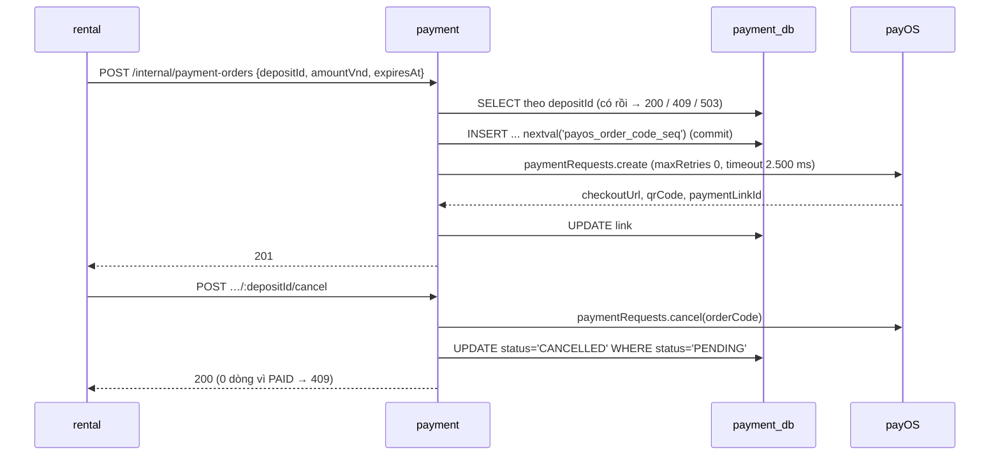
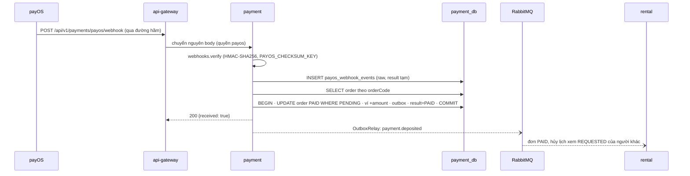

# Giải thích code — payment

> Đọc khi: cần hiểu code của payment để sửa tiếp (hết hạn giữ chỗ T3.4b, ví và payout T3.6), review, hoặc chuẩn bị vấn đáp.

| | |
|---|---|
| **Chủ sở hữu / Cập nhật** | hoang.lv — 2026-11-22 (T3.4a: webhook payOS) |
| **Thành phần** | `services/payment/` (cổng 3004); phần chép từ `services/_template-nest/` ghi rõ ở §3.3 |
| **Task** | `T3.1` (khung, payment order, payOS), `T3.4a` (webhook payOS, ghi nhận tiền vào ví, tiền đến muộn, script webhook giả); `implementation/PHASE-3.md` |
| **Thiết kế** | `design/PAYMENT/RE.PAYMENT/` (v1.3), `design/PAYMENT/RE.PAYOUT/API_Spec.md §7` (DDL ví), ADR-0006, ADR-0009 |
| **Commit / PR** | T3.1: PR #26 (`feature/T3.1-payment-order`). T3.4a: nhánh `feature/T3.4a-payos-webhook` (A cùng Claude, 2026-11-22) |

## 1. Luồng chung

Rental tạo đơn đặt cọc xong thì gọi `POST /internal/payment-orders`. Payment **ghi order `PENDING` trước** (cấp `orderCode` từ sequence), rồi mới gọi payOS tạo link hết hạn đúng lúc giữ chỗ hết hạn, lưu link và trả `201`. Gọi lại cùng `depositId` trả order cũ (`200`). Khi giữ chỗ hết hạn hoặc bù trừ, rental gọi `…/cancel`: payment hủy link ở payOS **trước**, rồi `UPDATE … WHERE status='PENDING'`; nếu webhook (T3.4) đã kịp chuyển order sang `PAID` thì `UPDATE` đổi 0 dòng và payment trả `409`, rental không chuyển đơn sang `EXPIRED`. Không có transaction nào bao lời gọi payOS.

**Webhook (T3.4a).** Người thuê quét QR trả tiền; payOS gọi `POST /api/v1/payments/payos/webhook` qua đường hầm → gateway (quyền `payos`, không token, giữ nguyên body) → payment. Payment kiểm chữ ký bằng SDK, **lưu nguyên văn trước mọi kiểm tra**, rồi tìm order theo `orderCode`. Order `PENDING` đúng số tiền: một transaction đổi order sang `PAID`, cộng ví (`DEPOSIT_IN`), ghi outbox `payment.deposited`, đặt `result = PAID`. Order đã hủy, hoặc đã `PAID` mà nhận thêm tiền với `reference` khác: tiền đến muộn (BR-10) — tạo yêu cầu hoàn 100% số thực nhận, ghi `late_payments`, cộng ví (`LATE_PAYMENT_IN`), outbox `payment.late-payment-credited`. Sau commit, `OutboxRelay` đẩy sự kiện lên RabbitMQ; rental nghe `payment.deposited` để chuyển đơn sang `PAID` (T3.2). payOS luôn nhận `200` khi webhook đã được lưu.





## 2. Cây thư mục

```text
services/payment/
├─ src/
│  ├─ app.module.ts                 # nạp PaymentModule khi có DATABASE_URL
│  ├─ scripts/send-fake-webhook.ts  # T3.4a: pnpm webhook:fake (+ spec)
│  ├─ config/                       # env.validation (+PAYOS_*), env.bootstrap (+checkPaymentEnv), feature-flags (+isPaymentEnabled)
│  ├─ database/migrations/          # 1730000000001 messaging (template), 1734000000000 bảng payment + ví
│  └─ payment/
│     ├─ payment.module.ts
│     ├─ config/payment.env.ts      # biến bắt buộc riêng (+ spec)
│     ├─ clients/payos.client.ts    # bọc @payos/node: tạo/hủy link, kiểm chữ ký webhook (+ spec)
│     ├─ controllers/payment-orders.internal.controller.ts
│     ├─ controllers/payos-webhook.controller.ts   # T3.4a
│     ├─ services/payment-order.service.ts (+ spec)
│     ├─ services/webhook.service.ts (+ spec)          # T3.4a: bảng API_Spec §1
│     ├─ services/deposit-capture.service.ts (+ spec)  # T3.4a: §1.1, §1.2 trong transaction
│     ├─ services/wallet.service.ts (+ spec)           # T3.4a: credit (debit ở T3.6)
│     ├─ dto/payment-order.dto.ts (+ spec)
│     ├─ entities/payment-order.entity.ts
│     └─ errors/payment.errors.ts
├─ test/
│  ├─ payment-orders.infra-spec.ts  # test 7–10, hợp đồng, đếm truy vấn; payOS giả
│  ├─ payos-webhook.infra-spec.ts   # T3.4a: test 1–6, 10–12, số truy vấn webhook
│  ├─ setup-infra-env.ts            # payment_db + khóa payOS giả
│  └─ (e2e, messaging, storage của template)
├─ .env.example, Dockerfile, package.json, README.md
```

## 3. Chức năng từng file

### 3.1 Phần riêng của payment (`src/payment/`)

| File | Làm gì | Gọi tới / được gọi bởi | Ghi chú |
|---|---|---|---|
| `payment.module.ts` | Khai báo entity, 2 controller, 4 service; dựng **một** instance SDK payOS (`PAYOS_SDK`) rồi lấy `.paymentRequests` và `.webhooks`; cấu hình `returnUrl`/`cancelUrl`; `PayosClient` bằng factory | `app.module.ts` (khi `isPaymentEnabled()`) | SDK: `timeout = PAYOS_TIMEOUT_MS`, `maxRetries: 2` (mặc định cho hủy), `logLevel: 'off'`. `OutboxService` lấy từ `MessagingModule` (global) nên payment bắt buộc `RABBITMQ_URL` |
| `config/payment.env.ts` | Biến bắt buộc: `DATABASE_URL`, `RABBITMQ_URL` (T3.4a), 3 khóa `PAYOS_*`, `JWT_ISSUER`, khóa công khai JWT | `config/env.bootstrap.ts` lúc khởi động (bỏ qua khi `NODE_ENV=test`) | Không in giá trị biến; cùng cách với `listing.env.ts` |
| `clients/payos.client.ts` | `createLink` (`maxRetries: 0`, `description = DC<orderCode>`, `items[0].name = listingTitle`, `expiredAt` giây), `cancelLink(orderCode)`, `verify(raw)` (T3.4a) | `PaymentOrderService`, `WebhookService` | Mọi lỗi SDK khi tạo/hủy → `503 PAYMENT_PROVIDER_UNAVAILABLE`. `verify` gọi `webhooks.verify` của SDK (ký lại `data` sắp khóa, HMAC-SHA256), mọi lỗi → `false`, log `warn` chỉ có lý do của SDK |
| `controllers/payos-webhook.controller.ts` | `POST /api/v1/payments/payos/webhook`, `@Public()`, `@HttpCode(200)`, trả `{received: true}` | payOS qua gateway | Body kiểu `object` thuần: không qua class-validator, giữ đủ trường để lưu nguyên văn và kiểm chữ ký. Chỉ ném (5xx) khi DB lỗi |
| `services/webhook.service.ts` | `handle(raw)`: bảng 9 dòng `API_Spec §1`; trả `WebhookResult` | Controller | Lưu nguyên văn trước (`result` tạm `RECEIVED`, hoặc ngay `INVALID_SIGNATURE`/`IGNORED`); sai số tiền chỉ xét order `PENDING`; trùng `reference` bắt `23505 ux_webhook_accepted_reference` → `DUPLICATE`; `transactionDateTime` (giờ VN) → `paidAt` |
| `services/deposit-capture.service.ts` | `capture` (§1.1: `UPDATE … WHERE status='PENDING'` → ví `DEPOSIT_IN` → outbox `payment.deposited`; trả `false` khi 0 dòng), `recordLate` (§1.2: hoàn `SYSTEM` 100% → `late_payments` → ví `LATE_PAYMENT_IN` → outbox `payment.late-payment-credited`) | `WebhookService` trong transaction | Mọi thay đổi tiền dùng `manager` của transaction (ADR-0006) |
| `services/wallet.service.ts` | `credit(m, …)`: INSERT `wallet_transactions` + `UPDATE admin_wallet SET balance_vnd = balance_vnd + $1` | `DepositCaptureService` | `ref_type` `ORDER`/`LATE_PAYMENT` (DDL `RE.PAYOUT`); `UNIQUE (ref_type, ref_id)` chặn cộng hai lần; T3.6 thêm `debit` |
| `services/payment-order.service.ts` | `create` (bảng §2a), `cancel` (§2b), `get` (§2c, chỉ đọc DB) | Controller nội bộ | INSERT dùng SQL thô để cấp `nextval` trong cùng câu; bắt `23505 uq_payment_orders_deposit` khi tạo song song |
| `controllers/payment-orders.internal.controller.ts` | 3 route `/internal/payment-orders*`; đặt `201`/`200` theo kết quả `create` | Rental (S2) | `@Public()` + `@ApiExcludeController()` như listing; `depositId` qua `createUuidParamPipe` |
| `dto/payment-order.dto.ts` | Body `CreatePaymentOrderDto` (UUID, `listingTitle` 1–200, `amountVnd` số nguyên ≥ 1, `expiresAt` có múi giờ); kiểu view khớp hợp đồng | Controller, service | Trường lạ bị từ chối (`forbidNonWhitelisted`, hợp đồng `additionalProperties: false`) |
| `entities/payment-order.entity.ts` | Bảng `payment_orders`; `PAYMENT_ORDER_STATUSES` | TypeORM | Tiền và `orderCode` là `bigint` → number qua `bigintToNumber`. Các bảng T3.4a ghi (`payos_webhook_events`, `late_payments`, `wallet_transactions`, `admin_wallet`, `refund_requests`) không có entity: chỉ ghi bằng SQL trong transaction, đếm được truy vấn |
| `errors/payment.errors.ts` | 5 mã của `API_Spec §4`; `isUniqueViolation(err, constraint)` | Service, client | Hàm `23505` viết lại cục bộ (không import service khác) |

### 3.2 Cấu hình, database, triển khai

| File | Làm gì | Ghi chú |
|---|---|---|
| `src/database/migrations/1734000000000-create-payment-tables.ts` | Sequence `payos_order_code_seq` (START 100000); bảng `payment_orders`, `payos_webhook_events` (+ `ux_webhook_accepted_reference`), `late_payments` (`RE.PAYMENT §6`); `admin_wallet` (+ một dòng id 1, số dư 0), `wallet_transactions`, `refund_requests`, `withdrawal_requests`, `transfer_receipts`, `audit_log` (`RE.PAYOUT §7`) | Có `down`. Tên ràng buộc đặt rõ (`uq_payment_orders_deposit`, ...) để service nhận ra lỗi trùng |
| `src/config/env.validation.ts` | Thêm `PAYOS_CLIENT_ID/API_KEY/CHECKSUM_KEY` (tùy chọn ở schema chung), `PAYOS_RETURN_URL`, `PAYOS_CANCEL_URL` (http/https), `PAYOS_TIMEOUT_MS` (100–30.000, mặc định 2.500) | Ba khóa bắt buộc ở `payment.env.ts` |
| `src/config/env.bootstrap.ts`, `feature-flags.ts`, `app.module.ts` | Kiểm biến riêng lúc khởi động; `isPaymentEnabled = isDatabaseEnabled()`; nạp `PaymentModule` | `env.bootstrap.spec.ts` sửa như listing: test thiếu biến, đủ biến |
| `.env.example` (payment, gốc), `infra/compose/docker-compose.yml` | Biến `PAYOS_*`; `RABBITMQ_URL`, `RABBITMQ_EXCHANGE` (T3.4a, chỉ phát, không nghe queue); service `payment` profile `apps`, không publish cổng, chờ `rabbitmq` healthy và `rabbitmq-init` xong | Khóa trống: payment báo thiếu và dừng |
| `src/scripts/send-fake-webhook.ts` | `pnpm --filter @realestate/payment webhook:fake -- --order-code <n> --amount <vnd>` (+ `--reference`, `--date`, `--url`, `--bad-signature`, `--failed`): dựng body giống payOS, ký `data` bằng `NodeCryptoProvider` của SDK với `PAYOS_CHECKSUM_KEY`, gửi bằng `node:http(s)` | Công cụ dev (A duyệt dùng `node:http`, không phải lời gọi giữa service). Khóa đọc từ môi trường → `services/payment/.env` → `.env` gốc; không in khóa. Dự phòng khi đường hầm/payOS lỗi lúc demo |
| `package.json` | `@payos/node@2.0.5` ghim chính xác; lệnh `webhook:fake` (T3.4a) | 2.0.6 mới 9 ngày lúc làm (quy ước ≥ 2 tuần) |
| `Dockerfile` | Như template, `SERVICE_DIR=services/payment` | `PORT` đặt ở compose |

### 3.3 Phần chép từ template (không giải thích lại)

`src/common/*`, `src/messaging/*`, `src/redis/*`, `src/storage/*`, `src/health/*`, `src/app.setup.ts`, `src/main.ts`, `src/swagger.setup.ts`, `src/database/{data-source,database.module,database.health,transformers}.ts`, migration messaging, `test/*.e2e-spec.ts`, `test/messaging.infra-spec.ts`, `test/storage.infra-spec.ts`, `test/helpers/*`: xem `services/_template-nest/README.md §3` và `design/SHARED/RE.SERVICE_TEMPLATE/`. Đã xóa module mẫu (`src/example/`, entity + migration mẫu, `test/example.e2e-spec.ts`).

### 3.4 Test

| File | Tầng | Kiểm |
|---|---|---|
| `src/payment/services/payment-order.service.spec.ts` | unit | Bảng §2a, §2b, §2c với repository và payOS giả: thứ tự INSERT → payOS → UPDATE; payOS cancel trước UPDATE; 0 dòng → đọc lại; C23 |
| `src/payment/clients/payos.client.spec.ts` | unit | Tham số gửi SDK, `maxRetries: 0` khi tạo, mọi lỗi → 503, log không lộ lỗi gốc; `verify` với **SDK thật**: chữ ký đúng, sai khóa, `data` bị sửa, body hỏng |
| `src/payment/services/webhook.service.spec.ts` | unit | 9 dòng `API_Spec §1` với DB, payOS, capture giả: lưu nguyên văn trước, sai số tiền không mở transaction, `capture` trước rồi `result`, nhánh đua → `LATE`, `DUPLICATE`, lỗi DB khác → ném, `transactionDateTime` sai dạng, log không lộ số tài khoản |
| `src/payment/services/deposit-capture.service.spec.ts`, `wallet.service.spec.ts` | unit | Thứ tự câu ghi, tham số, payload sự kiện; 0 dòng → không cộng ví, không phát |
| `src/scripts/send-fake-webhook.spec.ts` | unit | Chữ ký script tạo được `webhooks.verify` của SDK chấp nhận; `--bad-signature` bị từ chối; đọc tham số, báo lỗi tham số sai |
| `src/payment/dto/payment-order.dto.spec.ts`, `config/payment.env.spec.ts`, `src/config/*.spec.ts` | unit | Luật body; biến bắt buộc; tiến trình thật thoát mã 1 khi thiếu |
| `test/payos-webhook.infra-spec.ts` | infra | **Test 1–6, 10–12** với Postgres thật, webhook ký bằng thuật toán SDK: `PAID` (ví, outbox khớp hợp đồng), gửi hai lần và **5 lần đồng thời** → một giao dịch ví, `DUPLICATE`; sai chữ ký; sai số tiền; order `CANCELLED` → `LATE` (hoàn `SYSTEM` 100% số thực nhận); order `PAID` nhận thêm tiền; **hủy và webhook đua** 8 lần; `orderCode` 123 (webhook thử của payOS) → `200`; bất biến ví sau mỗi test (E10); số truy vấn `PAID` 7, `LATE` 8 |
| `test/payment-orders.infra-spec.ts` | infra | **Test 7–10**, tạo đồng thời, payOS 5xx không retry, C23, 409/400/404, hợp đồng OpenAPI mọi response, số truy vấn (tạo 3, gọi lại 1, hủy 2, tra cứu 1), migration đủ bảng. SDK thật trỏ vào payOS **giả** (`PAYOS_BASE_URL`), máy chủ giả ký `data` bằng checksum key như payOS và ghi lại trạng thái order trong DB đúng lúc nhận request |

## 4. Quyết định không hiển nhiên

| Quyết định | Lý do | Phương án đã loại | Căn cứ |
|---|---|---|---|
| INSERT order (commit) **trước** khi gọi payOS, không bọc transaction | Payment chết sau khi payOS tạo link thì webhook vẫn tìm được `orderCode`; không giữ kết nối DB khi chờ mạng | Gọi payOS trước rồi INSERT; transaction bao lời gọi HTTP | `Processing_Flow §1`, `developer.md` (không giữ transaction khi gọi HTTP) |
| Tạo link `maxRetries: 0` cho từng lệnh, client giữ retry 2 | Retry tạo link có thể tạo trùng; hủy idempotent nên retry được | Tắt retry toàn client (hủy mất retry) | `reliability-standard.md §3`, chốt 2026-11-16 |
| Hủy: payOS trước, `UPDATE … WHERE status='PENDING'` sau | Hủy và webhook đua nhau; Postgres khóa dòng nên chỉ một bên thắng; 0 dòng → đọc lại để phân biệt `PAID` (409) và `CANCELLED` (200) | `SELECT … FOR UPDATE` rồi gọi payOS (giữ khóa khi chờ mạng) | `Processing_Flow §3`, test 9, 10 |
| Order chưa có link thì hủy **không** gọi payOS | Link chưa từng tạo thành công; link payOS tự hết hạn đúng `expiresAt` | Luôn gọi payOS (lỗi "không tồn tại" khó phân biệt với lỗi thật) | `API_Spec §7.3` |
| Gọi lại khi `PENDING` chưa có link → `503`, không gọi lại payOS | Bảng §2a không có dòng này; §7.3 nói order giữ `PENDING` không link và job rental xử lý | Tạo lại link (payOS có thể đã tạo dù timeout, trùng `orderCode`) | C23 (chờ A) |
| `GET` chỉ đọc DB | "Hỏi payOS" không nói dùng kết quả làm gì; tra cứu payOS không có `checkoutUrl` | Tự thêm trường hoặc tự ghi DB | C22 (chờ A) |
| `description = DC<orderCode>`, tiêu đề tin vào `items[0].name` | payOS giới hạn `description` 25 ký tự | Cắt tiêu đề tin | Tài liệu SDK |
| Webhook: lưu nguyên văn **trước** mọi kiểm tra, kể cả sai chữ ký | Bằng chứng đối soát khi có tranh chấp; payOS gửi gì cũng còn dấu vết | Chỉ lưu webhook hợp lệ | `API_Spec §1` dòng 1 |
| Luôn `200` cho payOS khi đã lưu; `5xx` chỉ khi DB lỗi | `4xx` làm payOS gửi lại vô hạn mà không sửa được gì; DB lỗi thì gửi lại là đúng, unique chống ghi trùng | Trả `400` cho sai chữ ký | `API_Spec §1`, `Processing_Flow §4` |
| Body trả cố định `{received: true}` | Không lộ cho người gửi giả biết webhook bị coi là gì | Trả `result` | A duyệt 2026-11-22 |
| Sai số tiền chỉ xét order `PENDING` | Order đã hủy/đã trả mà vẫn nhận tiền thì tiền đã vào tài khoản: phải ghi nhận đúng số thực nhận và hoàn 100% (BR-10) | Bỏ qua mọi webhook sai số tiền (mất dấu tiền thật) | `API_Spec §1` dòng 5, 8, 9, `§7` mục 2; `RE.PAYMENT` v1.3 sửa mã giả `Component_Class_Design §3` cho khớp |
| Trong transaction: `UPDATE` order **trước**, ghi `result` sau | Nhánh đua (lệnh hủy vừa thắng) chỉ tốn 9 truy vấn; trùng `reference` vẫn bị index một phần chặn ở câu ghi `result` → rollback cả transaction | Ghi `result` trước (nhánh đua 10 truy vấn) | A chấp nhận nhánh đua 9 (2026-11-22) |
| Trùng `reference` phát hiện bằng index `ux_webhook_accepted_reference` (`WHERE result IN ('PAID','LATE')`), không `SELECT` trước | Hai webhook đồng thời: `SELECT` trước đều thấy "chưa có"; index một phần làm transaction sau chờ transaction trước rồi báo `23505` | `SELECT … FOR UPDATE` theo `reference` | Test 3 (5 webhook đồng thời) |
| Tiền đến muộn: yêu cầu hoàn **trước** `late_payments` | `late_payments.refund_request_id` có ngay, không cần `UPDATE` thêm → 8 truy vấn | Theo đúng thứ tự §1.2 (9 truy vấn) | A duyệt 2026-11-22 |
| `paidAt` = `transactionDateTime` của payOS đọc theo `+07:00`; sai dạng thì giờ hiện tại + `warn` | Thời điểm thanh toán thật theo ngân hàng; không chặn ghi nhận tiền vì một trường thời gian | Lấy giờ nhận webhook | A duyệt 2026-11-22 |
| `result` tạm `RECEIVED` giữa lúc lưu và lúc có kết quả | Phải lưu trước khi đọc order; dòng kẹt ở `RECEIVED` nghĩa là payment dừng giữa chừng (payOS sẽ gửi lại) | Đọc order trước rồi mới lưu | `RE.PAYMENT` v1.3 |
| Payment bắt buộc `RABBITMQ_URL` | Webhook phát sự kiện qua outbox; `OutboxService` thuộc `MessagingModule` | Webhook gọi thẳng rental (đồng bộ, mất bất đồng bộ) | ADR-0006, `API_Spec §5` |
| Test hạ tầng dùng SDK thật + payOS giả qua `PAYOS_BASE_URL` | Kiểm được cả timeout, không retry, kiểm chữ ký response của SDK; không cần khóa thật | Thay `PayosClient` bằng bản giả (không kiểm SDK); gọi sandbox payOS (cần khóa, mạng) | |

## 5. Câu hỏi vấn đáp

| Câu hỏi | Trả lời ngắn | Xem thêm |
|---|---|---|
| Rental gọi tạo order hai lần thì sao? | `deposit_id` UNIQUE: lần hai đọc order cũ, trả `200`, không gọi payOS lần nữa. Hai lệnh song song: bên thua bắt `23505` rồi đọc lại | Test 7 |
| payOS treo thì sao? | Timeout 2.500 ms (< 3.000 ms của rental) → `503`; order đã có trong DB, giữ `PENDING` không link; rental bù trừ nhả chỗ | Test 8 |
| Vì sao không retry tạo link? | Lần đầu có thể đã thành công phía payOS dù mình timeout; retry tạo trùng | `reliability-standard.md §3` |
| Hết hạn giữ chỗ đúng lúc người thuê vừa trả tiền? | Hủy và webhook đều `UPDATE … WHERE status='PENDING'`; webhook thắng → hủy `409`, đơn thành `PAID`; hủy thắng → webhook ghi tiền đến muộn, hoàn 100% | Test 10 (đua thật 8 lần), `Processing_Flow §3` |
| Làm sao biết webhook đúng là của payOS? | Chữ ký HMAC-SHA256 trên `data` (sắp khóa) bằng `PAYOS_CHECKSUM_KEY`; chỉ payOS và mình có khóa. Sai chữ ký: lưu lại, không đổi tiền, vẫn `200` | Test 4, Báo cáo T09 |
| payOS gửi một webhook hai lần? | Lần hai: index một phần trên `reference` chặn → `DUPLICATE`, không cộng ví, không phát sự kiện. Gửi đồng thời cũng vậy | Test 2, 3, Báo cáo T10 |
| Người thuê chuyển sai số tiền? | Order `PENDING`: `AMOUNT_MISMATCH`, không đổi gì, order chờ đúng tiền hoặc hết hạn. Order đã hủy/đã trả: ghi tiền đến muộn với số thực nhận, hoàn 100% | Test 5, 6 |
| Payment chết giữa transaction webhook? | Rollback; webhook đã lưu (`RECEIVED`); payOS gửi lại vì không nhận `200`; lần sau xử lý bình thường | `Processing_Flow §4` |
| Vì sao sự kiện không gửi thẳng RabbitMQ trong transaction? | Outbox: sự kiện ghi cùng transaction với tiền, relay gửi sau commit. RabbitMQ chết không mất sự kiện (E3) | ADR-0006 |
| Không có payOS lúc demo thì sao? | `pnpm --filter @realestate/payment webhook:fake` ký webhook bằng chính `PAYOS_CHECKSUM_KEY`, đi đúng đường gateway → payment | `RE_Docker_Local_Guide.md §6` |
| Khóa payOS có bị lộ qua log không? | Không: SDK tắt log, payment chỉ log tên lỗi, status, mã payOS; kiểm biến lúc khởi động không in giá trị | `payos.client.spec.ts` |

## 6. Hạn chế đã biết

| Hạn chế | Ảnh hưởng | Hướng xử lý |
|---|---|---|
| C22: `GET` chưa hỏi payOS khi order chưa có link | Đối soát tay khi đường hầm webhook rớt phải xem trang payOS | Chờ A chốt (`van-de-can-quyet-dinh.md` C22) |
| C23: gọi lại tạo order khi chưa có link trả `503` | Nếu payOS đã tạo link dù payment timeout, người thuê không nhận link đó; rental bù trừ, người thuê đặt lại | Chờ A chốt (C23) |
| Chưa có job hết hạn giữ chỗ | Đơn quá hạn chưa tự `EXPIRED`, link payOS tự hết hạn | T3.4b |
| Chưa có rút, hoàn (ví chỉ cộng) | Yêu cầu hoàn `SYSTEM` của tiền đến muộn nằm `PENDING_ADMIN` | T3.6 |
| Không đối soát chủ động với payOS | Đường hầm rớt lâu hơn thời gian payOS gửi lại thì mất webhook; đối soát tay trên trang payOS | `API_Spec §7` mục 5 (ghi hạn chế báo cáo) |
| `messaging.infra-spec`, `storage.infra-spec` chưa chạy trong môi trường của Claude (không có RabbitMQ, S3) | Chạy trên máy A cùng hạ tầng compose | A chạy `pnpm --filter @realestate/payment test:infra` |
| Chưa build image Docker trong môi trường kiểm chứng của Claude (Docker Hub bị chặn) | Dockerfile giống template, chưa chạy thử `compose up --build payment` | A chạy trên máy |
| Test DTO và test hạ tầng viết sau code (không thấy RED trước); đã kiểm ngược bằng cách cố ý đảo thứ tự hủy → 3 test hạ tầng đỏ | TDD chưa trọn | Ghi tech-debt |
