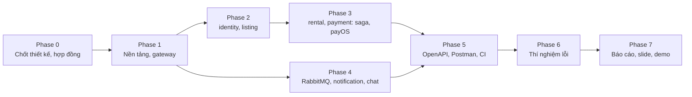

# Kế hoạch triển khai

> Bắt đầu từ đây. File này cho biết làm gì, theo thứ tự nào, ai làm. Nhóm có 3 người (ADR-0001).
> Tiến độ ghi ở `progress.md`. Chi tiết từng task ở `PHASE-x.md`. Vấn đề chờ chốt ở `van-de-can-quyet-dinh.md`.

| | |
|---|---|
| **Chủ sở hữu / Cập nhật** | hoang.lv — 2026-11-18 |

## 1. Lộ trình

| Phase | File | Mục tiêu | A | B | C | Điều kiện xong | Hạn |
|---|---|---|---|---|---|---|---|
| 0 | `PHASE-0.md` | Chốt `[cần xác nhận]` chặn code, hợp đồng nội bộ và sự kiện | ✓ | ✓ | ✓ | `pnpm contracts:check` xanh với hợp đồng v2 | M0 · 2026-11-13 |
| 1 | `PHASE-1.md` | Gateway chạy, identity sau gateway, CI | ✓ | ✓ (CI) | | Tag `v0.1-skeleton` | 2026-11-20 (dời từ M0) |
| 2 | `PHASE-2.md` | Identity bổ sung, listing đủ API công khai và nội bộ | ✓ | ✓ | | API nội bộ listing sẵn sàng cho saga | M1 · 2026-11-27; T2.5 M2 · 2026-12-04 |
| 3 | `PHASE-3.md` | Đặt cọc, hết hạn, hoàn, rút chạy được | | ✓ (T3.5) | ✓ | Tag `v0.5-deposit-flow` | M2 · 2026-12-04; T3.6 M3 · 2026-12-09 |
| 4 | `PHASE-4.md` | Notification, chat, outbox trên mọi service | ✓ | | ✓ (T4.1, phát sự kiện) | Tắt notification không ảnh hưởng đặt cọc | M2 · 2026-12-04; T4.4 M3 · 2026-12-09 |
| 5 | `PHASE-5.md` | OpenAPI, Postman, Newman, CI e2e | ✓ | ✓ | ✓ | Newman xanh trên máy sạch | M4 · 2026-12-11; T5.3, T5.4 2026-12-16 |
| 6 | `PHASE-6.md` | Số liệu E1–E10 | | ✓ | ✓ | Bảng 5.3 báo cáo đã điền (E1–E3) | E1–E3 2026-12-10; E4–E10 2026-12-16 |
| 7 | `PHASE-7.md` | Báo cáo, slide, demo | ✓ | ✓ | ✓ | Nộp báo cáo M4; tag `v1.0-submission` | Báo cáo M4 · 2026-12-11; còn lại M5 · 2026-12-18 |

### Lịch và mốc

Nguồn gốc: kế hoạch sprint `docs/pm/ke-hoach-sprint-va-tai-lieu.xlsx` (nhóm xác nhận 2026-11-12). 6 sprint, 2026-11-09 → 2026-12-18. **Dời mốc ngày 2026-11-16** sau khi ước thời lượng: mốc cũ M0–M2 không khả thi với khối việc của luồng payOS.

| Mốc | Ngày | Ý nghĩa | Cuối sprint | Phải xong |
|---|---|---|---|---|
| M0 | 2026-11-20 (cũ 11-13) | Nền móng | S2 | Phase 0, 1 |
| M1 | 2026-11-27 (cũ 11-20) | Lát cắt đồng bộ | S3 | T2.1–T2.4; saga luồng thành công chạy được |
| M2 | 2026-12-04 (cũ 11-27) | Saga đủ — **điểm cắt giảm** | S4 | T2.5, T3.1–T3.5, T4.1–T4.3, T6.1 |
| M3 | 2026-12-09 (cũ 12-04) | Feature freeze | S5 | T3.6, T4.4 |
| M4 | 2026-12-11 | Release candidate, **nộp báo cáo cuối kỳ** | S5 | T5.1, T5.2, T6.2 (E1–E3, 12-10), T7.1 |
| M5 | 2026-12-18 | Bảo vệ | S6 | T5.3, T5.4, T6.3 (12-16), T7.2–T7.4 |

### Năng lực và tải (ước 2026-11-16)

Năng lực gốc: 17 giờ/người/tuần × hệ số tập trung 0,75 = 12,75 giờ hiệu dụng (64 giờ cho S2–S6). Tổng việc còn lại ~240 giờ, chia lại cân ba người (~80 giờ mỗi người) → kế hoạch tính **16 giờ hiệu dụng/người/tuần** (≈ 21 giờ danh nghĩa). `[cần xác nhận]` B, C cam kết được mức này; không được thì cắt theo §6 (bắt đầu từ chat T4.4).

| Người | Tổng | S2 (16–20/11) | S3 (23–27/11) | S4 (30/11–4/12) | S5 (7–11/12) | S6 (14–18/12) |
|---|---|---|---|---|---|---|
| A | ~78 h | T1.2, T1.3 (15) | T2.1, T2.5 phần đầu (16) | T2.5 còn lại, T4.2, T4.3 (16) | T4.4, T5.1, T7.1 (20) | T7.2–T7.4 (10) |
| B | ~80 h | T1.1, T2.2 (16) | T2.2 còn lại, T2.3, T2.4 (16) | T3.5, T6.1 (15) | T6.2, T5.1, T5.2, T7.1 (21) | T5.3, T5.4, T6.3 E9, T7.3 (12) |
| C | ~81 h | T3.1, T3.2 phần đầu (16) | T3.2 còn lại, T3.3 phần đầu (16) | T3.3 còn lại, T3.4, T4.1 (17) | T3.6, T5.1, T7.1 (23) | T6.3, T7.3 (9) |

S5 quá 16 giờ ở cả ba người: nếu tới 2026-12-04 còn trễ, cắt T4.4 chat (A) và E6–E9 trước.

Chuyển việc ngày 2026-11-16 để cân tải: T3.5 vòng đời đơn C → B (C review); T4.1 binding queue A → C (A duyệt `definitions.json`); T5.4 kiểm tra máy sạch A → B.

Phase 2 (B) và Phase 3 (C) chạy song song: C bắt đầu bằng phần không cần listing thật (payment, entity, máy trạng thái), mock `ListingClient` theo `example` trong hợp đồng.

## 2. Phân công

> **Chốt 2026-11-18 (A):** mọi task giao cho **A**. A tự quyết task nào giao lại cho ai và khi nào; người được giao chỉ sửa trong phạm vi task đó. Cột A/B/C ở §1, bảng tải §1 và bảng "Sở hữu" dưới đây là phân công cũ (đến 2026-11-17), chỉ để tham khảo. Cột "Người làm" trong `PHASE-x.md` ghi `A`, kèm người làm cũ trong ngoặc.

Theo Báo cáo v2 Phụ lục A (phân công cũ, xem ghi chú trên).

| Vai | Thành viên | Sở hữu | Vấn đáp về |
|---|---|---|---|
| **A** | Lưu Việt Hoàng (B23DCCC073) | Quản lý dự án, `api-gateway`, `identity`, `notification`, `contracts/`, `_template-nest`, `infra/` | Gateway, JWT, outbox/consumer/DLQ, thông báo, quy trình |
| **B** | Đỗ Trung Thành (B23DCCC149) | `listing` (sản phẩm, ảnh S3, PostGIS, giữ chỗ), CI, kiểm thử tải, kịch bản lỗi | Giữ chỗ nguyên tử, tìm kiếm bán kính, số liệu thí nghiệm |
| **C** | Đỗ Trung Thông (B23DCCC153) | `rental`, `payment` (saga, máy trạng thái, công việc nền, payOS, ví) | Saga, bù trừ, webhook, ví, hoàn và rút |

Ngoại lệ phạm vi sửa code (2026-11-16): B sửa module vòng đời đơn trong `services/rental` cho T3.5, PR do C review; C sửa `infra/rabbitmq/definitions.json` cho T4.1, A duyệt.

Mọi người trả lời được cơ bản về luồng đặt cọc (`design/RENTAL/RE.DEPOSIT_SAGA/Processing_Flow.md`).

### Ai giao gì cho ai

| Cần | Người giao | Task | Chưa có thì |
|---|---|---|---|
| Hợp đồng nội bộ listing (holds, status) | B | T0.3, T2.3 | C mock theo `example` |
| Hợp đồng nội bộ payment, rental | C | T0.3 | A, B mock |
| Danh mục sự kiện + schema | A (khung), C (sự kiện rental/payment) | T0.4 | Consumer test bằng example |
| Gateway định tuyến | A | T1.2 | Gọi thẳng service, tự gắn `Authorization` |
| `GET /internal/users/:id/bank-account` | A | T2.1 | C mock |
| Binding queue mới | C (A duyệt) | T4.1 | Test consumer với hạ tầng thật của template |

## 3. Quy trình cho mỗi task

| # | Bước | Claude dùng |
|---|---|---|
| 1 | Mở task trong `PHASE-x.md`, đọc mục "Đọc trước" | skill `task-state-init` → `.claude/state/<dev-id>/current-task.md` |
| 2 | Tạo nhánh `feature/T<id>-<mô-tả>` từ `develop` | |
| 3 | Đọc thiết kế, quét thứ đã có, lập kế hoạch, **chờ duyệt**; gặp `[cần xác nhận]` chặn task → hỏi người phụ trách | procedure `developer` Bước 1–2, skill `reuse-scan` |
| 4 | Viết test từ "Test bắt buộc" của thiết kế, rồi code (TDD đang bật) | skill `tdd-workflow`, `progress-tracker` |
| 5 | Chạy test và "Kiểm chứng". Thấy pass thật rồi mới tiếp | cổng test của `developer` |
| 6 | Thiết kế sai hoặc thiếu: sửa tài liệu trước, thêm `CHANGELOG.md` | procedure `solution-architect` |
| 7 | Review trước commit, mở PR theo `standards/git-workflow.md §3` | skill `code-review`, procedure `code-reviewer` |
| 8 | Tick vào `progress.md` sau khi merge | |

Dừng giữa chừng: `/cf-handoff` lưu phiên, `/cf-resume` mở lại.

## 4. Definition of Done chung

- [ ] Đủ DoD riêng của task.
- [ ] Test bắt buộc trong thiết kế đều pass (`test`, `test:e2e`, `test:infra` khi chạm hạ tầng).
- [ ] `pnpm lint`, `pnpm format:check`, `pnpm build`, `pnpm contracts:check` không lỗi.
- [ ] Số truy vấn trong ngưỡng `standards/non-functional-standards.md §1`, hoặc đã được duyệt vượt.
- [ ] Không secret, không gọi `axios` trần, không truy cập DB service khác.
- [ ] Biến môi trường mới có trong `.env.example` và `infra/compose/docker-compose.yml`.
- [ ] Hợp đồng `contracts/` khớp code; người phụ trách bên gọi đã duyệt nếu đổi.
- [ ] CI xanh (check `ci`). Người khác duyệt khi A nhờ, không bắt buộc (chốt 2026-11-18).

## 5. Quản lý phụ thuộc giữa người với người

- **Hợp đồng viết trước** trong `contracts/` và `API_Spec.md` (ADR-0012). Hai bên làm song song.
- Bên gọi mock client trong unit test, dùng `test/helpers/http-upstream.ts` của template cho e2e.
- Đổi hợp đồng: bên đổi báo và cùng sửa trong một PR.

## 6. Cắt phạm vi khi thiếu thời gian

Cắt từ trên xuống. Báo cáo §4.7.3 gọi Phase 3 kết thúc là "điểm cắt giảm".

| # | Cắt | Mất |
|---|---|---|
| 1 | Chat (`RE.CHAT`) | Không nhắn tin; thông báo vẫn có |
| 2 | ~~Hồ sơ người thuê~~ | Đã cắt 2026-11-12 (ghi hạn chế) |
| 3 | E6–E9, chỉ giữ E1–E5, E10 | Ít số liệu bổ sung |
| 4 | CI e2e (giữ CI lint/build/test) | Mất kiểm tra tự động trên máy sạch |
| 5 | Rate limit ở gateway | Mất một phần NFR03 |

**Không được cắt:** saga có bù trừ, hết hạn giữ chỗ, timeout + retry, `/health`, OpenAPI, Postman ≥ 10 request, 2 thí nghiệm có số liệu, DLQ.

**Ngoài lộ trình (X1–X5, tương ứng WBS E9-1…E9-5 trong file xlsx; chỉ làm khi đạt M3 feature freeze đúng hạn):** X1 circuit breaker rental → listing, payment → rental; X2 Filebeat → Elasticsearch → Kibana; X3 email thông báo qua SMTP (email OTP, quên mật khẩu đã vào T2.5; Mailpit đã gỡ ở T1.5); X4 khiếu nại `DISPUTED`; X5 trợ lý chat gợi ý phòng.

## 7. Rủi ro

| Rủi ro | Dấu hiệu | Cách xử lý |
|---|---|---|
| Saga kéo dài | Hết tuần chưa xong nhánh lỗi | Làm thành công trước (T3.2), thêm bù trừ (T3.3), hết hạn (T3.4) |
| C quá tải (rental + payment) | 2026-11-27 saga luồng thành công (T3.2) chưa chạy | Đã chuyển T3.5 sang B. Nếu vẫn trễ: B nhận thêm T3.6 payout sau T3.5, C chỉ giữ saga (T3.1–T3.4) |
| Webhook không về máy local | Đơn không `PAID` khi demo | Đường hầm ổn định; script giả webhook có chữ ký cho test |
| Nguồn tài liệu lệch nhau | Code theo hợp đồng cũ | `van-de-can-quyet-dinh.md`; Báo cáo v2 là chuẩn |
| Tích hợp vỡ muộn | Ghép lại lỗi | Sau mỗi merge chạy compose + Newman |
| Máy yếu | Container bị kill | Không bật profile `demo` khi phát triển |
| Báo cáo nộp cùng M4 với thí nghiệm (Phase 6) | Tới 2026-12-04 chưa có số E1–E3 | Viết báo cáo song song từ M3; ưu tiên E1–E3 trước E4–E10 (cắt E6–E9 theo §6) |

## 8. Việc cần chốt ngay

`van-de-can-quyet-dinh.md` mục A (chặn code) và `requirements-traceability.md §5`.
